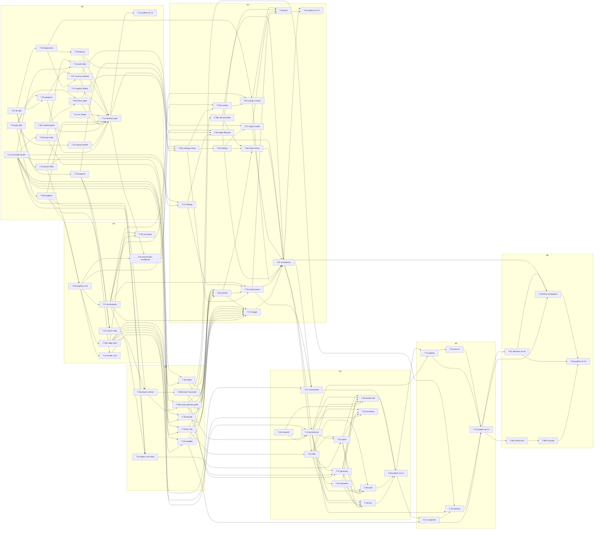

# PLAN: execution plan for ultimateCRT

Plan written 2026-11-18 from `CLAUDE.md`, `ARCHITECTURE.md`, `DESIGN.md`, `ENV.md`, `CRT.md`, `QUESTIONS.md` and the code. Ids such as CAP-4 or PHY-2 refer to `QUESTIONS.md`, A1 to A18 to the decisions table of `ARCHITECTURE.md`, T-xx to tasks in this file. The compact summary table is in section 11.

## 1. Introduction

### Goal

A physically based CRT shader for Windows. It captures an external window (no injection), runs it through a virtual CRT tube on the GPU, and shows it in a separate output window that can go fullscreen (F11) and does not steal focus while it displays; the F12 settings menu takes the focus on purpose while it is open (D-7). One screen must work. SDR output, linear FP16 internal pipeline, live tuning through Dear ImGui, a 3-way mask choice with every other look parameter independent and in physical units, up to 10 tube presets as data files. Composite video, interlace, ageing and burn-in are optional modules, off by default, after the first usable version. No GPL code. Accuracy is checked by analytic tests derived from `CRT.md`. First real target: the game Mina the Hollower, which is not on the dev machine: a stand-in game (D-13) is used during development and Mina is the final acceptance test on the owner's other machine (D-2, T-83).

### Current state (read from the code, 2026-11-18)

- Workspace version 0.1.0, never released (`CHANGELOG.md` has only `[Unreleased]`). Two crates: `pixel-demo` (Win32/GDI source: NES-style scene, test card, PNG, any resolution and integer scale) and `ultimatecrt`.
- `ultimatecrt` is a binary only (no `lib.rs`). `main.rs` holds argument parsing, the main loop, stats and the PNG dump.
- `capture.rs`: Windows.Graphics.Capture, free-threaded frame pool, client-area crop, CPU copy through a D3D11 staging texture, latest frame wins. The D3D11 device uses the default adapter.
- `scaling.rs`: pure integer-upscale detector and `View` (origin, divisor, native size), 5 unit tests. These are the only automated tests.
- `output.rs`: raw Win32 output, windowed or fullscreen `WS_POPUP | WS_EX_TOPMOST | WS_EX_TOOLWINDOW | WS_EX_NOACTIVATE`, `MA_NOACTIVATE`, Ctrl+Alt+Q via `RegisterHotKey`. No click-through, no second window.
- `gpu.rs` (812 lines, ash 0.38): Vulkan 1.3, dynamic rendering, synchronization2, one frame in flight, `B8G8R8A8_UNORM` texture and swapchain, FIFO, one graphics pipeline with a 40-byte push-constant block. Device choice: `--gpu`, else NVIDIA discrete, else any discrete. Nothing checks that capture and render share an adapter.
- `shaders/`: `fullscreen.vert`, `passthrough.frag` (texelFetch at block centres). `build.rs` compiles a fixed list with `glslc`.
- `scripts/package.ps1` and `scripts/release.ps1` implement the publish procedure of `ENV.md` section 7.
- Not present: parameter table, presets, settings, ImGui, linear/FP16 pipeline, any CRT physics, headless renderer, GPU timing, tests of capture/output/gpu.

### How to read this plan

- Section 2 lists the milestones and their checkable exit criteria. M3 is the first usable version.
- Section 3 gives the task conventions (model choice, review, owner, worktrees).
- Section 4 gives the waves, the files each task touches, the dependency graph and the critical path.
- Sections 5 to 8 are the tasks. Each task is sized for one agent session and names its files and its acceptance check.
- Section 9 is the merge gate every task must pass. Section 10 lists owner decisions (with the default the plan uses) and the top risks.
- Ids with a letter suffix (T-20a, T-20b) are the halves of one task that a review found too big for one session.
- Order note: `CLAUDE.md` names the first CRT pass as the next step and the spikes after it. This plan reverses that on purpose: the one-screen test on the real game (T-06) is the project-killing risk (OUT-1) and runs first, on the current build. T-13 updates the `CLAUDE.md` status.
- When a spike changes a decision, T-13 (or the task that found it) updates this file. Tasks that become unnecessary are marked "cancelled", never deleted, so ids stay stable.

## 2. Milestones

| M | Name | Release | Exit criterion (checkable) |
|---|---|---|---|
| M0 | Spikes and foundations | v0.1.0 | With the stand-in game (D-13) windowed on one monitor and `ultimatecrt --fullscreen` covering it for 10 min: average capture >= 58 fps, zero foreground changes in the T-06 poll log, game input works (T-06 first, then repeated with the final build). Headless GPU test passes, the parameter table generates Rust and GLSL, the ImGui spike shows the F12 menu opening inside the output window with a live slider and a text field, and the focus returning to the source on close. The early-look renders (T-16) have been judged by the owner. T-13 decision record approved by the owner. |
| M1 | Pipeline foundations | none | `cargo test` runs the headless identity test (all 256 codes per channel come out exact through the FP16 stage chain) with zero validation messages; the live app renders through the stage chain at display refresh; `--stats` prints GPU ms per stage. |
| M2 | Core CRT model | none | All M2 analytic tests (T-30, T-33, T-34, T-36a, T-36b, T-38, T-39a, T-46) pass in `cargo test` with zero validation messages. The GPU budget is measured by T-47 (M3), not here. |
| M3 | First usable version | v0.2.0 | Owner plays the stand-in game 30 min on one monitor through `ultimatecrt` fullscreen (F11), a preset loaded and tuned in the F12 settings menu: zero foreground changes while the menu is closed, the menu takes the focus when opened and gives it back to the game when closed (both logged), output at 60 fps, total GPU time <= 4.2 ms for the M3 stage set with presets 1, 5 and 9 (T-47), settings and source profile restored after a restart (T-61). v0.2.0 published. |
| M4 | Complete tube | v0.3.0 | ABL, saturation, persistence, optics and geometry tests pass; standard quality tier <= 4.2 ms at 2560x1440; physics audit (T-49) has no open high finding. v0.3.0 published. |
| M5 | Optional modules | v0.4.0 | Composite, interlace, ageing and burn-in each give output bit-identical to M4 when off (default); their tests pass; burn-in state survives a restart. v0.4.0 published. |
| M6 | Hardening | v0.5.0 | A 2 h owner session with a monitor unplug, target relaunch and an injected device loss ends without crash or manual restart, and the Mina acceptance session on the owner's other machine (T-83) is recorded. v0.5.0 published. |

### First usable version (M3, v0.2.0)

In:
- Capture of any window (Windows.Graphics.Capture), integer-scale detection plus manual crop and divisor, image and test-pattern sources.
- Fullscreen non-activating output on one screen (second monitor works as a bonus), a resizable window, F11 fullscreen and windowed toggle, other hotkeys.
- Linear FP16 stage pipeline with per-stage enable flags, A/B split and bypass.
- Source decode (source EOTF, PAR, line multiplier), video amplifier in the voltage domain (asymmetric), gun law (GOG, BT.1886), beam with current-dependent spot (Gaussian plus tail), mask with the 3 types (aperture grille in T-39a, slot and delta in T-39b), area-averaged, live px-per-triad readout and option D (coarser preset suggestion), output transform (tube primaries and white to sRGB, exposure, host EOTF, dither).
- 10 tube presets as data files, settings and per-source profiles persisted, ImGui settings menu (F12, inside the output window, takes the focus while open) and read-only stats overlay, GPU timestamps.

Out of M3: ABL, phosphor saturation, persistence (afterglow), halation, diffusion, glare, vignette, tint, curvature and geometry residuals, convergence, quality tiers (all M4). Composite, interlace, ageing, burn-in (M5). Never in this plan: HDR output, rolling scan (SP-12, needs headroom SDR lacks), VRR (SP-10), host-subpixel masks (HW-6), mouse remapping (OUT-4), reflections and ambient light (SCP-10), TATE, recording.

## 3. Task conventions

- **Fields.** Each task has: id, title, milestone, wave, size (S under half a day, M about a day, L up to two days of agent work), the QUESTIONS/ARCHITECTURE ids it settles or implements, dependencies, what to do, files, acceptance check, model and effort, reviewer, owner need.
- **Model choice** (cheapest to strongest: Haiku, Sonnet, Opus, Fable). Haiku: checklists, write-ups, mechanical docs. Sonnet: well-specified code, UI wiring, scripts, formulas already written in `CRT.md`. Opus: architecture, GPU passes, physics with derivations, cross-language design. Fable: only where an error is silent and costly: cross-API GPU synchronisation (T-04), the mask integration that carries the accuracy claim (T-39a), the independent physics audit (T-49).
- **Review by a second model** (column Review). Physics, unsafe/FFI and GPU-synchronisation tasks are reviewed by a different model before merge: Opus-authored -> Fable medium, Sonnet-authored -> Opus medium (low for small FFI), Fable-authored -> Opus high, infrastructure written by Opus -> Sonnet high. The reviewer receives the task spec, the diff, the relevant `CRT.md` section and the test output, not the author's conclusions.
- **Owner.** "yes" means the task cannot finish without the owner: a decision, a run on the owner's machine with a real game or the owner's eyes, or a publish (CLAUDE.md: never publish, commit or push without being asked). Agent tasks that open windows or go fullscreen on the desktop say so in their report before running.
- **Worktrees.** Every task that runs in a wave with other tasks runs in its own git worktree on branch `task/T-xx` (Agent tool `isolation: "worktree"`). Spikes that are throw-away use `spike/T-xx` and are never merged; only their documentation is. Merging a task is a commit plus merge, done only when the owner asks (a standing per-wave permission is the recommended way).
- **Hotspot files** take append-only edits and are merged in task-id order, keeping both sides: `crates/ultimatecrt/src/lib.rs`, `cli.rs`, `app.rs`, `gpu/mod.rs`, `gpu/pipeline.rs`, `gpu/stages/mod.rs` (one registration line per stage), `build.rs`, `crates/crt-model/src/lib.rs` (one `mod` line per module), all `Cargo.toml`, `CHANGELOG.md`, `README.md`, `ARCHITECTURE.md`, `QUESTIONS.md` (each task edits only its own question entries).
- **Concurrency.** At most 5 agents at once. A wave with more tasks runs in sub-batches in the order listed. Each worktree uses its own `CARGO_TARGET_DIR` so builds never lock each other's executables.
- **Desktop and GPU token** (gate 13). There is one desktop, one keyboard focus, one global Ctrl+Alt+Q and one GPU. Tasks marked `live` in section 4 (windows, fullscreen, foreground polling, GPU timings) run one at a time, never concurrently, and say so in their report.
- **Oracle independence.** A stage task that adds an oracle function and its expected numbers to `crt-model` has them checked first by a model that has not seen the shader: it re-derives the numbers from `CRT.md`. The author's own oracle is never the only check (gate 11).
- **Shell.** Scripts and commands are PowerShell (the Bash tool is broken on the dev machine).

## 4. Parallelisation

### Waves and files touched

Paths under `src/`, `tests/` are in `crates/ultimatecrt/` unless stated. "WT" = run in a worktree. `live` = needs the desktop and GPU token (section 3). A wave larger than 5 tasks runs in sub-batches in the order listed.

| Wave | Task | Files touched | WT | Notes |
|---|---|---|---|---|
| W0 | T-01 | `src/lib.rs` (new), `src/main.rs`, `src/cli.rs` (new), `src/app.rs` (new) | yes | none |
| W0 | T-02 | `src/gpu.rs` -> `src/gpu/{mod,context,present,upload,passthrough}.rs` | yes | keeps `gpu::Renderer` API so T-01 is unaffected |
| W0 | T-06 | `scripts/poll-foreground.ps1` (new), QUESTIONS CAP-4 | no | live, owner, current build |
| W0 | T-11 | QUESTIONS PRJ-4 | no | live, owner |
| W0 | T-12 | `crates/pixel-demo/src/main.rs`, `scripts/check-capture.ps1`, QUESTIONS CAP-3 | yes | live, owner |
| W0 | T-14 | `crates/crt-model/**` (new), root `Cargo.toml` members, `CRT.md` (one example fix) | yes | none |
| W1 | T-03 | `src/adapters.rs` (new), `src/capture.rs`, `src/gpu/context.rs`, `src/cli.rs`, README, ARCHITECTURE 3.5, QUESTIONS HW-3 | yes | `context.rs` with T-09: merge T-09 first. `cli.rs` append with T-05, T-22. Owner run |
| W1 | T-04 | branch `spike/T-04`: `src/capture.rs`, `src/gpu/upload.rs`; merged: QUESTIONS CAP-2 only | yes | never merged; live |
| W1 | T-05 | `src/diag.rs` (new), `src/app.rs`, `src/cli.rs`, README | yes | `cli.rs` append |
| W1 | T-09 | `src/gpu/headless.rs`, `src/gpu/context.rs` (debug messenger), `tests/common/mod.rs`, `tests/gpu_passthrough.rs`, ENV 3 | yes | merge before T-03 |
| W1 | T-10 | `crates/paramgen/**` (new), `params/{output,colour,_test}.toml`, `build.rs`, `src/params.rs`, `Cargo.toml` files | yes | root `Cargo.toml` members line with T-14 (merged in W0) |
| W1 | T-22 | `src/patterns.rs`, `src/source.rs` (new), `src/app.rs`, `src/cli.rs`, README | yes | `app.rs`, `cli.rs` append |
| W1 | T-38 | `crates/crt-model/src/mask.rs`, `crates/crt-model/src/lib.rs` (mod line) | yes | none |
| W1 | T-63 | `CRT.md` | yes | after T-14 is merged (both touch `CRT.md`) |
| W2 | T-07 | `src/output.rs`, `src/cli.rs`, QUESTIONS OUT-2, OUT-4 | yes | live, owner |
| W2 | T-08 | `spikes/imgui-spike/**` (own `[workspace]`, not a member), QUESTIONS TEC-5 | yes | live (windows); own target dir |
| W2 | T-16 | `crates/crt-model/examples/early_look.rs`, QUESTIONS SCP-7, PHY-2 | yes | owner looks at the images |
| W2 | T-20a | `src/gpu/pipeline.rs`, `src/gpu/stages/{mod,decode,encode}.rs`, `shaders/{decode.comp,encode.frag}`, `shaders/include/common.glsl`, `build.rs`, `src/gpu/mod.rs`, `src/app.rs`, `tests/gpu_identity.rs` | yes | merge first in W2 |
| W2 | T-24 | `scripts/check.ps1`, `deny.toml`, ENV 3 | yes | live smoke run |
| W2 | T-59 | `src/diag.rs`, `src/capture.rs` (timestamps), `crates/pixel-demo/src/main.rs` (`--fps`), README, QUESTIONS TIM-1 | yes | live, owner |
| W3 | T-13 | ARCHITECTURE 4, QUESTIONS "Decisions recorded", `CLAUDE.md` status, `PLAN.md` | no | docs only; owner approves |
| W3 | T-20b | `src/gpu/pipeline.rs`, `src/gpu/stages/{mod,signal,amp,gun,screen,phosphor,optics}.rs`, `shaders/{gun.comp,screen.comp}`, `shaders/include/{beam,mask}.glsl`, ARCHITECTURE | yes | runs at risk before T-13 completes |
| W3 | T-21 | `src/gpu/timing.rs`, `src/gpu/pipeline.rs`, `src/app.rs` | yes | merge T-20b first |
| W3 | T-23 | `src/render_cmd.rs`, `src/cli.rs`, `tests/render_cmd.rs`, README | yes | `--preset` comes with T-50 |
| W3 | T-51 | `src/settings.rs` (new), `src/sources.rs`, `crates/ultimatecrt/Cargo.toml` | yes | none |
| W4 | T-15 | `CHANGELOG.md`, release (version stays 0.1.0) | no | publish from main before merging the rest of W4 |
| W4 | T-26 | `src/capture.rs`, `src/gpu/upload.rs`, `src/cli.rs`, `crates/ultimatecrt/Cargo.toml` | yes | only if T-13 adopts the shared handle |
| W4 | T-30 | `shaders/decode.comp`, `src/gpu/stages/decode.rs`, `params/{source,tube}.toml`, `crates/crt-model/src/{tube,lib}.rs`, `src/gpu/stages/mod.rs`, `tests/stage_decode.rs` | yes | registration line |
| W4 | T-33 | `shaders/amp.comp`, `src/gpu/stages/amp.rs`, `params/amp.toml`, `tests/stage_amp.rs`, `src/gpu/stages/mod.rs` | yes | registration line |
| W4 | T-34 | `shaders/gun.comp`, `src/gpu/stages/gun.rs`, `params/gun.toml`, `crates/crt-model/src/{gun,lib}.rs`, `tests/stage_gun.rs` | yes | reads `params/colour.toml` (T-10) |
| W4 | T-36a | `shaders/include/beam.glsl`, `params/beam.toml`, `crates/crt-model/src/{beam,lib}.rs`, `tests/stage_beam_v.rs` | yes | tests inject their own `FrameConstants` |
| W4 | T-44 | `crates/ultimatecrt/benches/optics/**`, QUESTIONS PHY-10 | yes | live (GPU timings) |
| W4 | T-46 | `shaders/encode.frag`, `src/gpu/stages/encode.rs`, `params/output.toml`, `crates/crt-model/src/{output,lib}.rs`, `tests/stage_output.rs` | yes | reads `params/colour.toml` (T-10) |
| W4 | T-52a | `src/ui/{mod,control_window}.rs`, `src/gpu/ui_render.rs`, `src/gpu/present.rs`, `src/output.rs`, `src/app.rs`, `crates/ultimatecrt/Cargo.toml` | yes | live (focus checks) |
| W5 | T-25 | `src/gpu/shaders.rs`, `src/gpu/pipeline.rs`, `src/cli.rs` | yes | only W5 task on `pipeline.rs` |
| W5 | T-36b | `shaders/include/beam.glsl`, `params/beam.toml`, `crates/crt-model/src/beam.rs`, `tests/stage_beam_h.rs` | yes | after T-36a |
| W5 | T-39a | `shaders/include/mask.glsl`, `params/mask.toml`, `src/gpu/stages/screen.rs`, `tests/stage_mask.rs` | yes | tests inject their own `FrameConstants` |
| W5 | T-52b | `src/ui/overlay.rs`, `src/gpu/stages/encode.rs`, `src/gpu/ui_render.rs`, `src/app.rs` | yes | live (focus checks) |
| W5 | T-54 | `src/hotkeys.rs` (new), `src/output.rs`, `src/settings.rs`, `src/app.rs`, README | yes | merge after T-52a |
| W5 | T-56 | `src/capture.rs`, `src/sources.rs`, `src/app.rs` | yes | merge after T-26 |
| W6 | T-39b | `shaders/include/mask.glsl`, `params/mask.toml`, `tests/stage_mask.rs` | yes | after T-39a |
| W6 | T-50 | `presets/tubes/*.toml` (new), `crates/crt-model/src/preset.rs`, `src/cli.rs` (`--preset`), `src/render_cmd.rs`, `tests/presets.rs` | yes | none |
| W6 | T-55 | `src/ui/overlay_content.rs` | yes | none |
| W6 | T-57 | `src/output.rs`, `src/hotkeys.rs`, `src/app.rs`, README | yes | live (focus checks) |
| W7 | T-47 | QUESTIONS PRF-1 | no | live, owner (game running), GPU token |
| W7 | T-53 | `src/ui/panel/**` | yes | none |
| W7 | T-58 | QUESTIONS PHY-2 | no | owner |
| W8 | T-60 | README, ARCHITECTURE, `PARAMETERS.md` (new, generated), `crates/paramgen/src/doc.rs`, `CLAUDE.md`, CHANGELOG | no | docs |
| W8 | T-61 | QUESTIONS (acceptance record) | no | live, owner |
| W9 | T-62 | root `Cargo.toml` version, CHANGELOG, release | no | publish from main first |
| W9 | T-35 | `shaders/reduce.comp`, `src/gpu/stages/abl.rs`, `shaders/gun.comp`, `src/gpu/frame_constants.rs`, `params/abl.toml`, `tests/stage_abl.rs` | yes | only W9 task on `gun.comp` |
| W9 | T-41 | `shaders/persist.comp`, `src/gpu/stages/persist.rs`, `params/phosphor.toml`, `crates/crt-model/src/decay.rs`, `tests/stage_persist.rs` | yes | none |
| W10 | T-37 | `shaders/include/geometry.glsl`, `shaders/screen.comp`, `shaders/include/beam.glsl`, `params/geometry.toml`, `crates/crt-model/src/geometry.rs`, `tests/stage_geometry.rs` | yes | after T-35 (`raster_scale`) |
| W10 | T-40 | `shaders/gun.comp`, `params/gun.toml`, `tests/stage_gun.rs` | yes | after T-35 is merged |
| W10 | T-45 | `shaders/optics*.comp`, `src/gpu/stages/optics.rs`, `params/optics.toml`, `crates/crt-model/src/optics.rs`, `tests/stage_optics.rs` | yes | none |
| W10 | T-67 | `src/screenshot.rs` (new), `src/hotkeys.rs`, `src/ui/panel/**` | yes | live (focus check) |
| W11 | T-48 | `src/gpu/pipeline.rs`, `params/quality.toml`, `src/ui/panel/quality.rs` | yes | live, owner, GPU token |
| W11 | T-49 | QUESTIONS "Model audit" | no | read-only on code |
| W11 | T-64 | `presets/tubes/*.toml` | yes | none |
| W11 | T-65 | `scripts/sensitivity.ps1`, QUESTIONS PHY-5, SCP-7 | yes | live (renders) |
| W12 | T-66 | version, CHANGELOG, docs, release | no | publish |
| W13 | T-31 | `shaders/signal.comp`, `src/gpu/stages/signal.rs`, `params/composite.toml`, `crates/crt-model/src/composite.rs`, `tests/stage_composite.rs` | yes | none |
| W13 | T-42 | `params/ageing.toml`, `shaders/gun.comp`, `shaders/include/beam.glsl`, `shaders/screen.comp`, `tests/stage_ageing.rs` | yes | none |
| W14 | T-32 | `shaders/decode.comp`, `shaders/include/beam.glsl`, `params/interlace.toml`, `tests/stage_interlace.rs` | yes | none |
| W14 | T-43 | `shaders/wear.comp`, `src/gpu/stages/wear.rs`, `src/tube_state.rs`, `shaders/screen.comp`, `src/ui/panel/burnin.rs`, `tests/stage_burnin.rs` | yes | none |
| W15 | T-70 | version, CHANGELOG, docs, release | no | publish |
| W16 | T-80a | `src/gpu/mod.rs`, `src/gpu/context.rs`, `src/app.rs`, `tests/device_lost.rs` | yes | can be pulled into any wave after W9 if no other task touches these files |
| W16 | T-81 | QUESTIONS HW-2 | no | live, owner |
| W17 | T-80b | `src/capture.rs`, `src/output.rs`, `src/gpu/present.rs`, `src/app.rs` | yes | live, owner (soak) |
| W17 | T-83 | QUESTIONS CAP-4, SRC-2, SRC-5 | no | owner, other machine, no token |
| W18 | T-82 | version, CHANGELOG, release | no | publish |

### Dependency graph

### Critical path

To the first usable version: T-02 -> T-09 -> T-20a -> T-20b -> T-36a -> T-39a -> T-50 -> T-53 -> T-61 -> T-62, from W0 to W9 (ten waves). T-13 is no longer on it: T-20a and T-20b run before it, at risk (a D3D12 decision would rewrite them, accepted). T-13 gates only T-15, T-26 and T-52a. The near-critical chain is T-06/T-07/T-08 (owner sessions in W0 and W2) -> T-13 -> T-52a -> T-53. The largest delays to expect are the owner sessions in W0, W2, W7 and W8 and the 2-day T-04 spike.

Beyond M3: T-41 -> T-45 -> T-48 -> T-66 -> T-31 -> T-32 -> T-70 -> T-80a -> T-80b -> T-82, with T-83 (Mina, owner's other machine) before T-82.

## 5. M0: spikes and foundations

Spike overview (details in each task):

| Spike | Task | Question | Time box | If it fails, the architecture changes how |
|---|---|---|---|---|
| SP-1a | T-03 | Which adapter composes and drives the monitors, and do capture, game and Vulkan share it? | 1 day | Cross-adapter copy is accepted and measured; renderer adapter becomes a measured choice (iGPU vs dGPU) in T-13 |
| SP-1b | T-04 | Can the capture texture reach Vulkan without a CPU round trip, and is it worth it? | 2 days | A3 (CPU copy) becomes permanent; if CPU copy at the real capture size costs > 3 ms, a D3D11 decimation pass before readback is added, or capture/present move to D3D12 (TEC-1) |
| SP-1c | T-06 | Does a real covered game keep delivering frames at source rate with no focus change? | 2 h | One-screen fallbacks (leave 1 px uncovered, second monitor); owner decision if none works |
| SP-2 | T-07 | Does the non-activating output present every refresh, in which present mode, without focus change? | 1 day | Fix focus leaks in `output.rs`; if presents are missed under composition, a D3D12/DXGI present path enters T-13 |
| TEC-5 | T-08 | Can Dear ImGui (Rust bindings) render with our ash device inside the output window (F12 settings menu plus a read-only overlay), with hand-fed Win32 input and a focus hand-off on open and close? | 1 day | Own ash renderer over `dear-imgui-sys`, then `imgui` 0.12, then a non-ImGui toolkit only with owner agreement (A17) |
| TEC-7 | T-09 | Can the same shaders run headless with exact readback and silent validation? | 1 day | Tests fall back to CPU reference only (crt-model), shaders checked by hand: accuracy claim weakened, flagged in T-13 |
| TEC-3 | T-10 | Can one table generate Rust, GLSL and UI metadata with a verified std140 layout? | 1 day | Hand-written Rust and GLSL with a layout test; DESIGN section 8 deviation recorded |
| SP-11 | T-11 | Does an unsigned capture-and-overlay tool trigger antivirus? | 1 h | Code signing becomes an owner decision |
| SP-5 | T-12 | Are captured pixels bit-exact? | 0.5 day | Conditions that break it documented and detected at run time |
| SP-3 | T-59 | What are the capture-to-present latency and the cadence behaviour (software measurement)? | 1 day | Pacing policy changes; a latency above 2 frames is reported to T-13 |
| SP-7 early | T-16 | At 1.5 and 2.9 px per triad, is the physical model visibly different from scanlines alone? | 0.5 day | Stronger option D, host-subpixel masks (HW-6) or re-scoping, decided in T-13 |
| SP-13 | T-63 | Is published reference data enough (the owner has no CRT)? | 1 day | Values stay [E] and exposed; owner may later measure |

### T-01 Split `ultimatecrt` into library and binary
- **M0, W0, S.** Implements: prerequisite of TEC-7 integration tests, DESIGN 2. Deps: none.
- **Do:** add `src/lib.rs` declaring the modules; `main.rs` keeps only `fn main`; move `Args`, `parse_args`, `USAGE` to `cli.rs` and `run` to `app.rs`. No behaviour change.
- **Files:** `src/lib.rs`, `src/main.rs`, `src/cli.rs`, `src/app.rs`.
- **Accept:** fmt, clippy, test clean; `ultimatecrt --help` output identical to before (diff of saved output); a `tests/smoke.rs` that uses the library compiles and passes; manual end-to-end test of ENV 3 unchanged.
- **Model:** Sonnet medium, mechanical refactor with a clear target. **Review:** none. **Owner:** no.

### T-02 Split `gpu.rs` into modules, surface-less device
- **M0, W0, M.** Implements: prerequisite of TEC-7, fixes DESIGN 12 deviations (undocumented `unsafe fn` preconditions, per-frame `Vec` for push constants). Deps: none.
- **Do:** `gpu/context.rs` (instance, device choice, queue; creatable with or without a surface), `gpu/present.rs` (`Presenter`: surface, swapchain, per-image semaphores; instantiable once per window), `gpu/upload.rs` (frame texture and staging), `gpu/passthrough.rs` (current pipeline), `gpu/mod.rs` (`Renderer` facade with the same public API). Document each `unsafe fn` precondition. Push constants from a fixed `#[repr(C)]` struct.
- **Files:** `src/gpu.rs` -> `src/gpu/{mod,context,present,upload,passthrough}.rs`.
- **Accept:** fmt, clippy, test; manual ENV 3 test windowed and `--fullscreen` with `--validation` silent; `--list-gpus` output unchanged; `Context::new_headless()` creates a device on the dev machine (exercised by T-09).
- **Model:** Opus medium, moves unsafe Vulkan code where destruction order and barriers must survive. **Review:** Sonnet high. **Owner:** no.

### T-03 SP-1a: adapter topology and LUID matching
- **M0, W1, M.** Settles HW-3 (part of SP-1), implements the HW-3 default (Vulkan device chosen by the capture adapter's LUID, warning on mismatch). Deps: T-01, T-02.
- **Question:** which adapter has the monitor outputs (composes the desktop), which runs the game, and do the D3D11 capture device and the Vulkan device sit on the same one?
- **Do:** `--list-adapters`: DXGI adapters (`IDXGIFactory1::EnumAdapters1`, LUID, `EnumOutputs` with desktop rectangles) and Vulkan devices with `VkPhysicalDeviceIDProperties::deviceLUID`. Print the capture device LUID at start. Default Vulkan choice = device whose LUID equals the capture device's; `--gpu` still overrides; warn on mismatch. Owner runs `--list-adapters` and notes the per-application GPU preference in Windows graphics settings (exact UI path unverified).
- **Time box:** 0.5 day code, 0.5 h owner.
- **Pass:** the three sit on one adapter, or a documented setting makes them. **Fail:** monitors driven only by the Intel iGPU: cross-adapter copy is unavoidable; T-04 measures it and T-13 decides the render adapter.
- **Files:** `src/adapters.rs`, `src/capture.rs`, `src/gpu/context.rs`, `src/cli.rs`, README, ARCHITECTURE 3.5, QUESTIONS HW-3.
- **Accept:** `--list-adapters` lists every DXGI adapter with LUID and outputs and every Vulkan device with LUID; a default run prints "capture and render on the same adapter (LUID ...)" or the mismatch warning; unit test of the pure LUID-matching function.
- **Model:** Sonnet high, small DXGI FFI that is well documented. **Review:** Opus medium. **Owner:** yes (run and settings check).

### T-04 SP-1b: shared-handle handoff and its cost
- **M0, W1, L.** Settles CAP-2, part of TEC-2. Deps: T-02 (uses T-03 results if available).
- **Question:** can the WGC D3D11 texture reach Vulkan without a CPU round trip, reliably, and how much does it save at the real capture sizes?
- **Do (branch `spike/T-04`, not merged):** copy the client area into a D3D11 texture created with `D3D11_RESOURCE_MISC_SHARED_NTHANDLE | D3D11_RESOURCE_MISC_SHARED_KEYEDMUTEX` (or with a shared `ID3D11Fence`), import it with `VK_KHR_external_memory_win32` (handle type D3D11 texture) and synchronise with `VK_KHR_win32_keyed_mutex` or an imported fence as a timeline semaphore. Measure against the CPU path: callback CPU time, GPU time, capture-to-submit latency (QPC) at 768x720, 1920x1080 and 2560x1440 sources (`pixel-demo --res` and scale), on the same adapter and, if T-03 shows it, across adapters. Extension availability on both GPUs is unverified until this spike.
- **Time box:** 2 days.
- **Pass:** validation silent, no stale or torn frame over 10 min with a frame-counter test card, saves >= 1 ms per frame or >= 30 % of capture-to-submit at the size T-06 reports for the stand-in game: T-26 productionises it. **Fail:** keep the CPU copy (A3 permanent); if the CPU path costs > 3 ms at the real size, T-13 adds a D3D11 decimation pass before readback or reopens TEC-1.
- **Files:** spike branch only; merged: QUESTIONS CAP-2 result table, ARCHITECTURE A3 row.
- **Accept:** table of 3 sizes x 2 paths (x adapters) with method and go/no-go in CAP-2.
- **Model:** Fable xhigh, cross-API GPU synchronisation through unsafe FFI where failures are silent. **Review:** Opus high. **Owner:** no (agent runs pixel-demo windows on the desktop; tell the owner first).

### T-05 Diagnostics log
- **M0, W1, S.** Implements part of TEC-8; prerequisite of SP-2 and SP-3 (SP-1c uses the T-06 poll script). Deps: T-01.
- **Do:** `--log <file.csv>`: per second capture fps, min/max/p99 capture interval, render interval stats, gaps > 50 ms, foreground window title and pid when it changes (polled `GetForegroundWindow`, no hooks), flag "foreground is the source". Summary at exit.
- **Files:** `src/diag.rs`, `src/app.rs`, `src/cli.rs`, README.
- **Accept:** unit tests of the interval statistics (p99, gap count) on synthetic data; a 30 s run on pixel-demo writes 30 rows and reports zero foreground changes.
- **Model:** Sonnet medium. **Review:** none. **Owner:** no.

### T-06 SP-1c: real covered game (stand-in for Mina the Hollower)
- **M0, W0, S.** Settles CAP-4; feeds CAP-6, CAP-7, CAP-8, SRC-2 for the real target. Deps: none (runs on the current build).
- **Question:** does the game keep rendering and the capture keep delivering frames at source rate while our fullscreen output covers it on the same monitor, with no focus change?
- **Why first:** a failure here invalidates the one-screen requirement (OUT-1, CAP-4) and with it much of the plan. The current binary already has `--fullscreen --stats --exit-after`; nothing else is needed.
- **Do:** the agent writes `scripts/poll-foreground.ps1` (polls `GetForegroundWindow` every 100 ms with no hook, writes a CSV row on each change: time, title, pid, executable, "is the source"). Procedure: owner starts the stand-in game (D-13; pixel-demo is a synthetic fallback and cannot give a final CAP-4 verdict) windowed at an integer scale (then borderless if offered); the agent starts the poll script, then `ultimatecrt --window "<game title>" --fullscreen --stats --exit-after 600` with output redirected to a file; the owner plays 10 min with keyboard or gamepad. Repeat with the output on the second monitor (bonus mode) and with the source minimised (expected to fail, documented). The agent analyses the files and records: captured size, detected divisor, capture fps distribution from the `--stats` lines, gaps, foreground log, any pause, cursor behaviour, window title and class.
- **Time box:** 1 h owner, 1 h agent.
- **Mina (D-2):** Mina is on another machine. Once the v0.1.0 zip exists (T-15), the owner may run `scripts\poll-foreground.ps1` and the same command there as an early smoke test; the full Mina session is T-83.
- **Pass:** covered mode average >= 58 fps, no gap > 100 ms outside menus and loading, zero foreground changes, input reaches the game. **Fail:** try the CAP-4 fallbacks in order (output 1 px smaller than the monitor, second monitor); if none works, owner decision D-1 (section 10).
- **Files:** `scripts/poll-foreground.ps1`, QUESTIONS CAP-4.
- **Accept:** CAP-4 has the numbers, the method and a pass/fail line.
- **Model:** Sonnet low, small script, CSV analysis and write-up. **Review:** none. **Owner:** yes (owns and plays the game).

### T-07 SP-2: non-activating present and click-through
- **M0, W2, M.** Settles OUT-2, part of OUT-3, OUT-4 (click-through), TEC-4. Deps: T-05, T-03 (run per adapter configuration).
- **Question:** does the borderless topmost non-activating Vulkan window present every refresh without taking focus, and which present mode does Windows use?
- **Do:** add `--click-through` (`WS_EX_TRANSPARENT`; find whether `WS_EX_LAYERED` is required and whether it changes the present mode). Owner installs PresentMon (external tool, licence unverified, used only as a tool) and runs it on ultimatecrt and the game for 10 min of play. Check Alt-Tab, Win key, a click on the output (with and without click-through), gamepad, cursor clip of the game.
- **Time box:** 1 day.
- **Pass:** zero foreground changes, no missed refresh in 10 min, present mode recorded. **Fail:** focus leak -> fix in `output.rs`; missed refreshes caused by composition -> latency cost recorded and a DXGI/D3D12 present path weighed in T-13.
- **Files:** `src/output.rs`, `src/cli.rs`, QUESTIONS OUT-2, OUT-4.
- **Accept:** results recorded; `--click-through` documented in README and USAGE.
- **Model:** Sonnet high, Win32 window styles with subtle effects. **Review:** Opus medium. **Owner:** yes (run with the game).

### T-08 TEC-5: ImGui binding spike
- **M0, W2, M.** Settles TEC-5, part of OUT-3. Deps: T-02, T-06 (poll script).
- **Question:** can Dear ImGui render with our ash device as an overlay pass inside the output window, with input fed by hand from raw Win32 messages, and can the F12 toggle move the keyboard focus to the output window on open and back to the source on close (D-7), under the licence policy?
- **Known (crates.io and the repository README, 2026-11-18, not built; the licences and the ash dependency were re-checked on crates.io by two reviewers):** `dear-imgui-rs` 0.22.0 (2026-10-31, MIT OR Apache-2.0) tracks Dear ImGui 1.93.1 WIP with docking via cimgui; `dear-imgui-ash` 0.22.0 is a Vulkan renderer on ash 0.38 (our version); platform backends are winit and SDL3 only, so Win32 input must be fed by hand; source builds need a C/C++ toolchain. `imgui` 0.12.0 (imgui-rs, last release 2024-05-05, MIT OR Apache-2.0) tracks 1.89. `dear-imgui-ash` 0.22.0 and `dear-imgui-sys` 0.22.0 are MIT OR Apache-2.0, `dear-imgui-ash` depends on `ash ^0.38` with winit optional, and its default feature is `render-pass`. **Unverified:** that the packages build from crates.io without git submodules, and that the Vulkan renderer works with dynamic rendering (we use no render passes). Pin exact versions (`=0.22.0`): the crate released 0.20, 0.21 and 0.22 within three weeks. `QUESTIONS.md` still quotes `dear-imgui-rs` 0.9: update it.
- **Do:** standalone crate `spikes/imgui-spike` (own `[workspace]`), copy of the context code, one resizable output window (windowed and fullscreen, F11 toggles) with a read-only overlay and a menu overlay (slider, combo, text field) toggled by F12 through `RegisterHotKey`. Opening remembers the foreground window (the source), activates the output window (test whether `SetForegroundWindow` is enough or the foreground lock needs a workaround) and routes mouse, wheel, char and key messages into the ImGui IO; closing gives the foreground back to the remembered window. Record build time, binary size delta and GPU ms.
- **Time box:** 1 day.
- **Pass:** overlay and menu render in the output window; slider drag and text typing work while the menu is open; closing returns the foreground to the source (T-06 poll script, 10 open and close cycles, windowed and fullscreen); no foreground change while the menu is closed; F11 and F12 work while the source has the focus; validation silent; licences permissive. **Fail order:** own ~400-line ash renderer over `dear-imgui-sys`; `imgui` 0.12 with own renderer; a non-ImGui toolkit only with the owner's agreement (A17, decision D-9).
- **Files:** `spikes/imgui-spike/**`, QUESTIONS TEC-5.
- **Accept:** TEC-5 records the chosen crates and versions, licences, and the pass/fail evidence.
- **Model:** Opus high, unknown library meets Vulkan and FFI, needs a judgement on fallbacks. **Review:** none (decision reviewed at T-13). **Owner:** no.

### T-09 TEC-7: headless renderer and GPU test harness
- **M0, W1, M.** Implements TEC-7, A16 (infrastructure). Deps: T-02.
- **Do:** `gpu/headless.rs`: surface-less device, offscreen RGBA16F/RGBA32F target, upload an input image, run the passthrough pass, read back to `Vec<f32>`. A debug-utils messenger counts validation messages (layer enabled when installed). `tests/common/mod.rs`: `gpu_or_skip()` skips with a message when no Vulkan 1.3 device exists; `UCRT_REQUIRE_GPU=1` turns the skip into a failure. Report on software Vulkan for a future CI (availability on Windows unverified, report only).
- **Files:** `src/gpu/headless.rs`, `src/gpu/context.rs`, `tests/common/mod.rs`, `tests/gpu_passthrough.rs`, ENV 3.
- **Accept:** on the dev machine `cargo test` runs `gpu_passthrough`: a 256-step ramp per channel round-trips (`round(v * 255) == code`, FP16 cannot hold k/255 exactly); the validation layer must be present when `UCRT_REQUIRE_GPU=1` (a missing layer fails the test, otherwise a count of 0 would prove nothing); validation message count 0; without a GPU the test prints "skipped" and passes.
- **Model:** Opus high, readback synchronisation and infrastructure every model test relies on. **Review:** Sonnet high. **Owner:** no.

### T-10 TEC-3: declarative parameter table
- **M0, W1, M.** Implements TEC-3, DESIGN 8 ("defined once"), PHY-3 units, UX-1 metadata. Deps: T-01.
- **Do:** `params/<stage>.toml` (one file per stage so parallel stage tasks do not collide). Entry: id, stage, type (f32, i32, bool, enum), unit, default, soft min/max, confidence tag S/D/K/E, source, description, UI group. Generator crate `crates/paramgen` (build-dependency; `serde` and `toml`, both MIT OR Apache-2.0 per crates.io, to recheck in `package.ps1`) used by `build.rs` to emit: a Rust `Params` struct with defaults and a metadata array (`include!` from `OUT_DIR`), std140 serialisation, and `params.glsl` with a uniform block whose members carry explicit `layout(offset = N)` (the compiler only rejects overlapping or misaligned offsets; the Rust-side offset test below is the real guard that Rust and GLSL agree). Parameters live in a uniform buffer (push constants are limited to 128 bytes). Prototype entries: `exposure`, and the shared colorimetry in `params/colour.toml` (tube primaries xy and white xy, read by T-34 and T-46 so those tasks do not depend on each other); test-only entries live in `params/_test.toml` and are excluded from release builds. `tube_gamma` and `source_eotf` are defined by T-34 and T-30, not here, so ids stay unique.
- **Files:** `crates/paramgen/**`, `params/output.toml`, `crates/ultimatecrt/build.rs`, `src/params.rs`, both `Cargo.toml`, ARCHITECTURE.
- **Accept:** unit tests: std140 offsets for mixed float/int/vec members equal hand-computed values; a parameter added in TOML appears in Rust, GLSL and the metadata list; the generated header compiles with `glslc`; a duplicate id or an out-of-range default fails the build with a message naming file and id.
- **Model:** Opus high, cross-language source-of-truth design with layout rules. **Review:** Sonnet high. **Owner:** no.

### T-11 SP-11: antivirus and anti-cheat smoke test
- **M0, W0, S.** Settles PRJ-4, part of OUT-5. Deps: none.
- **Do:** agent writes a checklist; owner runs the current unsigned build with Windows Defender on, beside the stand-in game (and any anti-cheat title owned, optional); agent records the result.
- **Time box:** 1 h. **Pass:** no detection. **Fail:** record the offender; code signing becomes owner decision D-10.
- **Files:** QUESTIONS PRJ-4. **Accept:** PRJ-4 updated with date and result.
- **Model:** Haiku low, checklist and write-up. **Review:** none. **Owner:** yes.

### T-12 SP-5: capture fidelity
- **M0, W0, S.** Settles CAP-3, part of SRC-2. Deps: none.
- **Do:** `pixel-demo --verify-capture <png>` compares a PNG with its own current raster (scale removed) and prints the max difference; `scripts/check-capture.ps1` starts pixel-demo at scale 1, 3 and 4, runs `ultimatecrt --save-capture`, then the verification. Owner repeats with Night Light on and with 125 % display scaling.
- **Time box:** 0.5 day. **Pass:** bit-exact in the default configuration. **Fail:** list the breaking conditions; T-56 adds a run-time warning for them.
- **Files:** `crates/pixel-demo/src/main.rs`, `scripts/check-capture.ps1`, QUESTIONS CAP-3.
- **Accept:** the script exits 0 on the default configuration; CAP-3 lists each tested condition with its max difference.
- **Model:** Sonnet low. **Review:** none. **Owner:** yes (display settings toggles).

### T-13 M0 decision gate
- **M0, W3, S.** Records TEC-1, TEC-2, CAP-2, HW-3, OUT-2, TEC-5, TEC-3, TEC-7. Deps: T-03, T-04, T-06, T-07, T-08, T-09, T-10, T-11, T-12, T-16, T-59. It gates only T-15, T-26 and T-52a: T-20a and T-20b run before it, at risk.
- **Do:** consolidate the spike results; decide: keep Rust + Vulkan + GLSL or move capture/present to D3D12 (would rewrite T-20 onward); CPU copy or shared handle (enable or cancel T-26); ImGui crate set; render adapter; one-screen go/no-go; whether the early-look renders (T-16) justify the plan as is. Update ARCHITECTURE A3, A4, A17 statuses, QUESTIONS "Decisions recorded", the `CLAUDE.md` status and next step, and this plan (tasks cancelled or added).
- **Files:** ARCHITECTURE 4, QUESTIONS, `PLAN.md`.
- **Accept:** every spike has a pass/fail line; the owner approves the decision record.
- **Model:** Opus high, architecture trade-offs. **Review:** owner approval. **Owner:** yes.

### T-14 `crt-model` crate: units and analytic oracle
- **M0, W0, L.** Implements TEC-7 (CPU reference part), SCP-3. Deps: none.
- **Do:** new pure crate `crates/crt-model` (no OS or GPU dependency): units (`_mm`, `_ms` naming), tube geometry (visible size from diagonal and aspect, line pitch, triads across, px per triad, triads per source pixel, sigma/P, FWHM conversions), colour (xy -> XYZ -> RGB matrices), and f64 reference functions: Gaussian scanline sum (valley/peak, Michelson), spot growth law and fit, gun laws (GOG, BT.1886, Annex 1), sRGB EOTF, Gaussian amplifier step response, decay I(t) = A exp(-t/tau) + B (1 + t/t0)^-n, halation radius 2 t tan(asin(1/n)), moire beat p1 p2 / |p1 - p2|, curvature sagitta. Fix in `CRT.md` the example "pure 2.4 gives 0.0049, pure 2.2 gives 0.0057" for level 20/255 (recomputed independently by both plan reviewers): by calculation (20/255)^2.4 = 0.00222 and (20/255)^2.2 = 0.00370 (verify, then correct with a [D] tag).
- **Files:** `crates/crt-model/**`, root `Cargo.toml`, `CRT.md`.
- **Accept (unit tests, numbers from `CRT.md`):** scanline table rows sigma/P 0.15, 0.20, 0.25, 0.30, 0.35, 0.40, 0.50 give valley/peak 0.008, 0.09, 0.27, 0.495, 0.70, 0.84, 0.97 (+/- 0.005; `CRT.md` rounds 0.495 to 0.50); FWHM = 2.355 sigma; GOG 0.5^2.4 = 0.18946; BT.1886 with Lw = 100, Lb = 0.1: a = 87.03, b = 0.0596, L(0) = 0.100, L(1) = 100.0; sRGB EOTF(20/255) = 0.006995; halation r/t = 1.7471 for n = 1.52; T^2.65 = 0.128 (T = 0.46) and 0.671 (T = 0.86); green tail with B = 0.046, t0 = 1 ms, n = 0.72: 0.95 % at 8 ms, 0.60 % at 16 ms; delta P = 0.28 mm: 0.485, 0.242, 0.140, 0.162 mm; PVM-20M4U: 386 / 0.31 = 1245 triads, 1920 px wide -> 1.54 px per triad; 19 in 1R sagitta 34.85 mm; small-ripple modulation ~ 2 exp(-2 pi^2 sigma^2 / P^2), valid only for sigma/P >= 0.3 (it gives 1.28 at 0.15); decay: per-frame energy ratios E_k / E_0 (k = 1, 2, 3) at 60 Hz for the green and red fits, recorded by the test, which fails when the green E_1 / E_0 lies outside the 0.5 to 4 % ghost-trail range of PHY-12 (an independent reviewer integrated the quoted green fit and got about 30 %, so either the fit or the integration window in `CRT.md` is wrong: stop and flag it to the owner, T-63 researches it).
- **Model:** Opus high, the oracle every GPU test trusts. **Review:** Fable medium (independent check of the oracle). **Owner:** no.

### T-15 Publish v0.1.0
- **M0, W4, S.** Deps: T-13. Scaffold plus diagnostics, adapters and click-through.
- **Do:** ENV section 7 exactly (version stays 0.1.0, never released).
- **Accept:** `gh release view v0.1.0` lists the zip and `.sha256`; the release notes equal the changelog section.
- **Model:** Sonnet low, scripted procedure that stops on any failure. **Review:** none. **Owner:** yes (asks for the publish).

### T-16 SP-7 early look: CPU reference render
- **M0, W2, M.** Tests the SP-7 risk (is the differentiator visible?) and SCP-7 before the expensive work; informs PHY-2 tiers. Deps: T-14, T-38.
- **Question:** at 1.5 and 2.9 px per triad on the owner's 2560x1440 panel, does the physical model (Gaussian scanlines plus area-averaged mask) look different enough from a plain scanline filter to justify the project as scoped?
- **Do:** `crates/crt-model/examples/early_look.rs`: a slow CPU render (no GPU, no shader) of an NES still (the owner's snapshot or the pixel-demo scene) with the oracle's scanline sum, gun gamma and the area-averaged aperture-grille mask at 1.54 and 2.9 px per triad, next to a scanlines-only render; PNGs at 1:1 and 2x zoom.
- **Pass:** the owner judges the mask-plus-scanline renders visibly different from scanlines only, at 2.9 px per triad at least. **Fail:** T-13 weighs a stronger option D, host-subpixel masks (HW-6) or re-scoping.
- **Files:** `crates/crt-model/examples/early_look.rs`, QUESTIONS SCP-7, PHY-2.
- **Accept:** three image sets exist and the owner's verdict is recorded in SCP-7 and PHY-2.
- **Model:** Opus medium, reuses the oracle. **Review:** none. **Owner:** yes (looks at the images).

## 6. M1: pipeline foundations

### T-20a Pipeline core: resources, frames in flight, decode and encode
- **M1, W2, L.** Implements A10, part of A11 and TEC-6, SRC-8 (history cleared on mode change), part of COL-4. Deps: T-09, T-10 (T-13 is not needed: this is headless-first Vulkan work, a D3D12 decision would rewrite it, accepted risk).
- **Do:** replace the passthrough path by a `Pipeline` that owns its images and reallocates them on native or output size change, with two stages only: `decode` (compute: captured BGRA8 -> native raster RGBA16F of code values, block-centre sampling from `View`) and `encode` (fragment pass to the swapchain: explicit host EOTF, black surround). A `FrameConstants` uniform buffer (tube rectangle in px, px per mm, line pitch, native size, frame index, frame time) and the `Params` buffer of T-10, both per frame in flight. Two frames in flight, each with its own uniform buffers and its own staging upload buffer (today there is one persistently mapped staging buffer: ARCHITECTURE 3.2 step 4). Barriers per DESIGN 7. `build.rs` compiles every `shaders/*.{vert,frag,comp}` with `shaders/include` on the include path. The headless path runs the same chain.
- **Files:** `src/gpu/pipeline.rs`, `src/gpu/stages/{mod,decode,encode}.rs`, `shaders/{decode.comp,encode.frag}`, `shaders/include/common.glsl`, `build.rs`, `src/gpu/mod.rs`, `src/app.rs`, `tests/gpu_identity.rs`.
- **Accept:** headless identity test, tube gamma = host gamma: output code equals input code for all 256 levels per channel (`round(v * 255) == code` through the FP16 image); codes 1 to 5 at gamma 2.4 land in FP16 subnormals, so the test also asserts they are not flushed to zero; native size change 256x240 -> 320x240 in a test with no validation message; tests run with synchronization validation enabled; live ENV 3 test at display refresh with `--validation` silent.
- **Model:** Opus xhigh, GPU synchronisation and resource lifetime across frames in flight. **Review:** Fable medium. **Owner:** no.

### T-20b Stage slots and the image contract
- **M1, W3, M.** Implements A11, TEC-6 (the fixed ordered chain). Deps: T-20a.
- **Do:** add the remaining slots as identity stages: `signal` (voltage domain), `amp`, `gun` (beam current), `screen` (compute at the tube rectangle's host resolution, calls `beam_eval()` from `include/beam.glsl` (stub: nearest native pixel) and `mask_eval()` from `include/mask.glsl` (stub: 1.0)), `phosphor`, `optics`. A registry in `stages/mod.rs` with one registration line per stage and per-stage enable flags. **Define and document the image contract** between `amp`, `gun` and `screen` so T-33, T-34 and T-36a can be built in parallel: the `amp` output is `native_w * K` texels wide (K, default 4, is a `FrameConstants` field), `gun` reads and writes that image, `screen` reads the `gun` output. A dummy stage added in a test proves that a new stage needs only its own files plus one registration line.
- **Files:** `src/gpu/pipeline.rs`, `src/gpu/stages/{mod,signal,amp,gun,screen,phosphor,optics}.rs`, `shaders/{gun.comp,screen.comp}`, `shaders/include/{beam,mask}.glsl`, ARCHITECTURE (contract).
- **Accept:** identity test of T-20a still exact with every slot at identity; the dummy-stage test passes; K and the image sizes are written in ARCHITECTURE; validation silent.
- **Model:** Opus high, infrastructure that every stage task builds on. **Review:** Sonnet high. **Owner:** no.

### T-21 GPU timestamps per stage
- **M1, W3, S.** Implements TEC-8 (timing), PRF-1 measurement. Deps: T-20a.
- **Do:** timestamp query pool, per-stage ms averaged over 1 s, honouring `timestampPeriod` and `timestampValidBits`; `--stats` prints them; an API for the overlay.
- **Files:** `src/gpu/timing.rs`, `src/gpu/pipeline.rs`, `src/app.rs`.
- **Accept:** headless test: stage times are non-negative and their sum does not exceed the frame time; `--stats` shows one value per stage; validation silent.
- **Model:** Sonnet high. **Review:** Opus low. **Owner:** no.

### T-22 Test-pattern and image sources
- **M1, W1, M.** Implements UX-3 (patterns), UX-5 (image input), SRC-1 decision (image source from the start). Deps: T-01.
- **Do:** pure `patterns.rs`: flat level, grey ramp, 1-px vertical line every N, 1-px horizontal line, grating of period N, checkerboard, crosshatch, point source, windows at 10/25/50/100 % APL, moving bar (px per frame), PLUGE (near-black steps) and a moire grid (UX-3). `source.rs`: `Source { Capture, Pattern, Image }`. Flags `--pattern name[:args]`, `--pattern-size WxH`, `--image file.png` (divisor 1).
- **Files:** `src/patterns.rs`, `src/source.rs`, `src/app.rs`, `src/cli.rs`, README.
- **Accept:** unit test per pattern (exact pixel values, APL within 0.5 %); `ultimatecrt --pattern ramp` runs with no capture target.
- **Model:** Sonnet medium. **Review:** none. **Owner:** no.

### T-23 Headless render command
- **M1, W3, S.** Implements UX-5 (headless render). Deps: T-20a, T-22.
- **Do:** `ultimatecrt render (--image f.png | --pattern ...) [--set id=value]... (the `--preset` flag is added by T-50) --size WxH --out out.png|out.pfm` (PFM for float output, no dependency).
- **Files:** `src/render_cmd.rs`, `src/cli.rs`, `tests/render_cmd.rs`, README.
- **Accept:** integration test: rendering a pattern to PFM and reading it back equals the in-process headless result exactly.
- **Model:** Sonnet medium. **Review:** none. **Owner:** no.

### T-24 Check script, licence policy, validation gate
- **M1, W2, S.** Implements TEC-9 (local), DESIGN 11 `cargo-deny` plan. Deps: T-09, T-22 (the smoke run uses `--pattern ramp`).
- **Do:** `scripts/check.ps1`: fmt check, clippy `-D warnings`, `cargo test` with `UCRT_REQUIRE_GPU=1`, then a 10 s live smoke `--pattern ramp --exit-after 10 --validation` that fails on any validation line on stderr. `deny.toml` with the same licence policy as `package.ps1` (GPL denied); the script runs `cargo deny check licenses` when `cargo-deny` is installed, else warns.
- **Files:** `scripts/check.ps1`, `deny.toml`, ENV 3.
- **Accept:** script exits 0 on a clean tree; exits non-zero when a clippy warning is introduced (shown in the task report, then reverted).
- **Model:** Sonnet low. **Review:** none. **Owner:** no.

### T-25 Development shader hot reload (optional)
- **M1, W5, S.** Implements the TEC-3 hot-reload default. Deps: T-21, T-20b.
- **Do:** `--shader-dir <path>`: poll shader file times, run `glslc` at run time, rebuild affected pipelines after `device_wait_idle`; on a compile error keep the old pipeline and print the error. Release builds keep embedded SPIR-V.
- **Files:** `src/gpu/shaders.rs`, `src/gpu/pipeline.rs`, `src/cli.rs`.
- **Accept:** manual: an edit of `encode.frag` shows within 1 s; a syntax error keeps the app running with the old shader; validation silent.
- **Model:** Sonnet medium. **Review:** none. **Owner:** no.

### T-26 Shared-handle capture path (conditional on T-13)
- **M1, W4, M.** Implements CAP-2 decision. Deps: T-13 (adopted), T-20a.
- **Do:** productionise the T-04 path behind `--handoff auto|cpu|shared` (auto = shared on the same adapter when supported, else CPU). The detector needs CPU pixels: read back every Nth frame until the divisor locks.
- **Files:** `src/capture.rs`, `src/gpu/upload.rs`, `src/cli.rs`, `crates/ultimatecrt/Cargo.toml`, ARCHITECTURE A3.
- **Accept:** ENV 3 test in both modes, validation silent; T-04 cost numbers reproduced within 20 %; frame-counter card shows no stale or torn frame over 10 min.
- **Model:** Opus xhigh, cross-API synchronisation in production code. **Review:** Fable medium. **Owner:** no.

## 7. CRT model tasks, in physical pipeline order

Order follows "Suggested physical pipeline order" in `CRT.md` (the authority, see ARCHITECTURE 5): signal, gun law, ABL, beam (geometry and convergence belong to the beam stage there), mask, phosphor, optics, output. Every GPU test renders headless (T-09) with the other stages bypassed and compares with the `crt-model` oracle, never with a copy of the shader formula. Lengths are in tube mm and converted with the px-per-mm factor of T-30.

### T-30 Source decode, raster and tube placement
- **M2, W4, M.** Settles SRC-3, SRC-4, SRC-5, OUT-7, PHY-3. Deps: T-20b, T-14.
- **Do:** `params/source.toml`: `source_eotf` (`drive_voltage` default per SRC-5, `srgb`: decode with the sRGB EOTF then V = L^(1/tube_gamma)), PAR or display aspect, `line_multiplier` (1, 2); `params/tube.toml`: visible width and height mm (or diagonal and aspect), output height fraction (default 1.0), black surround. CPU computes `FrameConstants`: px per mm, line pitch = visible height / (native rows x multiplier), tube rectangle.
- **Files:** `shaders/decode.comp`, `src/gpu/stages/decode.rs`, `params/source.toml`, `params/tube.toml`, `crates/crt-model/src/tube.rs`, `tests/stage_decode.rs`.
- **Accept:** `drive_voltage`: V = code/255 within FP16 precision; `srgb` with gun gamma 2.4: code 20 ends as beam current 0.006995 +/- 2 %; PAR 8:7 on 256x240 -> displayed aspect 1.219 +/- 0.5 %; PVM-20M4U at full height of 1440 px: 1440 / 290 = 4.966 px/mm +/- 0.1 %, line pitch 240 lines = 1.208 mm; `line_multiplier` 2 halves the pitch.
- **Model:** Sonnet high, well specified but unit-sensitive. **Review:** Opus medium. **Owner:** no.

### T-31 Composite video module (optional)
- **M5, W13, L.** Settles PHY-9 (composite part), A15. Deps: T-33, T-66.
- **Do:** `signal` pass before the amplifier, voltage domain: RGB -> YIQ (NTSC) or YUV (PAL) at the source pixel clock with the subcarrier phase per line and frame, composite sum, decode with notch or 1-line comb filter, S-Video variant (separate Y/C), chroma bandwidth parameter. Needs native raster and pixel clock (source profile). Off by default. Clean-room: existing filters read for ideas only, sources and licences recorded (PRJ-2).
- **Files:** `shaders/signal.comp`, `src/gpu/stages/signal.rs`, `params/composite.toml`, `crates/crt-model/src/composite.rs`, `tests/stage_composite.rs`.
- **Accept:** off -> bit-identical to the M4 reference render of the same pattern; S-Video with full chroma bandwidth reproduces flat colour fields within 1 %; flat grey: luma preserved +/- 0.5 % and residual chroma < 0.5 %; subcarrier phase advance per line = 360 deg x frac(f_sc / f_line) (+/- 1 deg; NTSC 525-line timing gives 180 deg); a 1-px black/white alternation near the subcarrier frequency decodes with chroma magnitude > 10 % in composite mode and < 1 % in S-Video mode.
- **Model:** Opus xhigh, signal physics with many silent failure modes. **Review:** Fable medium. **Owner:** no.

### T-32 Interlace manual field mode (optional)
- **M5, W14, M.** Settles SRC-7. Deps: T-31 (decided order), T-41, T-36b.
- **Do:** `field_mode` (`off` default, `alternate_frames_are_fields`, `split_woven_frame`) and field order; the beam offsets odd fields by half a line pitch; each output refresh shows one field; persistence gives the inter-field decay; warning when output refresh differs from the field rate.
- **Files:** `shaders/decode.comp`, `shaders/include/beam.glsl`, `params/interlace.toml`, `tests/stage_interlace.rs`.
- **Accept:** split woven 480-row frame -> field 0 rows 0, 2, 4, ..., field 1 rows 1, 3, ...; field 1 scanline centres shifted by P/2 +/- 0.1 px; off -> identical to progressive; a 1-line horizontal detail alternates on and off between successive outputs while a 2-line detail stays lit in both.
- **Model:** Opus medium. **Review:** Fable medium. **Owner:** no.

### T-33 Video amplifier (voltage domain)
- **M2, W4, M.** Settles PHY-9 (first-version part), CRT.md rule 1. Deps: T-20b, T-14.
- **Do:** horizontal filter on native rows in the voltage domain, before the gun law: zero-order-hold source at the pixel clock, Gaussian low-pass with bandwidth B and pixel clock f_px (MHz, sigma_t = 0.1325 / B), asymmetric rise and fall slew (parameters), optional peaking; output supersampled horizontally by the factor K fixed in the T-20b image contract (default 4) so the beam sees a continuous signal.
- **Files:** `shaders/amp.comp`, `src/gpu/stages/amp.rs`, `params/amp.toml`, `tests/stage_amp.rs`, `src/gpu/stages/mod.rs`.
- **Accept:** flat field DC gain 1 +/- 1e-3; symmetric step 10-90 % width = 0.3396 f_px / B source px +/- 5 % (a Gaussian with sigma_t = 0.1325 / B has a 10-90 % width of 2.563 sigma_t; B = 5 MHz, f_px = 5.37 MHz: 0.365 px); with gun gamma 1 an isolated 1-px vertical line integrates to the same luminance as a 1-px horizontal line +/- 0.5 %; with gamma 2.4 and f_px = 5.37 MHz the vertical line is dimmer by 19.8 % at B = 5 MHz, 24.7 % at 4 MHz and 32.9 % at 3 MHz, each +/- 1 point (independently recomputed values); rise/fall asymmetry > 1 puts the smear on the right of edges (sign of centroid shift); bypass is exact identity.
- **Model:** Opus xhigh, nonlinear slew model, the first differentiator of SCP-7. **Review:** Fable medium. **Owner:** no.

### T-34 Gun law and white balance
- **M2, W4, M.** Settles PHY-6, COL-2 (white as per-channel gain). Deps: T-20b, T-14. Reads the primaries and white xy of `params/colour.toml` (T-10).
- **Do:** per channel I = gain_c x max(k_g V + k_o + cutoff_c, 0)^gamma (GOG); modes BT.1886 (Lw, Lb) and Annex 1; brightness = offset before the power law, contrast = gain; white point solved on the CPU in `crt-model` as per-channel gains so drive (1, 1, 1) gives the target white xy with the tube primaries.
- **Files:** `shaders/gun.comp`, `src/gpu/stages/gun.rs`, `params/gun.toml`, `crates/crt-model/src/gun.rs`, `tests/stage_gun.rs`.
- **Accept:** GOG V = 0.5 -> 0.18946 +/- 0.2 %; V = 1 -> 1; zero slope at cutoff (I(0.01) < 1.6e-5); BT.1886 Lw = 100, Lb = 0.1: L(0) = 0.100, L(1) = 100.0 +/- 0.5 %; Annex 1 continuous at V = 0.35 (+/- 1e-4); SMPTE-C primaries with D65 -> white xy (0.3127, 0.3290) +/- 0.0005; D93 -> (0.2831, 0.2971) +/- 0.0005.
- **Model:** Sonnet high, formulas are written in `CRT.md`. **Review:** Opus medium. **Owner:** no.

### T-35 Automatic beam limiting (ABL)
- **M4, W9, M.** Settles PHY-13 (ABL and raster breathing). Deps: T-34, T-61 (M4 work starts once M3 is accepted, in parallel with the T-62 publish).
- **Do:** reduction pass for the frame mean beam current (FP32), low-pass with time constant tau using real frame times, gain g = 1 / (1 + k max(0, APL_f - I_th)) applied in the gun stage of the next frame (1 frame of latency, documented); off in professional presets. Raster breathing (EHT sag): a `raster_scale` = 1 + b x (APL_f - APL_ref) (plus sign: sag enlarges the raster, the physical direction; amended 2026-11-18 after the T-35 review) (b = 0 by default), applied to the beam position by T-37. AMENDED: `raster_scale` lives in the `abl` slot's GPU state buffer, not in `FrameConstants` (the CPU writes those before the GPU measures the APL); the geometry stage (T-37) binds that buffer read-only. The gain is applied in its own `abl` slot after `gun`, not in `gun.comp`.
- **Files:** `shaders/reduce.comp`, `src/gpu/stages/abl.rs`, `shaders/gun.comp`, `src/gpu/frame_constants.rs`, `params/abl.toml`, `tests/stage_abl.rs`.
- **Accept:** APL below threshold -> g == 1 exactly; consumer defaults: full-field white luminance / 10 % window luminance = configured value (within 30 to 60 %) +/- 2 %; step response reaches 63.2 % after tau +/- 1 frame; reduction mean of a known pattern = analytic APL +/- 0.1 %; b = 0 -> `raster_scale` exactly 1, otherwise equal to the formula +/- 0.1 %.
- **Model:** Opus medium. **Review:** Fable medium. **Owner:** no.

### T-36a Beam: vertical scanline profile
- **M2, W4, M.** Settles PHY-7 (vertical part), CRT.md rule 2, SCP-3 scanline checks. Deps: T-20b, T-14. Tests inject their own `FrameConstants`, so they do not wait for T-30.
- **Do:** `beam_eval()` per host pixel: sum the scanlines within +/- 4 sigma_max; vertical Gaussian (plus an optional wide tail of weight w) integrated over the host pixel footprint with erf (area integration, not point sampling); energy normalised so a flat field's mean luminance does not depend on sigma. The horizontal term stays the nearest amp sample until T-36b.
- **Files:** `shaders/include/beam.glsl`, `params/beam.toml`, `crates/crt-model/src/{beam,lib}.rs`, `tests/stage_beam_v.rs`.
- **Accept (flat field, >= 16 px per line, growth off):** Michelson modulation for sigma/P 0.15, 0.20, 0.25, 0.30, 0.35, 0.40 = 98, 84, 57, 34, 18, 8.5 % (+/- 1.5 points) and 1.4 % at 0.50 (+/- 0.3 points); mean luminance constant within 0.5 % for sigma/P from 0.15 to 0.6; tail weight conserves energy +/- 0.5 %; at 6 px per line (PVM 240p on 1440 px) flat-field ripple equals the oracle's area-integrated value +/- 1 point.
- **Model:** Opus xhigh, core physics plus GPU numerics. **Review:** Fable medium (oracle numbers re-derived first, gate 11). **Owner:** no.

### T-36b Beam: horizontal spot, spot growth, convergence hook
- **M2, W5, M.** Settles PHY-7 (horizontal part and spot growth). Deps: T-36a.
- **Do:** horizontal spot sigma_x(I) applied to the amplifier output and integrated over the footprint; spot growth d^2 = d0^2 + k I^(2n), parameterised by FWHM at mid drive and at peak plus n; per-channel convergence offset hook (zero until T-37).
- **Files:** `shaders/include/beam.glsl`, `params/beam.toml`, `crates/crt-model/src/beam.rs`, `tests/stage_beam_h.rs`.
- **Accept:** FWHM(peak) / FWHM(mid) = configured ratio (PVM-20M4U 0.8 / 0.45 = 1.78) +/- 2 % on isolated lines; the datasheet fit (0.4, 0.5, 0.6 mm at relative current 1, 2, 4) is reproduced +/- 0.02 mm with n = 0.29 and d0 = 0 (maximum error 0.011 mm; an exact three-point fit would need a negative d0^2, so the test states n and d0); horizontal response of a **sinusoidal** 1-px-period current pattern: modulation = exp(-2 pi^2 sigma_x^2 f^2) +/- 1 point with the amplifier off (a square-wave grating has Fourier harmonics and would give about 0.64 instead of 0.50 at an MTF of 0.5: if a square wave is used the oracle must use its Fourier-series value).
- **Model:** Opus xhigh. **Review:** Fable medium (oracle numbers re-derived first). **Owner:** no.

### T-37 Geometry and convergence
- **M4, W10, L.** Settles PHY-11, convergence (CRT.md), part of OUT-7. Deps: T-36b, T-39a, T-35 (`raster_scale`).
- **Do:** mapping host pixel -> tube surface (mm) -> beam raster: flat, spherical (radius) and cylindrical (horizontal radius) faceplates seen from a centred eye at a stated distance (ray cast to the inner surface, refraction optional), overscan per axis, rounded-corner visible opening, pincushion/barrel and S-linearity residuals applied to the beam position only (the mask stays in tube coordinates), per-channel convergence (static offset plus quadratic polynomial in x, y, mm).
- **Files:** `shaders/include/geometry.glsl`, `shaders/screen.comp`, `shaders/include/beam.glsl`, `params/geometry.toml`, `crates/crt-model/src/geometry.rs`, `tests/stage_geometry.rs`.
- **Accept:** flat with zero residuals -> bit-identical to the T-36b render; sagitta of a 19 in 1R tube 34.85 mm +/- 0.1 (oracle); `raster_scale` from T-35 scales the raster about its centre (0.5 % change moves an edge by 0.5 % of the half width +/- 0.05 px); cylindrical: vertical source lines stay straight (x independent of y within 0.05 px); a pincushion value moves source pixel centroids but mask stripe positions (measured at 16 px per triad) stay within 0.05 px; overscan 5 % puts source edges 5 % outside the visible area +/- 0.5 px; red convergence +0.3 mm shifts the red centroid by 0.3 x px_per_mm +/- 0.1 px; pixels outside the rounded opening are exactly 0.
- **Model:** Opus high. **Review:** Fable medium. **Owner:** no.

### T-38 Mask mathematics and readouts (CPU)
- **M2, W1, M.** Settles PHY-8 (formulation), PHY-2 (tiers and readouts), part of UX-1. Deps: T-14.
- **Do:** analytic emitter functions in tube mm for the three types: aperture grille (pitch p, stripe fill 0.20 to 0.27 p, soft edge, damper wires: count, positions, 10 to 30 micrometres), slot mask (horizontal pitch, vertical slot period, bridge fraction, half-period stagger), delta (diagonal pitch P on the hexagonal lattice of CRT.md, dot diameter 0.4 to 0.5 P, soft edge). Exact area integral of each colour over an axis-aligned rectangle (host pixel footprint) in closed form where possible, fixed quadrature otherwise. Tier C (< 3 px per triad) prefilter of width >= 1 triad so flat-field per-channel ripple stays under 1.4 % (Barten threshold). Readouts: px per triad, triads per source pixel, FWHM / pitch, product-form validity (FWHM >= 1.5 pitch), moire beat periods (pixel pitch vs triad pitch, line pitch vs vertical mask period). Option D: presets whose px per triad >= threshold (default 2.8, so presets 3 and 5 at 2.9 px per triad qualify, as PHY-4 names them) on the current host.
- **Files:** `crates/crt-model/src/mask.rs`, `crates/crt-model/src/lib.rs`.
- **Accept:** delta P = 0.28: same-colour row repeat 0.485, horizontal dot pitch 0.242, row spacing 0.140, neighbour spacing 0.162 mm; area integrals equal a 4096 x 4096-sample numeric integral within 1e-4 relative on random rectangles for all types; flat-white area mean normalised to 1 over 10 x 10 triads +/- 0.1 %; tier C ripple < 1.4 % for every px per triad in [1.0, 3.0) by steps of 0.05; moire formula test.
- **Model:** Opus high, geometry and integration derivations. **Review:** Fable medium. **Owner:** no.

### T-39a Mask stage (GPU): aperture grille
- **M2, W5, L.** Implements A12, A14, PHY-1, PHY-2 option A for the aperture grille. Deps: T-38, T-36a. Tests inject their own `FrameConstants`.
- **Do:** `mask_eval()` implements the T-38 integrals per host pixel and channel for the aperture grille including damper wires; product form L_c = M_c x B_c with the area-averaged beam of T-36a; `mask_type` 3-way enum and all per-type geometry parameters declared in `params/mask.toml` (slot and delta parameters unused until T-39b: selecting them before then falls back to the aperture grille with a UI warning); normalisation so the flat-white area mean is 1; tier-dependent prefilter; readouts computed on the CPU (crt-model) for the UI.
- **Files:** `shaders/include/mask.glsl`, `params/mask.toml`, `src/gpu/stages/screen.rs`, `tests/stage_mask.rs`.
- **Accept:** flat white per-channel host-pixel values equal the crt-model integrals +/- 0.5 % at 1.54, 2.9, 4.4 and 8 px per triad; area mean 1.0 +/- 0.5 %; tier C ripple < 1.4 %; on a zoomed test tube (16 px per triad) the dominant period of R along x = p +/- 1 %; a damper wire at 1/3 and 2/3 height attenuates its host row by wire width / pixel height +/- 10 %; no vertical modulation outside damper rows (variance < 1e-4).
- **Model:** Fable high, carries the PHY-2 accuracy claim, aliasing errors are invisible to a quick look. **Review:** Opus high. **Owner:** no.

### T-39b Mask stage (GPU): slot and delta
- **M3, W6, M.** Implements A12 for the two other mask types. Deps: T-39a. Off the critical path: T-50 only needs the parameter ids of T-39a, T-61 needs this task.
- **Do:** slot mask (horizontal pitch, vertical slot period, bridge fraction, half-period stagger) and delta dot (diagonal pitch on the hexagonal lattice, dot diameter, soft edge) in `mask_eval()` with the same normalisation and tier prefilter; removes the fallback of T-39a.
- **Files:** `shaders/include/mask.glsl`, `params/mask.toml`, `tests/stage_mask.rs`.
- **Accept:** for each of the two types: flat white per-channel values equal the crt-model integrals +/- 0.5 % at 1.54, 2.9, 4.4 and 8 px per triad; area mean 1.0 +/- 0.5 %; tier C ripple < 1.4 %; zoomed 16 px per triad: slot vertical period +/- 1 %, delta row spacing P/2 +/- 1 %.
- **Model:** Opus high, same technique as T-39a. **Review:** Fable medium. **Owner:** no.

### T-40 Phosphor saturation
- **M4, W10, S.** Settles PHY-14 (saturation item). Deps: T-35.
- **Do:** per-channel soft clip on instantaneous drive before the mask, stronger on blue and green, off by default; knee and strength parameters.
- **Files:** `shaders/gun.comp`, `params/gun.toml`, `tests/stage_gun.rs`.
- **Accept:** off -> identity; on: output monotonic; unchanged below the knee (+/- 1e-4); blue reduced more than red at equal drive above the knee; a highlight white moves toward warmer x by the configured percentage.
- **Model:** Sonnet high. **Review:** Opus medium. **Owner:** no.

### T-41 Phosphor persistence (60 Hz frame feedback)
- **M4, W9, L.** Settles PHY-12 (frame-feedback part), CRT.md rule 8. Deps: T-39a, T-14, T-63 (decay numbers), T-61 (M4 starts once M3 is accepted).
- **Do:** per channel, frame-integrated weights from I(t) for the real output frame period; exponential terms exact, the power-law tail fitted by 2 or 3 exponentials over [T, 1 s] with truncation below 3e-4 linear (CRT.md); history buffers FP32 (RGBA32F, three images: four decay terms x three channels; FP16 history drifts in the slow term, rho about 0.98), cleared on mode change; normalised so a static image keeps its no-persistence luminance.
- **Files:** (as built) `shaders/phosphor.comp`, `src/gpu/stages/phosphor.rs`, `params/phosphor.toml`, `crates/crt-model/src/phosphor.rs`, `tests/stage_phosphor.rs`.
- **Accept:** AMENDED 2026-11-18 (T-63 research, T-41 review; the original gate 'E_k / E_0 in 0.5 to 4 %, otherwise stop' is withdrawn because that range came from residual luminances, not per-frame energy ratios; the owner is asked to ratify, see section 10): the oracle's per-frame energy ratios at 60 Hz are the Kuhn values, green E1/E0 5.36 %, E2/E0 2.97 %, E3/E0 2.03 %, blue 4.72 / 2.60 / 1.78 %, red below 1e-6; (the old 'green residual 0.95 % at 8 ms and 0.60 % at 16 ms' line belonged to the withdrawn fit); a static picture shows its own value from frame 0 (the history is primed to the steady state on a clear) and stays within +/- 0.1 % afterwards; moving bar: trail one frame behind = oracle E_1 / E_0 +/- 2 % relative, green trail above red trail at frame 2; after white goes black the residue falls below 1/1024 within the oracle frame count +/- 1 and reaches exactly 0 after the flush; changing the frame time (60 to 50 Hz) recomputes the weights.
- **Model:** Opus xhigh, normalisation of a divergent power-law tail. **Review:** Fable medium. **Owner:** no.

### T-42 Ageing (optional)
- **M5, W13, M.** Settles PHY-14 (ageing). Deps: T-41, T-66.
- **Do:** tube-wide parameters, all 0 by default: per-colour efficiency loss (blue fastest), maximum beam current reduction, cutoff drift, spot growth factor; applied in gun, beam and emission.
- **Files:** `params/ageing.toml`, `shaders/gun.comp`, `shaders/include/beam.glsl`, `shaders/screen.comp`, `tests/stage_ageing.rs`.
- **Accept:** all zero -> identical to the M4 render; 15 % blue loss -> blue x 0.85 +/- 0.5 % and white x increases; spot factor 1.2 -> measured FWHM x 1.2 +/- 2 %.
- **Model:** Sonnet high. **Review:** Opus medium. **Owner:** no.

### T-43 Burn-in wear map (optional)
- **M5, W14, L.** Settles PHY-14 (burn-in), SCP-6. Deps: T-42.
- **Do:** per-colour wear map (RGBA32F, resolution in tube mm, default 0.5 mm per texel) accumulating beam charge x accelerated time; efficiency = f(Q) calibrated so a constant drive equivalent to 350 cd/m2 for 20,000 h gives 0.85 (the only sourced figure [S]; colour ratios [E]); applied in emission. Tube state per preset in `%APPDATA%\ultimateCRT\tubes\<preset>.state` (magic, schema version, map size, tube size), atomic write on exit and every N minutes. UI: acceleration, "burn in now" (X hours at once), "new tube".
- **Files:** `shaders/wear.comp`, `src/gpu/stages/wear.rs`, `src/tube_state.rs`, `shaders/screen.comp`, `src/ui/panel/burnin.rs`, `tests/stage_burnin.rs`.
- **Accept:** acceleration 0 -> map bit-identical after 1000 frames; calibration point 0.85 +/- 0.01; blue wears faster than red by the configured ratio; save and load bit-exact; corrupt or wrong-version file -> new tube plus warning, never a crash; a static bar leaves a ghost only inside its area (efficiency exactly 1.0 outside).
- **Model:** Opus high, FP32 accumulation and persistence format. **Review:** Fable medium. **Owner:** no.

### T-44 Optics cost study (part of SP-8)
- **M4, W4, M.** Settles the PHY-10 implementation choice, part of PRF-1. Deps: T-21, T-14, T-09 (the benchmarks need only the headless device and the oracle kernel, so the optics cost is known long before M4 and the budget can be split early).
- **Question:** which halation algorithm fits the budget with acceptable error? Ring radius is about 104 px for PVM-20M4U (t = 12 mm, 4.97 px/mm), about 83 px for a consumer TV (t = 13 mm, 3.6 px/mm) and about 210 px for the 17 to 21 in monitor presets (t = 20 mm). Optics budget to meet: <= 1.0 ms.
- **Do:** headless benchmarks at a 1920x1440 tube rectangle: (a) sparse ring sampling at 1/4 resolution, (b) mip-pyramid approximation, (c) FFT convolution; compare radial profiles with the f64 oracle kernel.
- **Time box:** 1 day. **Pass:** a method at <= 1.0 ms with radial-profile error <= 5 % of the ring peak. **Fail:** low-resolution ring with documented error, finer option only in the reference tier (T-48).
- **Files:** `crates/ultimatecrt/benches/optics/**` (or `#[ignore]` tests), QUESTIONS PHY-10.
- **Accept:** table of ms and error per method; choice recorded.
- **Model:** Opus high. **Review:** none (choice reviewed with T-45). **Owner:** no.

### T-45 Optics: diffusion, halation, glare, vignette, tint
- **M4, W10, L.** Settles PHY-10, CRT.md rule 7. Deps: T-44, T-41, T-35.
- **Do:** linear-light passes on emitted light: phosphor-layer diffusion (0.05 to 0.5 mm, energy conserving); halation annulus at r = 2 t tan(asin(1/n)), width about t, sharp inner edge, Fresnel haze inside; attenuation T^2.65; total weight 0.5 to 5 %; black-matrix absorption; veiling glare proportional to APL (T-35 reduction); vignetting (corner / centre ratio); per-channel glass transmission.
- **Files:** `shaders/optics*.comp`, `src/gpu/stages/optics.rs`, `params/optics.toml`, `crates/crt-model/src/optics.rs`, `tests/stage_optics.rs`.
- **Accept:** point source: ring inner edge at 1.747 t within 1 px (t = 12 mm at 4.966 px/mm: 104.1 px); halo energy = configured weight +/- 0.1 point absolute (the weight is the final fraction of emitted energy in the halo; the glass factor T^2.65 = 0.128 for T = 0.46 only derives its default); diffusion conserves energy +/- 0.5 %; vignette corner / centre = configured 0.8 +/- 1 %; all off -> identity; glare on a dark patch in a bright surround is linear in APL +/- 2 %.
- **Model:** Opus xhigh, non-separable kernel with energy bookkeeping. **Review:** Fable medium. **Owner:** no.

### T-46 Output transform
- **M2, W4, M.** Settles COL-1, COL-2, COL-3, COL-4 (dither), CAP-9 (dark-tone banding), A7, A10. Deps: T-20b, T-14. Reads `params/colour.toml` (T-10).
- **Do:** tube primaries and white (xy parameters) to sRGB primaries by a 3x3 matrix in linear light (computed in crt-model), "match sRGB colours" toggle (identity), exposure (tube white -> panel white, default 1.0), soft shoulder above a knee for element peaks above panel white (COL-1: soft-clipped when the mask is resolved; knee = 1 is a hard clip) with a clip counter for the UI, host EOTF encode (pure 2.2 default per COL-3, piecewise sRGB option), seeded blue-noise or ordered dither of 1 LSB (off in test mode). Check whether a 10-bit swapchain format is offered (COL-4); default stays `B8G8R8A8_UNORM`.
- **Files:** `shaders/encode.frag`, `src/gpu/stages/encode.rs`, `params/output.toml`, `crates/crt-model/src/output.rs`, `tests/stage_output.rs`.
- **Accept:** sRGB primaries with D65 -> identity matrix +/- 1e-5; SMPTE-C -> sRGB rows sum to 1 +/- 1e-4 and match crt-model; encode/decode round trip exact for all 256 codes with dither off; dither on: mean of a flat 0.5 field within 0.1 LSB, max deviation 1 LSB; the clip counter equals the number of saturated pixels of a known pattern; exposure 0.5 halves linear output +/- 0.1 %; below the knee the transform is identity and above it monotonic, knee 1 clips hard; dark-tone banding check (replaces SP-4's banding test, CAP-9): an 8-bit dark ramp (codes 0 to 31) through gamma 2.4 is reported with and without dither, with dither no step above 1 LSB.
- **Model:** Sonnet high, standard colorimetry. **Review:** Opus medium. **Owner:** no.

### T-47 Performance budget of the first usable model
- **M3, W7, S.** Settles PRF-1 (first part), measures PRF-3. Deps: T-21, T-30, T-33, T-34, T-36b, T-39a, T-46, T-50 (it measures presets 1, 5 and 9).
- **Do:** per-stage GPU ms for presets 1, 5, 9 at 2560x1440 fullscreen (tube 1920x1440) with the stand-in game running. Budget 4.2 ms total (25 % of 16.7 ms, PRF-1 default). Over budget: create optimisation tasks from the measured hotspots (beam line range, mask quadrature, FP16 arithmetic) and update this plan.
- **Files:** QUESTIONS PRF-1.
- **Accept:** table recorded; total <= 4.2 ms for the M3 stage set including the overlay, with a target of <= 2.5 ms for the M3 stage chain so that optics (<= 1.0 ms, T-44) and persistence still fit in M4; otherwise optimisation tasks are added. Runs under the desktop and GPU token.
- **Model:** Sonnet medium. **Review:** none. **Owner:** yes (game running).

### T-48 Quality tiers and full-model budget
- **M4, W11, M.** Settles PRF-2, OUT-6 (overrun policy), PRF-1. Deps: T-45, T-37, T-40, T-41, T-35.
- **Do:** tiers reference, standard, fast that change only approximation (optics resolution, kernel truncation, beam line range, mask quadrature), never physics; tier selector in the UI; automatic drop on sustained overrun, reported, can be disabled.
- **Files:** `src/gpu/pipeline.rs`, `params/quality.toml`, `src/ui/panel/quality.rs`.
- **Accept:** for each test pattern, standard and fast differ from reference by a mean absolute error <= 1 % of white; standard tier <= 4.2 ms with the stand-in game running.
- **Model:** Opus high. **Review:** Sonnet high. **Owner:** yes (game run).

### T-49 Independent physics audit
- **M4, W11, M.** Supports SCP-1, SCP-3, PRJ-7 (also writes the per-stage model document, one section per stage). Deps: T-45, T-37, T-40, T-41, T-35.
- **Do:** a model that wrote none of the stages reads `CRT.md`, the shaders, crt-model and the tests: units, order of operations (voltage vs linear light), normalisations, confidence tags, tautological tests (a GPU test that compares with the same mistaken formula), hidden compensation. Findings in a new QUESTIONS section "Model audit", one fix task per high finding.
- **Accept:** findings list with severity; every high finding has a task id in this plan.
- **Model:** Fable high, independent check of the accuracy claim. **Review:** it is the review. **Owner:** no.

## 8. Product surface, documentation, releases

### T-50 Tube presets as data files
- **M3, W6, M.** Settles PHY-4, A13, PHY-2 option D, PRJ-3 (labels). Deps: T-30, T-33, T-34, T-36b, T-39a, T-46 (parameter ids only: the loader is CPU-side).
- **Do:** `presets/tubes/01-pvm-20m4u.toml` to `10-delta-17in.toml` (PHY-4 extended list), schema version, label "based on published data for model X", every value with tag and source (CRT.md starting presets and pitch tables); loader in crt-model (unknown key = error naming file and key, value outside the soft range = warning); applying a preset overrides parameter defaults; option D suggestion list; adds the `--preset <file>` flag to `ultimatecrt` and to `ultimatecrt render` (T-23).
- **Files:** `presets/tubes/*.toml`, `crates/crt-model/src/preset.rs`, `src/cli.rs`, `src/render_cmd.rs`, `tests/presets.rs`.
- **Accept:** all 10 load; px per triad on a 1920 px image matches the PHY-4 table within 10 %; every [E] value is tagged E; save -> load round trip identical; a schema mismatch is a clear error.
- **Model:** Sonnet medium, data transcription with a loader. **Review:** Opus medium (values against `CRT.md`). **Owner:** no.

### T-51 Settings and profiles
- **M3, W3, M.** Settles UX-2, PRF-4 (reset store), SRC-2 (per-profile storage). Deps: T-10, T-14.
- **Do:** `%APPDATA%\ultimateCRT\settings.toml`: global (preset, overrides as the ids changed from the parameter defaults (the diff against a preset is computed in T-53), hotkey chords, UI state), host profile (monitor, panel size mm from EDID with manual override; P2418D 53 x 30 cm), source profiles keyed by executable file name and window class (crop, divisor, PAR, EOTF, pixel clock, bandwidth, line multiplier). Executable name via `GetWindowThreadProcessId` and `QueryFullProcessImageNameW`. Atomic write, schema version.
- **Files:** `src/settings.rs`, `src/sources.rs`, `crates/ultimatecrt/Cargo.toml`.
- **Accept:** round-trip test; corrupt file -> defaults plus warning, the file kept as `.bak`; the overrides hold only changed ids; profile lookup by executable and class; executable-name parsing test.
- **Model:** Sonnet medium. **Review:** Opus low (small FFI). **Owner:** no.

### T-52a ImGui integration: settings menu in the output window
- **M3, W4, M.** Implements A17, OUT-3 (settings menu), D-7, the TEC-5 decision. Deps: T-08, T-13, T-20a.
- **Do:** ImGui drawn in the encode pass of the output window (same swapchain, no second window). F12 (global hotkey, T-54) toggles the menu. Opening: remember the foreground window (the source), activate the output window, route mouse, wheel, keyboard and text input into ImGui, show the cursor. Closing: stop routing input, hide the cursor, restore the remembered foreground window (workaround from T-08 if needed). While the menu is closed the output stays `WS_EX_NOACTIVATE` and does not take input. The menu window is movable, collapsible and has an opacity slider, so it can be moved off the picture while tuning. The captured game may see a deactivate message while the menu is open (it may pause): accepted by D-7, documented. ImGui renderer as chosen in T-13, per-monitor DPI.
- **Files:** `src/ui/{mod,menu}.rs`, `src/gpu/ui_render.rs`, `src/gpu/stages/encode.rs`, `src/output.rs`, `src/app.rs`, `crates/ultimatecrt/Cargo.toml`.
- **Accept:** `scripts/poll-foreground.ps1` log: zero foreground changes over 10 min with the menu closed and the game running; 10 open and close cycles (fullscreen and windowed) log exactly one change to the output window on open and one back to the source on close; slider and text input work; validation silent. Live, under the desktop and GPU token.
- **Model:** Opus high, ImGui renderer integration and Win32 focus hand-off rules. **Review:** Fable medium. **Owner:** no.

### T-52b Output overlay
- **M3, W5, S.** Implements OUT-3 (overlay). Deps: T-52a, T-21.
- **Do:** ImGui draw lists rendered in the encode pass over the output, read-only, no input; the output keeps `WS_EX_NOACTIVATE`.
- **Files:** `src/ui/overlay.rs`, `src/gpu/stages/encode.rs`, `src/gpu/ui_render.rs`, `src/app.rs`.
- **Accept:** poll log: zero foreground changes over 10 min with the overlay on; overlay <= 0.2 ms (T-21); validation silent.
- **Model:** Sonnet high. **Review:** Opus medium. **Owner:** no.

### T-53 Settings menu content
- **M3, W7, M.** Settles UX-1, UX-4, UX-3 (stage flags, A/B), PHY-2 readout. Deps: T-52a, T-50, T-51, T-21.
- **Do:** panels generated from the parameter metadata: grouped by physical stage, units, soft ranges, tooltips with description, confidence tag and source, per-parameter reset, "diff vs preset", preset load and save-as (preset next and previous actions of T-54 are wired here), stage enable boxes, split-screen A/B and full bypass, readouts (px per triad and tier, triads per source pixel, sigma/P, FWHM/pitch, product-form validity, moire beat periods, clip indicator, GPU ms per stage), option D button, zoom inspection (tube rendered at N x scale, labelled non-physical), source panel (window list, crop, divisor, PAR, EOTF), output panel (monitor, height fraction).
- **Files:** `src/ui/panel/**`.
- **Accept:** unit test: every parameter of the table appears in exactly one panel group; a value changed through the UI model changes the serialised `Params` bytes; manual checklist in the task report.
- **Model:** Sonnet medium, wiring from metadata. **Review:** none. **Owner:** no.

### T-54 Hotkeys
- **M3, W5, S.** Settles OUT-5. Deps: T-52a. Ctrl+Alt+PageDown and PageUp raise `NextPreset` and `PreviousPreset` events that T-53 handles.
- **Do:** `RegisterHotKey` only (no low-level hook): F11 toggle fullscreen and resizable windowed output (also the panic key, fixed), F12 toggle the settings menu (T-52a), Ctrl+Alt+Q quit (exists), Ctrl+Alt+O overlay, Ctrl+Alt+B A/B and bypass, Ctrl+Alt+PageDown/PageUp next/previous preset; chords configurable in settings except quit and F11; F11 and F12 are registered globally, so the game loses those two keys while ultimatecrt runs (configurable, documented); a failed registration names the chord. The keys still arrive as `WM_HOTKEY` while the menu has the focus, so F12 closes it.
- **Files:** `src/hotkeys.rs`, `src/output.rs`, `src/settings.rs`, `src/app.rs`, README.
- **Accept:** unit tests of chord parsing and formatting; double registration reports the failing chord; F11 and F12 work while the source has the focus; manual checklist.
- **Model:** Sonnet medium. **Review:** none. **Owner:** no.

### T-55 Stats overlay content
- **M3, W6, S.** Settles TEC-8 (overlay content). Deps: T-52b, T-21, T-05.
- **Do:** capture fps and p99 interval, render fps, GPU ms per stage, native size and divisor, px per triad, clip count, adapter, "foreground is the source".
- **Files:** `src/ui/overlay_content.rs`.
- **Accept:** every item shown; overlay cost <= 0.1 ms.
- **Model:** Sonnet low. **Review:** none. **Owner:** no.

### T-56 Target selection and lifecycle
- **M3, W5, M.** Settles CAP-7, CAP-5 (message), SRC-2 (smoothed-source warning), SRC-8. Deps: T-51, T-22, T-26 (both edit `capture.rs`).
- **Do:** window list for the UI (title, executable, class); auto-reattach when the target closes and a window with the same executable and class appears; capture session recreated on loss; black or stale frame message ("protected or not drawing"); warning when no integer scale is found and edges look smoothed; resources rebuilt and history cleared on source size change.
- **Files:** `src/capture.rs`, `src/sources.rs`, `src/app.rs`.
- **Accept:** pure tests of stale/black detection and of the smoothed-source heuristic on synthetic frames; manual: closing and reopening pixel-demo reattaches within 2 s.
- **Model:** Sonnet high, WinRT capture lifecycle. **Review:** Opus medium. **Owner:** no.

### T-57 Output modes
- **M3, W6, S.** Settles OUT-4 (click-through option), OUT-5 (panic), CAP-6 (cursor), OUT-1 (second monitor). Deps: T-54, T-07.
- **Do:** F11 toggles fullscreen and a framed, resizable windowed output (swapchain recreated on resize, size and position remembered in settings, picture letterboxed to the tube aspect, non-activating except while the menu is open); F11 doubles as the panic key back to windowed; click-through toggle per T-07; host cursor hidden over the output when it is not click-through and the menu is closed (source cursor capture stays off); monitor change at run time.
- **Files:** `src/output.rs`, `src/hotkeys.rs`, `src/app.rs`, README.
- **Accept:** manual checklist; the poll log (`scripts/poll-foreground.ps1`) shows no foreground change in fullscreen modes.
- **Model:** Sonnet high. **Review:** Opus low. **Owner:** no.

### T-58 Owner mask review on the real panel (SP-6)
- **M3, W7, S.** Confirms PHY-2 and PHY-1, closes SP-6. Deps: T-50, T-54, T-39b (all three mask types).
- **Do:** agent prepares a checklist; owner views presets 1, 3, 5, 6, 8, 9 on the P2418D with the stand-in game and the test patterns (preset hotkeys of T-54), compares the area-averaged rendering with the option D suggestion; agent records the choices. Zoom inspection (T-53) is reviewed at T-61 if wanted.
- **Files:** QUESTIONS PHY-2.
- **Accept:** PHY-2 records the owner's verdict per preset.
- **Model:** Haiku low. **Review:** none. **Owner:** yes.

### T-59 Latency and cadence (SP-3, software only)
- **M0, W2, M.** Settles TIM-1, TIM-2, CAP-8; SRC-6 default confirmed or changed (the SP-3 software part, blocking per CAP-8). Deps: T-05. It measures capture timestamps and present times on the current renderer, so it needs no pipeline.
- **Do:** log `Direct3D11CaptureFrame.SystemRelativeTime` and QPC at submit and present; PresentMon gives display-side times; capture-to-present distribution; duplicates and drops for 60 and 60.1 Hz sources (`pixel-demo --fps`, added if missing). No high-speed camera (SCP-2), so light output latency stays an estimate.
- **Files:** `src/diag.rs`, `src/capture.rs`, `crates/pixel-demo/src/main.rs`, README "Latency", QUESTIONS TIM-1.
- **Accept:** median and p99 recorded; pacing policy (latest frame wins) confirmed or changed; T-61 later checks the latency threshold TIM-1 (<= 2 frames capture to present, or the measured value recorded as accepted by the owner).
- **Model:** Sonnet medium. **Review:** none. **Owner:** yes (run with the game).

### T-60 Documentation for the first usable version
- **M3, W8, M.** Implements PRJ-7 (parameter reference), DESIGN 11. Deps: T-53, T-57, T-56, T-55.
- **Do:** README user guide (sources, settings menu, hotkeys, presets, profiles, limits); ARCHITECTURE pipeline marked Implemented; `PARAMETERS.md` generated from the table by `crates/paramgen` with a test that fails when the committed file is stale; `CLAUDE.md` status and documents list; CHANGELOG reviewed against `git log`.
- **Files:** README, ARCHITECTURE, `PARAMETERS.md`, `crates/paramgen/src/doc.rs`, `CLAUDE.md`, CHANGELOG.
- **Accept:** staleness test passes; every CLI flag of USAGE is in README; ARCHITECTURE has no "Planned" item that is implemented.
- **Model:** Sonnet low. **Review:** none. **Owner:** no.

### T-61 First-usable-version acceptance
- **M3, W8, S.** Exit criterion of M3. Deps: T-47, T-53, T-55, T-56, T-57, T-58, T-59, T-39b.
- **Do:** owner session per the M3 exit criterion with `--log`; agent records the result.
- **Accept:** M3 exit criterion met and recorded in QUESTIONS (PRJ-6).
- **Model:** Haiku low. **Review:** none. **Owner:** yes.

### T-62 Publish v0.2.0
- **M3, W9, S.** Deps: T-60, T-61. ENV section 7, minor bump to 0.2.0. **Accept:** `gh release view v0.2.0`. **Model:** Sonnet low. **Owner:** yes.

### T-63 Research pass on the weakest data
- **M4, W1, M.** Settles SCP-2 action, part of PHY-5, SP-13 (published data only: the owner has no CRT). Deps: none. Moved first because T-14 and T-41 need its decay numbers and `CRT.md` has an inconsistency to resolve (see T-14).
- **Do:** web research on spot size versus current for colour tubes, green and blue decay tails, halation amplitude, consumer pitch and faceplate thickness, Trinitron cylindrical radius, ABL constants; update `CRT.md` values and tags with sources; list preset values to change.
- **Files:** `CRT.md`.
- **Accept:** every changed value has a source and tag; the list for T-64 is in the task report.
- **Model:** Opus high, source evaluation. **Review:** Sonnet high (checks each citation). **Owner:** no.

### T-64 Presets update for M4 parameters
- **M4, W11, S.** Deps: T-63, T-35, T-37, T-40, T-41, T-45.
- **Do:** add ABL, geometry, convergence, persistence, optics values to the 10 presets from `CRT.md` starting presets and T-63.
- **Files:** `presets/tubes/*.toml`. **Accept:** T-50 tests pass; no M4 parameter left at a generic default without a tag.
- **Model:** Sonnet medium. **Review:** Opus medium. **Owner:** no.

### T-65 Sensitivity analysis
- **M4, W11, M.** Settles PHY-5, part of SP-7 and SCP-7. Deps: T-23, T-45, T-37, T-41.
- **Do:** with the render command, perturb each [E] parameter across its documented range on 4 inputs (test patterns plus a stand-in-game screenshot from the owner) and rank by mean colour difference and luminance difference; recommend the next research targets. SCP-7: the same screenshot next to a render from the owner's preferred existing shader (owner-supplied captures, no code reused) for a side-by-side judgement.
- **Files:** `scripts/sensitivity.ps1`, QUESTIONS PHY-5.
- **Accept:** ranked table recorded.
- **Model:** Opus medium. **Review:** none. **Owner:** no (screenshot from the owner).

### T-67 Screenshots and output export
- **M4, W10, S.** Settles OUT-8 (screenshots; recording and streaming stay out). Deps: T-20b, T-53, T-61.
- **Do:** a hotkey and a panel button save the final output as PNG and the linear FP16 tube image as PFM (EXR only if a permissive crate exists) to `%USERPROFILE%\Pictures\ultimateCRT\`, with the readback done after present and no foreground change.
- **Files:** `src/screenshot.rs`, `src/hotkeys.rs`, `src/ui/panel/**`.
- **Accept:** the PNG equals the headless render of the same state; the hotkey causes no foreground change (poll log).
- **Model:** Sonnet medium. **Review:** none. **Owner:** no.

### T-66 Publish v0.3.0
- **M4, W12, S.** Deps: T-48, T-49 (no open high finding), T-64, T-67. Docs updated, ENV section 7 (version bump to 0.3.0, changelog, build, test, commit and push, package, release).
- **Files:** root `Cargo.toml`, `CHANGELOG.md`, README, ARCHITECTURE.
- **Accept:** `gh release view v0.3.0` lists the zip and `.sha256`; the notes equal the changelog section.
- **Model:** Sonnet low. **Owner:** yes.

### T-70 Publish v0.4.0
- **M5, W15, S.** Deps: T-31, T-32, T-42, T-43. README section on optional modules, ENV section 7 (version bump to 0.4.0).
- **Files:** root `Cargo.toml`, `CHANGELOG.md`, README.
- **Accept:** `gh release view v0.4.0` lists the zip and `.sha256`; the notes equal the changelog section.
- **Model:** Sonnet low. **Owner:** yes.

### T-80a Robustness: device loss
- **M6, W16, M.** Settles TEC-8 (part). Deps: T-70 (may be pulled forward, see section 4).
- **Do:** device lost -> full renderer recreation in the right order (swapchain, pipeline images, history buffers, pools); a debug flag injecting the device-lost path; log file.
- **Files:** `src/gpu/mod.rs`, `src/gpu/context.rs`, `src/app.rs`, `tests/device_lost.rs`.
- **Accept:** a headless test recovers from an injected device loss with no validation message and bit-identical output afterwards.
- **Model:** Opus high, recreation order of Vulkan objects. **Review:** Fable medium. **Owner:** no.

### T-80b Robustness: hot-plug, resolution and capture loss
- **M6, W17, M.** Settles TEC-8 (part). Deps: T-80a.
- **Do:** swapchain out of date, monitor hot-plug, resolution and DPI change; capture loss -> reattach (T-56).
- **Files:** `src/capture.rs`, `src/output.rs`, `src/gpu/present.rs`, `src/app.rs`.
- **Accept:** owner 2 h session per the M6 exit criterion (monitor unplug, target relaunch, injected device loss) with no crash or manual restart.
- **Model:** Sonnet high. **Review:** Opus medium. **Owner:** yes (soak session).

### T-81 Windows baseline re-run
- **M6, W16, S.** Settles HW-2. Deps: T-70.
- **Do:** re-run the T-06, T-07 and T-12 checks after a Windows update or on a non-Insider build if one is available; record the minimum build.
- **Files:** QUESTIONS HW-2.
- **Accept:** HW-2 records the Windows build tested, the three checks and the minimum build.
- **Model:** Haiku low. **Owner:** yes.

### T-83 Mina acceptance on the owner's other machine
- **M6, W17, M.** Settles CAP-4 (final verdict), SRC-2, SRC-5 (Mina EOTF, D-3), D-2. Deps: T-70 (package), T-61, T-81.
- **Do:** the owner installs the latest release zip (v0.4.0) on the Mina machine and records its GPU and Windows build; runs `scripts\poll-foreground.ps1` and the T-06 procedure (10 min covered, F11 and F12 cycles), then a 30 min play session fullscreen with a preset, and sends back the `--log` CSV, the poll CSV and screenshots. The agent analyses and records: CAP-4 final, Mina's scale and divisor, EOTF choice for the Mina profile, any defect as a new task fixed before T-82. A second GPU configuration is a bonus HW-3 data point.
- **Files:** QUESTIONS CAP-4, SRC-2, SRC-5.
- **Accept:** the real-game parts of the M3 and M6 exit criteria are met on the Mina machine and recorded; defects opened as tasks.
- **Model:** Sonnet medium. **Review:** none. **Owner:** yes (machine, game, play).

### T-82 Publish v0.5.0
- **M6, W18, S.** Deps: T-80b, T-81, T-83. ENV section 7 (version bump to 0.5.0).
- **Files:** root `Cargo.toml`, `CHANGELOG.md`, README.
- **Accept:** `gh release view v0.5.0` lists the zip and `.sha256`; the notes equal the changelog section.
- **Model:** Sonnet low. **Owner:** yes.

## 9. Quality gates (every task, before merge)

1. `cargo fmt --all --check` clean.
2. `cargo clippy --all-targets -- -D warnings` clean; each `#[allow]` has a one-line reason.
3. `cargo test` passes on the dev machine with `UCRT_REQUIRE_GPU=1` once T-09 exists (GPU tests run and count zero validation messages). After T-24, `scripts/check.ps1` replaces items 1 to 4.
4. GPU or shader change: live run with `--validation` (pixel-demo and `--pattern`) prints no validation message.
5. Documentation per DESIGN 11: a line under `## [Unreleased]` in CHANGELOG for every user-visible change; README and the USAGE text for new flags; ARCHITECTURE when behaviour or structure changes; QUESTIONS when a question is settled (with the date).
6. New dependency: permissive licence (MIT, Apache-2.0, BSD, ISC, Zlib), named in the task report; the `package.ps1` licence check passes.
7. Unsafe code: minimal blocks, preconditions of each `unsafe fn` documented, invariant comment on each `unsafe impl`.
8. Physics: every constant carries [S]/[D]/[K]/[E] and a source; tests compare with the crt-model oracle or `CRT.md` numbers, not with a copy of the shader formula; nothing non-physical outside a labelled stage that is off in reference presets.
9. The task's acceptance check passes; its output (numbers, test names) is pasted in the task report.
10. Performance: after T-21, the report gives the GPU ms of every stage the task touched; no new per-frame allocation or CPU readback in the render loop.
11. **Counter-review (standing instruction):** physics, unsafe/FFI and GPU-synchronisation changes are reviewed by a different model (column Review) before merge. The reviewer gets the spec, the diff, the `CRT.md` section and the test output, not the author's reasoning. Each finding is fixed or rejected with a written reason. For a stage task that adds an oracle function and expected numbers to `crt-model`, the reviewer first re-derives those numbers from `CRT.md` without seeing the shader, because the author wrote both the shader and its oracle.
12. Owner-needed tasks: results recorded in `QUESTIONS.md` with the date before the task counts as done.
13. Desktop and GPU token: a task that opens windows, goes fullscreen, registers Ctrl+Alt+Q, polls the foreground window or measures GPU time runs alone on the machine (no other agent's window, no other GPU load), and its report says so. Each worktree builds with its own `CARGO_TARGET_DIR`.

## 10. Open owner decisions, proposals and risks

### Owner decisions

Rows marked **Decided** are settled (2026-11-18) and the plan above already reflects them.

| Id | Decision | Plan default if no answer |
|---|---|---|
| D-1 | If T-06 shows a covered game stops delivering frames and no fallback works: accept the second monitor as the supported mode, or stop? | Try the 1-px-uncovered fallback; if it fails, pause after M0 and ask |
| D-2 | Is Mina the Hollower available to you now, and in which window modes (windowed, borderless, scale)? | **Decided:** yes, but not on this machine; it is the final acceptance test when everything is ready (T-83). A stand-in game runs here meanwhile (D-13). |
| D-3 | Source EOTF for Mina, a modern game made on sRGB displays: drive voltage (SRC-5 default) or decode as sRGB, per profile? | Global default drive voltage; the Mina profile starts on sRGB, switchable |
| D-4 | Host EOTF: pure 2.2 (COL-3 default) or piecewise sRGB? | Pure 2.2 |
| D-5 | First usable version with all 3 mask types, or a smaller cut? | **Decided:** all 3 mask types in the first version (T-39a on the critical path, T-39b off it). |
| D-6 | Halation in the first usable version? (PRJ-6 default: no.) | No, M4 |
| D-7 | One screen: how is the menu used? | **Decided:** no separate control window. F11 toggles fullscreen and a resizable windowed output; F12 opens and closes the ImGui settings menu inside the output window, which takes the focus while open and gives it back to the source on close. |
| D-8 | Output click-through by default (OUT-4 default) or not? | Off by default; toggle (clicks on a covering output otherwise land at wrong positions once curvature exists) |
| D-9 | If no Dear ImGui binding works with raw Win32 and ash, may a non-ImGui toolkit be used (A17)? | No; own renderer over `dear-imgui-sys` first |
| D-10 | Code signing if T-11 shows detections? | No signing; document the warning |
| D-11 | Version per milestone (v0.1.0 to v0.5.0) and a standing permission to commit and merge each wave? | Versions as in section 2; ask per wave |
| D-12 | TATE (rotated) output (SCP-6)? | Out |
| D-13 | Which real pixel-art game runs on this machine as the stand-in for Mina until the final test (T-06, T-47, T-58, T-61)? Ideally one with an integer-scaled windowed mode. | pixel-demo plus the first game you name; with none, the T-06 CAP-4 verdict stays provisional until T-83 |
| D-14 | Ratify the T-41 gate change: the plan's 'stop if the green trail per frame is outside 0.5 to 4 %' is withdrawn (T-63 found that range came from residual luminances, not per-frame energy ratios; the Kuhn P22 values give green 5.36 %, 2.97 %, 2.03 %). T-41 was built on that reading and is off by default. | Ratified (T-63, two independent reviews agree); overrule and the persistence stage stays disabled until a source is found |
| D-15 | The mask snaps from flat to saturated RGB columns when the pitch crosses 3.0 px per triad (tier C below, area integral above). Blend over 2.8 to 3.2 (box prefilter narrowing continuously) or keep the hard switch (PHY-2 as written)? Also the mask tier rule should prefilter whenever the vertical period (delta P/2, slot V/2) is under 2 px (delta 27 % host-grid ripple at 3.0 px per triad). | Blend band and the vertical-period rule (new task after T-37) |

### Proposals (not part of the plan until the owner agrees)

- **P-1 (PHY-4, up to 10 presets).** On this host, presets 1, 2, 4, 7, 9 and 10 get 1.0 to 1.7 px per triad and will look very similar once the mask is area-averaged. Keep them as recorded, but label them "mask not resolvable on this host" in the UI so their sameness is not read as a bug.
- **P-2 (COL-1, SDR 8-bit).** If T-46 finds a 10-bit swapchain format offered by the driver, use it by default instead of 8-bit plus dither for the dark tones of the gun law. Still SDR, so COL-1 holds; the change only touches A7.

### Top risks and mitigations

| Risk | Effect | Mitigation task |
|---|---|---|
| Covered source throttles or stops (CAP-4) | One-screen requirement fails | T-06, fallbacks, D-1 |
| Hybrid graphics: the iGPU composes, render on the dGPU (HW-3) | Cross-adapter copy, latency, no shared handle | T-03, T-04, T-13 |
| ImGui binding unusable with raw Win32 and ash (TEC-5) | No live tuning | T-08 fallbacks, D-9 |
| Non-activating output is composed and adds latency or misses refreshes (OUT-2) | Laggy or stuttering output | T-07, T-59 |
| GPU budget exceeded (beam line loop, mask quadrature, halation) | Below 60 fps with the game on the same GPU | T-21, T-47, T-44, T-48 |
| Physics collapses to blur on a 1.5 px-per-triad host (SP-7 risk) | Differentiator not visible | T-16, T-33 (vertical-line dimming), T-36a, T-58, T-65, option D |
| Estimated constants presented as physical (T-7 tension) | Credibility of the claim | Confidence tags (gate 8), T-63, T-49 |
| FP16 too coarse for decay tails or wear | Banding, stuck residues | FP32 escape in T-41, T-43 tests |
| Insider build changes capture or present behaviour (HW-2) | Breakage after updates | T-81, re-run spikes |
| Mina or the stand-in not integer-scaled or smoothed (SRC-2) | Wrong raster, no scanline alignment | T-06 records it, manual divisor, T-56 warning |
| Mina behaves differently from the stand-in (covered throttling, scale, EOTF) and is first tested late (D-2) | One-screen or look surprises at the end | Early optional smoke with the v0.1.0 zip (T-06), a stand-in of a similar kind (D-13), T-83 before v0.5.0 |
| F11 and F12 are taken from the game and every other program while ultimatecrt runs (global hotkeys, D-7) | A game that uses F11 or F12 loses them | Chords configurable (T-54), documented, a failed registration names the chord |
| Parallel agents collide on hotspot files | Merge breakage | File table in section 4, worktrees, merge order |
| Oracle and shader share the same mistake | Tests pass on wrong physics | Oracle review (T-14 by Fable), oracle numbers re-derived before each stage review (gate 11), T-49 audit |
| Parallel agents share one desktop, one focus, one hotkey and one GPU | Invalid focus and timing measurements, hotkey registration failures | Desktop and GPU token (gate 13), `live` marks in section 4, sub-batches of at most 5 |
| The persistence oracle in `CRT.md` implies an implausible trail (an independent integration gave about 30 % per-frame for green) | Wrong afterglow, ghosting far above 0.5 to 4 % | T-14 bound test, T-63 research first, acceptance line in T-41 |
| The differentiator is invisible at 1.5 px per triad (SP-7) | Wasted effort | T-16 early look before the gate, T-58, T-65 |

## 11. Summary table

71 tasks in 19 waves (W0 to W18). Ids with a suffix are the halves of one split task.

| Id | Title | M | Wave | Model | Effort | Owner | Review | Size |
|---|---|---|---|---|---|---|---|---|
| T-01 | Lib and bin split | M0 | W0 | Sonnet | medium | no | none | S |
| T-02 | gpu module split, headless device | M0 | W0 | Opus | medium | no | Sonnet high | M |
| T-03 | SP-1a adapters and LUID | M0 | W1 | Sonnet | high | yes | Opus medium | M |
| T-04 | SP-1b shared handle | M0 | W1 | Fable | xhigh | no | Opus high | L |
| T-05 | Diagnostics log | M0 | W1 | Sonnet | medium | no | none | S |
| T-06 | SP-1c covered real game (current build) | M0 | W0 | Sonnet | low | yes | none | S |
| T-07 | SP-2 no-focus present | M0 | W2 | Sonnet | high | yes | Opus medium | M |
| T-08 | TEC-5 ImGui spike | M0 | W2 | Opus | high | no | (T-13) | M |
| T-09 | Headless renderer and tests | M0 | W1 | Opus | high | no | Sonnet high | M |
| T-10 | Parameter table | M0 | W1 | Opus | high | no | Sonnet high | M |
| T-11 | SP-11 antivirus smoke | M0 | W0 | Haiku | low | yes | none | S |
| T-12 | SP-5 capture fidelity | M0 | W0 | Sonnet | low | yes | none | S |
| T-13 | M0 decision gate | M0 | W3 | Opus | high | yes | owner | S |
| T-14 | crt-model oracle | M0 | W0 | Opus | high | no | Fable medium | L |
| T-15 | Publish v0.1.0 | M0 | W4 | Sonnet | low | yes | none | S |
| T-16 | SP-7 early look (CPU render) | M0 | W2 | Opus | medium | yes | none | M |
| T-20a | Pipeline core, decode, encode | M1 | W2 | Opus | xhigh | no | Fable medium | L |
| T-20b | Stage slots and image contract | M1 | W3 | Opus | high | no | Sonnet high | M |
| T-21 | GPU timestamps | M1 | W3 | Sonnet | high | no | Opus low | S |
| T-22 | Pattern and image sources | M1 | W1 | Sonnet | medium | no | none | M |
| T-23 | Headless render command | M1 | W3 | Sonnet | medium | no | none | S |
| T-24 | Check script, licences | M1 | W2 | Sonnet | low | no | none | S |
| T-25 | Shader hot reload (optional) | M1 | W5 | Sonnet | medium | no | none | S |
| T-26 | Shared-handle path (conditional) | M1 | W4 | Opus | xhigh | no | Fable medium | M |
| T-30 | Source decode and placement | M2 | W4 | Sonnet | high | no | Opus medium | M |
| T-31 | Composite video (optional) | M5 | W13 | Opus | xhigh | no | Fable medium | L |
| T-32 | Interlace (optional) | M5 | W14 | Opus | medium | no | Fable medium | M |
| T-33 | Video amplifier | M2 | W4 | Opus | xhigh | no | Fable medium | M |
| T-34 | Gun law and white | M2 | W4 | Sonnet | high | no | Opus medium | M |
| T-35 | ABL and raster breathing | M4 | W9 | Opus | medium | no | Fable medium | M |
| T-36a | Beam: vertical scanlines | M2 | W4 | Opus | xhigh | no | Fable medium | M |
| T-36b | Beam: horizontal spot and growth | M2 | W5 | Opus | xhigh | no | Fable medium | M |
| T-37 | Geometry and convergence | M4 | W10 | Opus | high | no | Fable medium | L |
| T-38 | Mask maths (CPU) | M2 | W1 | Opus | high | no | Fable medium | M |
| T-39a | Mask stage: aperture grille | M2 | W5 | Fable | high | no | Opus high | L |
| T-39b | Mask stage: slot and delta | M3 | W6 | Opus | high | no | Fable medium | M |
| T-40 | Phosphor saturation | M4 | W10 | Sonnet | high | no | Opus medium | S |
| T-41 | Phosphor persistence | M4 | W9 | Opus | xhigh | no | Fable medium | L |
| T-42 | Ageing (optional) | M5 | W13 | Sonnet | high | no | Opus medium | M |
| T-43 | Burn-in (optional) | M5 | W14 | Opus | high | no | Fable medium | L |
| T-44 | Optics cost study | M4 | W4 | Opus | high | no | none | M |
| T-45 | Optics | M4 | W10 | Opus | xhigh | no | Fable medium | L |
| T-46 | Output transform | M2 | W4 | Sonnet | high | no | Opus medium | M |
| T-47 | Performance budget (M3 stages) | M3 | W7 | Sonnet | medium | yes | none | S |
| T-48 | Quality tiers, full budget | M4 | W11 | Opus | high | yes | Sonnet high | M |
| T-49 | Physics audit | M4 | W11 | Fable | high | no | (is review) | M |
| T-50 | Presets | M3 | W6 | Sonnet | medium | no | Opus medium | M |
| T-51 | Settings and profiles | M3 | W3 | Sonnet | medium | no | Opus low | M |
| T-52a | ImGui: settings menu in the output window | M3 | W4 | Opus | high | no | Fable medium | M |
| T-52b | ImGui: output overlay | M3 | W5 | Sonnet | high | no | Opus medium | S |
| T-53 | Settings menu content | M3 | W7 | Sonnet | medium | no | none | M |
| T-54 | Hotkeys | M3 | W5 | Sonnet | medium | no | none | S |
| T-55 | Stats overlay content | M3 | W6 | Sonnet | low | no | none | S |
| T-56 | Target lifecycle | M3 | W5 | Sonnet | high | no | Opus medium | M |
| T-57 | Output modes | M3 | W6 | Sonnet | high | no | Opus low | S |
| T-58 | Owner mask review | M3 | W7 | Haiku | low | yes | none | S |
| T-59 | Latency and cadence (software) | M0 | W2 | Sonnet | medium | yes | none | M |
| T-60 | First-version documentation | M3 | W8 | Sonnet | low | no | none | M |
| T-61 | First-version acceptance | M3 | W8 | Haiku | low | yes | none | S |
| T-62 | Publish v0.2.0 | M3 | W9 | Sonnet | low | yes | none | S |
| T-63 | Research pass | M4 | W1 | Opus | high | no | Sonnet high | M |
| T-64 | Presets update M4 | M4 | W11 | Sonnet | medium | no | Opus medium | S |
| T-65 | Sensitivity analysis | M4 | W11 | Opus | medium | no | none | M |
| T-66 | Publish v0.3.0 | M4 | W12 | Sonnet | low | yes | none | S |
| T-67 | Screenshots and export | M4 | W10 | Sonnet | medium | no | none | S |
| T-70 | Publish v0.4.0 | M5 | W15 | Sonnet | low | yes | none | S |
| T-80a | Robustness: device loss | M6 | W16 | Opus | high | no | Fable medium | M |
| T-80b | Robustness: hot-plug, capture loss | M6 | W17 | Sonnet | high | yes | Opus medium | M |
| T-81 | Windows baseline re-run | M6 | W16 | Haiku | low | yes | none | S |
| T-82 | Publish v0.5.0 | M6 | W18 | Sonnet | low | yes | none | S |
| T-83 | Mina acceptance (other machine) | M6 | W17 | Sonnet | medium | yes | none | M |
