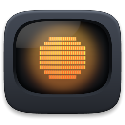

# ultimateCRT

A physically based CRT shader for Windows. It captures a window, runs it through a virtual CRT tube on the GPU and shows the result in a separate output window. See `CLAUDE.md` for the vision, `CRT.md` for the physics and `QUESTIONS.md` for decisions and open questions.

Current state: the physical chain runs on the GPU in linear light (FP16): source decode, video amplifier, gun law and white balance, automatic beam limiting, scanline beam with spot growth, geometry and convergence, aperture grille, slot mask or delta dot mask, phosphor saturation and persistence, faceplate optics (diffusion, halation ring, veiling glare, vignette, glass tint, room-light reflection; off by default, `optics_*` parameters), and an output transform (tube colour to sRGB, shoulder, dither), with 10 tube presets, a settings file, and an ImGui settings menu and stats overlay inside the output window (preset selector, headroom and output parameters, readouts; not yet checked live). Not there yet: the full parameter panels of the menu and its hotkeys (T-53, T-54; until then most parameters are changed through `--preset`, `--set` of `render`, and the settings file), the optional composite, interlace, ageing and burn-in modules, and any validation on a real game. See `ARCHITECTURE.md` for the stage table and `CHANGELOG.md` for the detail.

## Requirements

- Windows 11 x64, a Vulkan 1.3 GPU (developed on an NVIDIA RTX A2000 Laptop)
- Rust 1.98.1 (pinned in `rust-toolchain.toml`, MSVC toolchain)
- Vulkan SDK with `glslc` (`VULKAN_SDK` set, or `glslc` on `PATH`)
- The MSVC C++ compiler (Visual Studio Build Tools): `dear-imgui-sys` compiles Dear ImGui from source (about 16 s once)

Setup, tests, packaging and releases are in `ENV.md`. Architecture is in `ARCHITECTURE.md`, coding rules in `DESIGN.md`.

## Build

```
cargo build --release
```

## How to run

1. Start the demo source: `target\release\pixel-demo.exe`
   - Keys (window focused; the title shows the state and lists the keys, so a live agent can drive it with `SendInput`): 1 to 9 and 0 set the integer scale 1 to 10, M cycles the presentation (1to1, integer, autofit, fit, stretch), F the filter, B the bar colour, P the bar pattern, C (or Space) the content, N the native preset (an exact-size window follows), K toggles the frame counter, X the corner markers, A the alignment, Alt+Enter toggles fullscreen (F11 belongs to ultimatecrt), Esc quits. The window is resizable and re-lays out the picture on every size change; it handles `WM_DPICHANGED` (an exact-size window stays exact on a monitor with another scaling).
   - Game emulation (to exercise every source-adjustment setting of ultimatecrt: `source_scale_mode`, centring, surround colour, crop and divisor detection):
     - `--native-preset nes|snes|gb|dos|vga|hd720|hd1080` (256x240, 256x224, 160x144, 320x200, 640x480, 1280x720, 1920x1080; exclusive with `--native`); `--par` also takes a decimal 0.25 to 4 (`--par 1.2`).
     - `--present 1to1|integer|autofit|fit|stretch` names the presentation the way games do: true 1:1 pixels, integer `--scale N`, the largest integer scale that fits, the largest non-integer fit (aspect kept), or a stretch that fills the client (aspect not kept). It is the same as `--mode native|integer|fit|fit-free|stretch` (the two flags are exclusive). `--filter nearest|bilinear|bicubic` applies to `fit` and `stretch`.
     - `--bars black|grey|white|red|green|blue|magenta|#rrggbb` (alias `--bg`) colours the letterbox and pillarbox bars; `--bars-pattern checker|stripes|noise` fills them with that colour and a second one 64 codes away, to test the surround detection on a non-uniform border.
     - `--window WxH` (alias `--window-size`) is the initial client size in physical pixels (the process is per-monitor DPI aware, so 125 % scaling does not change it); `--fixed-size` stops the user from resizing it.
     - `--content grid` (white edge outline, lines every 8 and 32 native pixels), aliases `testcard` (= `card`) and `gradient` (= `ramp`); `--markers` / `--no-markers` draws red, green, blue and yellow squares in the four corners of the native surface (default on for `grid` and `motion`), under the frame counter.
   - Universal test source (T-95), all options also on the command line (`pixel-demo --help`):
     - `--native WxH` (alias `--res`, default 256x240; 320x240, 640x480, 1280x720, 1920x1080, any 16 to 8192) is the native image, `--image file.png` shows a pixel-art image (its size is the native size unless `--native` is given), `--par N:M` is the pixel aspect ratio (for example `8:7`).
     - `--mode native` shows the image 1:1 (PAR ignored), `--mode integer --scale N` an integer upscale x1 to x10 (nearest, `--scale N` alone keeps meaning that, default 3), `--mode fit` the largest integer scale that fits the client area (1 to 10), `--mode fit-free` a non-integer fit that keeps the aspect, with `--filter nearest|bilinear|bicubic` to emulate a smoothed upscaler (for the smoothed-source warning of the application). With a PAR the integer modes scale the height by N and the width by N times the PAR, floored.
     - The picture is centred in the client area (`--align center`, or `top-left`) with black bars around it, `--bg #rrggbb` colours the bars. Without `--window-size WxH` the initial client area is exactly the picture (x3 for the fit modes).
     - Windows: `--borderless`, `--maximised`, `--fullscreen` (Alt+Enter toggles at run time), `--no-round-corners` (Windows 11: the bottom corner pixels of a normal window are darkened by the rounded corners, this asks DWM not to round them).
     - `--content card|bars|ramp|checker|motion|text|noise|scene|image` (alias `--scene`, default `scene`). `motion` is a moving bar and box on a grid. `--counter` (default on for `motion`, `--no-counter` to disable) draws a 32 bit binary frame number in the top-left corner (a sync cell, 32 cells of at most 8 native pixels, a closing cell; it needs a native width of at least 34). `pixel-demo --decode capture.png <same layout flags>` prints the frame number found in a client-area capture (exit code 1 if none), which gives a capture-based latency and cadence test. `--fixed-seed` makes the `noise` content deterministic (frame N is always the same pixels).
     - `--fps N` (1 to 240, default 60) is the update rate. The loop waits on a high-resolution waitable timer armed for each frame deadline instead of `WM_TIMER` (which was limited to about 57 distinct frames per second), and `--stats` prints the achieved painted rate and skipped frames every second (also in the title). Frames are painted with GDI, so a capture sees at most the DWM composition rate (the monitor refresh rate); during a window drag or resize Windows runs a modal loop and the animation pauses. `--exit-after SECS` quits by itself. The achieved rate is not measured yet on this machine, `scripts\check-pixel-demo.ps1` measures it.
      - An integer scale whose exact window is taller or wider than the work area of the monitor (for example x5 and above for a 240-line source on a 1080-line monitor) is clamped at start and on the digit, M and N keys to the largest scale that fits, and the window is moved back inside the work area; the title says so (`integer x5 (clamped to x4)`) instead of claiming a scale that is not displayed. An explicit `--window` size, maximised and fullscreen are not clamped.
     - Presentation keys at run time (pure logic in `crates/pixel-demo/src/keys.rs`, unit tested): `1` to `9` and `0` set the integer scale x1 to x10; `+` / `=` / numpad plus / `Up` raise it by 1 and `-` / numpad minus / `Down` lower it by 1 (a French AZERTY `-` is the digit key 6: use the numpad or the arrows there); `PgUp` / `PgDn` move by 2; all clamp to x1..x10 and, from 1to1, autofit or the free modes, switch to integer starting from the scale shown. `Home` is x1, `End` is autofit (largest integer scale that fits the client area, live while the window is resized). `T` or `Tab` flips between autofit and the last explicit mode (it remembers your multiplier, even one that had been clamped), `Z` cycles autofit, fit (non-integer), stretch, `M` still cycles all five presentations. A multiplier that does not fit the work area keeps the clamp text `integer xN (clamped to xM)`. The title shows the state first (mode, effective multiplier, client size) and the key legend last. After each of these keys, and `F` in the free modes, a toast (one line of white text on a dark box, bottom centre, 1.5 s) shows the new state (`integer x4`, `autofit -> x3`, `stretch nearest`); it sits clear of the frame counter and the corner markers and only appears after a key, so the counter decoding is not affected; `--no-toast` disables it.
   - `scripts\check-pixel-demo.ps1` exercises the modes with `ultimatecrt --save-capture` and the counter decoder (layouts, resize, rounded corners, optional DPI move, rates).
2. Start the CRT app: `target\release\ultimatecrt.exe` (double-click it, no command line needed; see "Choosing the window to capture" below). The options that follow are developer and diagnostic conveniences.
   - `--window "pixel-demo"` captures at once the first window whose title starts with that text (else contains it), without the picker; an error when there is none. Every output is non-activating: starting it, clicking it, or moving and resizing the framed window by its title bar or frame leaves the foreground and the keyboard on the captured window (only the settings menu takes them while it is open). Quit with Ctrl+Alt+Q.
   - `--fullscreen` covers the source's monitor with a borderless, topmost, non-activating window. `--monitor N` picks another monitor. `--no-activate` is accepted for older scripts and has no effect.
   - `--window "text"` captures another window, `--list-windows` and `--list-gpus` list candidates, `--list-adapters` prints the GPU and monitor topology (adapters, LUIDs, the chosen adapter marked `<- CHOSEN`, the capture adapter, verdict and warnings; opens no window), `--gpu N` picks the Vulkan device by index (see GPU choice below).
   - `--divisor N` (or `NxM`) tells it the source is an integer upscale by N, `1` meaning native. `--crop x,y,w,h` selects the part of the client area that is the source. Without `--divisor` the factor is detected automatically.
   - `--no-crop` captures the whole window instead of its client area.
   - `--stats` prints capture and render rates once per second, followed by a GPU line: the mean whole-frame GPU time and one value per timed segment (`upload`, `decode`, every chain slot, `encode`, `ui` for the settings menu and overlay) in ms, from Vulkan timestamp queries (`gpu 3.4 ms | upload 0.097 | decode 0.023 | signal - | amp 0.061 (bypass) | ...`). `-` is a segment that did not run in the second (an off or placeholder slot that keeps its domain, an upload without a new frame); `(bypass)` is an off slot that changes the domain (`amp`, `screen`) and runs the cheap resample copy, so its value is that copy's cost. The numbers are read when a frame slot is reused, so they lag the CPU by at most two frames and never stall it. A device without timestamp support prints `gpu timings unavailable: <reason>` once. `--save-capture out.png` saves the first captured frame and exits, `--exit-after SECS` quits by itself, `--integer` restricts to integer scales, `--validation` enables the Vulkan validation layer.
   - `--log file.csv` writes a diagnostics CSV with one row per second: capture fps, min/max/p99 capture interval, render fps and interval stats, gaps over 50 ms (strictly greater, capture and render counted separately), the number of foreground-window changes in that second, the pid and title of the last foreground window when it changed, and `fg_is_source` (1 when the foreground window is the captured one). The GPU timings are appended after those 15 columns (the earlier columns keep their position): `gpu_frame_ms`, then `gpu_<segment>_ms` for `upload`, `decode`, every chain slot, `encode` and `ui` (the new chain slots add columns at their place in the chain, so read columns by name), each the mean over the second in ms, empty when the segment did not run or the device has no timestamps. The foreground is polled with `GetForegroundWindow` once per loop (no hooks); the first poll is the baseline, not a change. A summary line is printed at exit. Capture intervals are observed from the main loop (a counter jump of k frames over d ms counts as k intervals of d/k), so their resolution is the render cadence; exact capture timestamps come with T-59. The foreground title can contain private content: delete the log when done.
   - `--pattern name[:args]` shows a generated test pattern instead of capturing a window (no capture target needed, divisor 1): `flat[:level]`, `ramp`, `vline[:N]`, `hline[:N]`, `grating[:N]`, `checker[:N]`, `crosshatch[:N]`, `point`, `window[:APL]` (10, 25, 50, 100 % area on black), `bar[:width[:px-per-frame]]` (moving), `pluge`, `moire[:N]`. `--pattern-size WxH` sets its size (default 320x240). Values are 8-bit sRGB codes.
   - `--image file.png` shows a still PNG (any colour type, alpha flattened over black, divisor 1) instead of capturing. It is exclusive with `--pattern`.
   - `--detect-bars capture.png` (developer diagnostic, offline, opens no window) runs the picture-area detector on a saved capture (a `--save-capture` PNG) with the thresholds of the settings file and prints the picture found (`detected: picture 256 x 224 at 422, 288 (x 422..677, y 288..511); bars left 422, top 288, right 422, bottom 288`), or why nothing was cropped, and per edge the dark rows or columns, the largest lit-pixel count among them and the threshold, plus what the first single-pixel rule would have found. To debug a detection: `ultimatecrt --window "game" --save-capture frame.png`, then `ultimatecrt --detect-bars frame.png`.
   - `--help` prints all options, `--version` the version.
3. Offline render, no window: `ultimatecrt render (--pattern name[:args] [--pattern-size WxH] | --image f.png) [--set id=value]... [--size WxH] --out out.png|out.pfm`. It runs one frame through the same GPU pipeline headless (default transfer settings and parameters of the live path, `--set` overrides a parameter by id: numbers, `a,b` for vectors, `true`/`false`, enum value names). `--size` is the output size (default: the source size). A `.png` is 8-bit RGB (the codes the output window would show); a `.pfm` is 32-bit float RGB (little-endian, no dependency) holding the same encoded values unquantised, in [0, 1], not linear light. `--validation` enables the validation layer. `--preset <id|file.toml>` applies a tube preset before the `--set` overrides. `render` has no `--gpu` option.

## Choosing the window to capture (no command line)

ultimateCRT is one window and needs no command line. Started without options:

1. The output window opens (framed, at its remembered place) with a "Choose a window to capture" card: the app name, a short hint and the list of windows that can be captured, each with its program icon, title, program, size and monitor. The windows recently in the foreground come first, then the others alphabetically. Minimised windows are listed greyed with the note that they deliver no frames until restored. Our own windows, hidden, cloaked (other virtual desktops), tool and owned windows, untitled ones and the shell (taskbar, desktop, start menu) are not listed. The list refreshes by itself every second; Refresh does it at once.
2. Type to search (every word must appear in the title, the program or the class), Up and Down (Page Up, Page Down) choose, Enter or a double-click (or Capture) captures. The preview on the right is a one-shot capture of the hovered or selected window (taken after a short pause on the row, again every few seconds; never of our own windows, one at a time); Refresh preview takes it again.
3. The chosen window is captured, its source profile (`[[source]]` for its program and class) applies, the foreground goes back to it and the output is non-activating again. Everything else is automatic as before: the integer upscale and the native raster are detected, the client area is captured, the picture is scaled, centred and surrounded by the tube's settings.
4. The settings menu (F10) has a Source section at the top (click its header, it names the program): what was detected (native size, integer scale, capture area, captured size, whether a source profile applies), **Change source** (the list again; Esc or Cancel keeps the current window), **Detach** (stop capturing: the list comes back), the **Picture area** (Auto by default, Manual limits, Whole client area; **Detect now**, **Back to Auto**, **Reset (whole client area)**, **Undo**) and the **Scaling multiplier** (see Source scaling), **Ask at every start** and **Wait for a closed window**. The manual overrides are the "Source and placement" panel: scale mode and scale, crop and divisor modes, centring, surround colour, aspect and PAR; the crop and divisor modes now apply live.

The last choice (program, class and title) is kept in `settings.toml`, `[global.source] last`. `[global.source] ask_at_start` (default true, also "Show this list at every start" in the card) shows the list at every start; off, the app attaches at start to a running window of the last program and class, and shows the list only when there is none. `[global.source] wait_s` (default 30) is how long a closed window is waited for (see Target lifecycle); `--wait-source` wins over it.

Without a source, Esc in the list only clears the search (there is nothing to go back to) and the menu key shows the settings; closing them comes back to the list. Switching to another window leaves the list where it is. Quit with Ctrl+Alt+Q or the close button. Errors during the session (a window that cannot be captured, a source given up) are shown as a message in the card; a fatal error at start is shown in a message box when the app was not started from a terminal.

Release builds are GUI programs (no console window). Started from a terminal with options, the app writes its text to that terminal (`--help`, `--list-windows`, `--stats`...); without options it prints nothing.

## GPU choice (HW-3)

One GPU runs the whole chain: the capture's Direct3D 11 device and the Vulkan renderer are created on the same adapter. It is chosen at start from the settings file:

```toml
[global.gpu]
adapter = "auto"   # or a LUID such as "00000000:00017801", or part of the adapter name such as "RTX" or "Intel"
```

- `auto` (the default, also when the key or the table is missing): the adapter that drives the monitor the output window covers (the one holding most of the window). When that cannot be told, or that adapter has no usable Vulkan 1.3 device, the earlier default is used: an NVIDIA discrete GPU, else any discrete GPU, else the first.
- A LUID or a name part forces an adapter (copy the LUID from `--list-adapters`). A name part is matched case-insensitively against the DXGI and the Vulkan names; when it matches several, the first is used and a warning names them all.
- `--gpu N` (Vulkan index from `--list-gpus`) wins over the setting.
- Changing the adapter needs a restart. The settings menu (GPU and system) lists the adapters and writes the setting.
- At start the console prints `gpu: <adapter> (Vulkan [i], LUID ...; <reason>)`. A `warning: gpu: ...` line appears when a configured adapter or `--gpu` index is not found (the automatic choice is used instead), when the chosen adapter does not drive the monitor the output covers (every presented frame then crosses adapters, done by Windows), when the renderer had to fall back to another device, or when the capture device could not be created on the renderer's adapter.
- The choice is made once: moving the output to a monitor of another GPU later (F11, a drag) does not change it or warn. Restart to re-choose.
- `--list-adapters` shows what the setting selects without opening a window. Without a window it only knows the output rectangle with `--fullscreen --monitor N` or a remembered windowed rectangle; otherwise it lists, per monitor, what `auto` would pick.

## Hotkeys and output modes (T-54, T-57)

Global hotkeys are registered with `RegisterHotKey` on the output window (no keyboard hook, no antivirus red flag). A registered chord is swallowed system-wide while ultimatecrt runs, so the captured game does not receive it: that is why the chords below that use no modifier are function keys, and why the others use Ctrl+Alt. They work while the source has the focus and never change the foreground window.

| Action | Default | Settings key (`[global.hotkeys]`) |
|---|---|---|
| Quit (fixed, cannot be rebound) | `Ctrl+Alt+Q` | `quit` |
| Fullscreen / framed window (also the panic key back to a window) | `F11` | `toggle_fullscreen` |
| Settings menu (T-52a) | `F10` | `toggle_menu` |
| Overlay (T-52b) | `Ctrl+Alt+O` | `toggle_overlay` |
| A/B: bypass the whole CRT chain | `Ctrl+Alt+B` | `toggle_bypass` |
| Next preset / previous preset | `Ctrl+Alt+PageDown` / `Ctrl+Alt+PageUp` | `next_preset`, `previous_preset` |

- **Chord text:** `Mod+Mod+Key`, case-insensitive. Modifiers `Ctrl`, `Alt`, `Shift`, `Win`; keys `F1` to `F24`, `A` to `Z`, `0` to `9`, `PageUp`, `PageDown` (`PgUp`, `PgDn`), `Home`, `End`, `Insert`, `Delete`, the arrows, `Space`, `Pause`, `ScrollLock`, `PrintScreen`. Only function keys may go without Ctrl, Alt or Win. Example: `toggle_menu = "Ctrl+Alt+F12"`.
- **Invalid or colliding entries:** an unparsable chord, an unknown action, a chord used by two actions, or a rebound `quit` prints a `warning:` line naming the entry and the default is used instead (a collision keeps the first action in the table order above and gives the other its default).
- **Registration failure:** when another program owns a chord, the console prints `warning: hotkey toggle_menu: cannot register F12 (hot key is already registered by another program, Win32 error 1409); using F10 instead`. Each action has a short fallback list tried in order (menu: `F10`, `Ctrl+Alt+F10`, `Ctrl+Alt+F12`; fullscreen: `Ctrl+Alt+F11`; the others add Shift: `Ctrl+Alt+Shift+O`, `...+B`, `...+PageDown`, `...+PageUp`). If none registers the action is unavailable and the line says so. On the dev machine F12 is owned by another program (error 1409), which is why the menu key is F10. The line `hotkeys: ...` at start lists the chord in force per action. `Ctrl+Alt+Q` has no fallback: a fullscreen output refuses to start without it, a windowed one warns (Esc still works).
- **F11 and the output modes:** F11 toggles between the borderless fullscreen output (topmost, non-activating, covering the monitor the window is on) and a framed, resizable window (taskbar button, not topmost). The window rectangle (position, size, so the monitor) is remembered in `settings.toml` (`[global.output] windowed = [left, top, right, bottom]`, written on F11 and at exit) and used again at the next start when it is still on a monitor, else the window is centred on the monitor it came from. The swapchain follows every size change; the picture keeps its tube-based placement (letterboxed, see Source adjustment). Both modes are non-activating, except while the settings menu is open (the menu takes the focus; F11 works in both states): in the framed window Esc cannot reach it, quit with `Ctrl+Alt+Q` or the close button. When the monitors change (`WM_DISPLAYCHANGE`: resolution, a monitor plugged or unplugged) a fullscreen output re-covers the monitor that holds most of it, and a framed window that is mostly off screen is moved back onto a monitor. The framed window follows its own DPI when moved to a monitor with another scaling.
- **Cursor:** the host cursor is hidden over the picture while the settings menu is closed (the source's own cursor is not captured, so no cursor shows; over the frame and title bar it stays). The output is not click-through: clicks land on the output, not on the source. A click-through option (`WS_EX_LAYERED | WS_EX_TRANSPARENT`, off by default, PLAN D-8) is not implemented yet: it needs a command-line flag and a test that a layered window keeps independent flip (QUESTIONS OUT-2, OUT-4).
- **Presets:** next and previous step through the presets in menu order (the ten shipped ones, then the user ones in `%APPDATA%\ultimateCRT\presets\`), wrap around, print `preset next: <name> (<id>)`, and replace the tube parameters at once. The `source` group (scale mode, PAR, crop, surround) is kept; the parameter overrides of `settings.toml` belong to the preset they were made on and are not carried over. The choice is not written to the settings.
- **A/B bypass:** `Ctrl+Alt+B` disables every slot of the CRT chain (the picture then goes through source decoding, placement and output encoding only) and prints `bypass: on`; pressing it again restores the slot flags as they were and prints `bypass: off`.
- `scripts\check-hotkeys.ps1` is the live check (sends the keys with SendInput, needs a hands-off desktop, prints PASS, MITIGATED or FAIL). It has not been run yet.

## Tube presets and parameters

- `--preset <id>` (live and `render`) starts from a shipped preset, a user preset (a `.toml` file in `%APPDATA%\ultimateCRT\presets\`, whose `id` replaces a shipped one of the same id) or a preset file path. Shipped ids (`presets\tubes\`): `pvm-20m4u` (Sony PVM-20M4U), `bvm-20f1u` (Sony BVM-20F1U), `kv-trinitron-tv` (Sony KV-class Trinitron TV), `gdm-f520` (Sony GDM-F520 PC monitor), `slot-tv-26in` (26 in slot-mask TV class), `tv-13in` (13 in consumer TV class), `cromaclear-17in` (NEC CromaClear 17 in), `arcade-19in` (19 in arcade monitor class), `vga-15in` (15 in delta-dot VGA class), `delta-17in` (17 in delta-dot monitor class). They are starting points built from published data, each tagged with its source, not measurements of a given unit.
- Every parameter (id, unit, default, range, confidence tag, source, description) is declared in `params\*.toml`, one file per stage. `--set id=value` of `render` takes those ids.
- Without `--preset`, the live app starts from the preset named in `%APPDATA%\ultimateCRT\settings.toml` (else the parameter defaults), with the parameter overrides stored in that file on top.

Only the client area of the target window is captured, so a 256×240 source at 3× arrives as exactly 768×720 pixels.

## Settings menu and overlay (T-52a, T-52b)

- The menu key (default F10, `toggle_menu` in `[global.hotkeys]`, with the fallbacks of the hotkey table) opens the settings menu inside the output window, windowed or fullscreen. While it is open the output window takes the keyboard focus, the mouse cursor shows over it, and mouse, wheel and keyboard go to the menu; the captured game sees a deactivation and may pause (accepted, D-7). The same key, or Esc, closes the menu and gives the foreground back to the window that had it (else to the captured window); Esc never closes the output while the menu is open. Switching to another window yourself (Alt+Tab, a click elsewhere) also closes the menu, and that window keeps the foreground. F11 still toggles fullscreen and the framed window while the menu is open, and the menu stays usable; after the menu closes the output is non-activating again in either mode. Ctrl+Alt+Q quits at any time (an open menu gives the foreground back first).
- When a hotkey could not be registered (a chord owned by another program, a fallback in force, an action left without a key), the menu shows the same message as the console under its key hint, and the hint names the chord actually in force.
- The menu window can be moved, resized and collapsed, and has an opacity slider, so it can be moved off the picture while tuning; its place, size, opacity and collapsed state are kept in `settings.toml` (`[global.ui]`) when it closes.
- **Every parameter is in the menu** (T-53), in panels by topic: Output and headroom (open; the SDR headroom readout, the mode in effect, exposure, knee, mask depth...), Source and placement (with the placement readout of `--stats`), Signal and amplifier, Gun and white, Beam and scanlines, Mask, Geometry, Phosphor, Ageing and burn-in, Optics (not implemented yet), Performance and diagnostics (fps, GPU ms per stage), GPU and system. Click a header to open or close a panel; the body scrolls with the wheel.
  - Drag a slider, or Ctrl+click it (or focus it and press Enter) to type a value; values outside the slider range are accepted. Wide ranges (exposure, bandwidth, curvature radius...) use a logarithmic slider. Check boxes, lists and a colour swatch (the surround colour) work as usual. Hover a label for what the parameter does, its range, and its preset and default values.
  - A parameter that differs from the preset in force (with the source profile and command-line options) shows an amber dot and a brighter label, and its panel header counts the changes. Double-click a label to reset it to the preset value; right-click it to choose the preset value or the table default. "Reset N changed" at the bottom of a panel resets the whole panel.
  - "Search parameters" at the top finds parameters in every panel by name, id or group (every word must match). "Advanced" shows the fine-tuning parameters (model internals such as the mask tier or the BT.1886 constants); a search always shows them.
  - Preset: type in the filter to narrow the list and pick a preset to apply it at once (the source profile and the command-line options stay on top). An amber dot next to the preset means the parameters were changed since; Revert restores the preset, Reload reads the preset files again. Type a name and press "Save as new" to keep the current parameters as a user preset (`%APPDATA%\ultimateCRT\presets\<id>.toml`, the id made from the name); the shipped presets cannot be overwritten. When the preset in force is a user preset, "Update" rewrites it.
  - Changes apply to the picture at once and are saved in `settings.toml` as overrides of the preset in force (only the parameters you changed), one second after the last change and when the menu closes; the next start comes back to the same picture. Picking a preset clears the overrides.
  - GPU and system: the adapter in use and why, the adapter for the next start (writes `[global.gpu] adapter`; a note says a restart is needed), the GPU warnings, the hotkeys as registered (change them in `[global.hotkeys]`, applied at the next start) and the settings folder.
- The read-only stats overlay (top right: fps, GPU ms, px per triad) is toggled by `Ctrl+Alt+O` (`toggle_overlay`); it never takes input or focus.
- The menu and the overlay are drawn over the finished picture, after the CRT chain (never dithered or tone-mapped), and cost nothing while hidden (no pass at all). `--stats` and `--log` show their GPU time as the `ui` segment (`gpu_ui_ms`).
- `scripts\check-menu.ps1` is the live check of the focus hand-off (needs a hands-off desktop; see its header). It judges each open and close cycle against the independent foreground poll (not a count of all the changes, which depends on the startup state), and `scripts\check-menu.ps1 -SelfTest` tests that criterion on recorded sequences without opening anything. Not re-run live since that change.

## Quality tiers and the automatic quality drop (T-48)

The menu panel **Performance** chooses how exactly the CRT model is computed. A tier never changes the look parameters (the tube, the mask, the beam), only how much work is spent evaluating them; a preset change keeps the tier.

- `quality_tier` = **standard** (default): the beam of a flat tube is computed once per scanline and column, the method the curved tubes already used, instead of once per screen tile. The picture is within one FP16 step of `exact` (measured mean 0.012 %, max 0.2 % of white) and the `screen` pass costs about 2.5 times less on a flat tube.
- **exact**: the evaluation as written, with nothing approximated beyond the model itself; the same picture, bit for bit, as before the tiers existed. The slowest.
- **fast**: standard, plus no more amplifier sub-samples per source pixel than the output has pixels per source pixel (at least 4). Within 1 % of white on average (worst case a 1-pixel checker, 0.8 %), at most 2.7 % on one pixel. Mostly helps the presets with 16 sub-samples (PVM, BVM, the TVs).
- **low**: fast, plus a beam reach of 3 instead of 4 spot widths and a coarser sampling grid on curved tubes. About 10 to 15 % cheaper than fast, error 0.9 % on average at worst.
- `quality_auto` (off by default, so the picture never changes unasked): when the GPU frame time stays above the refresh period of the output's monitor for 3 seconds, the next lower tier is used; it goes back one tier after 10 seconds with at least 35 % headroom (waiting twice as long after each relapse, up to 160 s). The console, the window title and the overlay (`Ctrl+Alt+O`, row "Quality") show the tier in force while it is lowered.

The measured cost and error of each tier are in ARCHITECTURE.md, section 3.7 "Quality tiers".

## Ageing and burn-in (T-42, T-43, optional)

Both are off by default; the picture is then exactly the same as without them. They are in the menu panel "Ageing and burn-in".

- **Tube ageing** (`ageing_enable`): the tube has been used for `ageing_hours` at an average picture level `ageing_mean_level` on a white of `ageing_white_cd_m2`. The phosphors lose efficiency (blue fastest, so white turns warm; 20,000 hours of full white at 350 cd/m² cost 15 % of the white, the one sourced figure), and the worn guns can lose emission (`ageing_cathode_loss_rgb`, a dimmer channel and a colour cast), drift their cutoff (`ageing_cutoff_drift_rgb`, crushed or lifted blacks) and draw a larger spot (`ageing_spot_growth`, softer scanlines).
- **Burn-in** (`burnin_enable`). **Warning: this deliberately degrades the picture, and the damage is kept between sessions.** Static bright parts of the picture (a HUD, a score, a letterbox edge, a logo) wear the phosphors under them and leave a ghost, tinted by the colour that wore (blue fastest). Real burn-in takes thousands of hours: `burnin_acceleration` sets how many tube hours pass per real hour (1 is real time, 3600 makes every second an hour, typing 0 freezes the wear). The button "Burn in N h now" wears the current picture for `burnin_now_hours` at once.
- **Where the wear is kept:** one file per tube preset, `%APPDATA%\ultimateCRT\tubes\<preset>.state` (`default.state` without a preset), next to `settings.toml`. It is loaded when burn-in is on, saved every 5 minutes (without stopping the picture), when you switch to another preset, and at exit. A damaged or unknown file is not used: the tube starts new, a warning is printed and the file is kept as `<preset>.state.bak`.
- **Reset (a new tube):** the button "New tube (reset wear)" in the menu, or start with `--reset-burnin` (the stored wear of the preset in force is replaced at the next save). Deleting the `.state` file while the app is closed does the same.

## Composite video (T-31, optional)

Off by default (`composite_enable`); the picture is then exactly the same as without it. The settings are in the menu panel "Signal and amplifier", group "Composite video". It re-encodes the captured RGB as a composite (or S-Video) signal and decodes it again, before the video amplifier, as a TV fed by an 8-bit era console would:

- **Set the source's pixel clock first:** `amp_pixel_clock_mhz` (same panel) is the clock of the source's video mode, which the capture cannot know. Its ratio to the colour subcarrier makes the artifact colours: 5.37 MHz (NES, SNES, default), 6.71 MHz (Genesis H40), 7.16 MHz (Apple II high res, CGA 320), 14.32 MHz (CGA 640). These clocks are from general knowledge, not from `CRT.md`; check your machine's.
- `composite_connection`: `composite` (cross-colour, dot crawl, chroma bleed) or `svideo` (chroma bleed only). `composite_standard`: `ntsc` or `pal`. `composite_separation`: `notch` (soft luma, strong false colour on fine luma detail) or `comb` (NTSC: a 1-line comb that removes it where adjacent lines match; PAL: the colour delay line).
- `composite_frame_advance_deg`: 180 makes the dot pattern and artifact colours alternate every frame (broadcast NTSC), 0 keeps them still. `composite_hue_deg` (tint) and `composite_saturation` (colour) are the TV's knobs; `composite_i_bandwidth_mhz` and `composite_q_bandwidth_mhz` set how far colour bleeds past edges.
- Advanced: the subcarrier and line rate (0 = the standard's), the channel bandwidth, and `composite_phase_deg`, which picks the hues of the artifact colours (machine specific, try values to match a known screenshot).

## Interlace (T-32, optional)

Off by default; the picture is then exactly the same as without it. In the menu panel "Beam and scanlines" (the field lock is an Advanced setting), or with `--set` on the command line and in presets.

- **`interlace_mode`**: `off` (every refresh draws every row: 240p and 480p sources), `alternate_frames_are_fields` (each captured frame is one field of an interlaced picture; every other field lands half a line lower, between the lines of the previous one) or `split_woven_frame` (the captured frame holds both fields woven together, a "combed" 480i frame; each refresh draws only the even or only the odd rows, at twice the line spacing). The window capture cannot tell which, so you choose.
- **`interlace_field_order`**: `top_first` (default) or `bottom_first`. If moving edges jitter up and down or look doubled, try the other order.
- **`interlace_field_select`**: `alternate` (default: the field changes at every output refresh) or `top` / `bottom` to lock one field (a still picture for inspection; with a split woven frame, the 240p "double strike" look with its scanline gaps).
- Interlaced pictures flicker and one-line horizontal details twitter, as on a real TV; phosphor persistence (`phosphor_persistence`) gives the afterglow between fields. The output refresh should equal the field rate (a 60 Hz monitor for 59.94 Hz fields): the window title and the console show a notice when it does not.

## Source scaling

The CRT model needs the native raster: scanlines are native rows. A game shown at 3× is captured as 768×720, so the app recovers 256×240 with a divisor:
- **Automatic (default):** over the first 30 informative frames (flat frames such as a black screen are skipped) it looks at the run lengths of identical pixels along rows and of identical rows, and keeps the largest factor that explains nearly all of them. If nothing does, the source is native (x1) and nothing is divided. A margin of 16 pixels is ignored because Windows 11 rounds window corners.
- **Manual:** `--divisor` and `--crop`.
- The shader reads the centre of each block, so no extra pass is needed. Detection restarts when the captured size changes.
- Only simple integer nearest-neighbour upscales are handled. Smoothed or non-integer scaling detects as x1.

### In the menu: the picture area and the scaling multiplier

Open the settings menu (F10) and click the **Source** header.

- **Picture area** (Auto, Manual, Whole client area). Many games and emulators draw their picture inside a larger window with black bars around it (letterbox, pillarbox, or a small game centred in a big window). The picture area is the part of the captured window that is the game's picture; everything outside it is cropped away before the CRT.
  - **Auto** (the default) finds it by itself: when a window is attached, again whenever the captured window changes size, and with **Detect now**. For about one second the app counts, for every row and column, how many of its pixels are lit (more than 8 code values above black, so dithering and compression noise do not matter) and keeps the largest count of any frame. A row or column is part of the picture only when at least 2 of its pixels, and 0.5 % of its length, are lit (5 px of an 1100 px row): a lone bright pixel (a hot pixel, a 1 px cursor) does not count. The rows and columns at the edges that are not picture are the bars, each side measured on its own. A 48 px square at each corner of the window is left out, because Windows 11 rounds the window corners and the capture includes the grey anti-aliased rounding (it is what made the detection fail on a real capture). One bright frame is enough to keep a dark scene from being taken for a bar. When the scale is known, the picture is shrunk to whole source pixels.
  - While the game runs, Auto keeps checking cheaply: a few frames per second (never more than 2 % of the time; `--stats` prints the cost), evaluated every 2 s. A picture that grows or moves is followed after three evaluations in a row agree (about 6 s: a toast or an overlay shown for a second over a bar is ignored). A picture that shrinks is followed only after its bars stayed dark for 30 s: a dark scene, a fade or a black screen never shrinks the crop. A black or flat screen changes nothing.
  - The Source section shows the area in force ("detected · 256 × 224 at 329, 265 in 914 × 754") and the outcome of the last detection.
  - **Guard rails.** The bars of one axis may remove up to 97 % of it (**Largest crop**), and the picture left is always at least 16 source pixels and 2 % of the window, so an almost black capture never collapses to a sliver. When a guard blocks an axis the message says why ("the bars would remove 99 % of the width, more than Largest crop allows"); that axis is left uncropped. (The first version refused more than 60 %, which blocked a 256 × 224 game at x1 in a 914 × 754 window.)
- **Manual limits.** Four rows, **Left**, **Top**, **Right**, **Bottom**: the pixels cropped from each side of the captured client area. They always show the limits in force (in Auto, the detected ones). Drag a slider, Ctrl+click it to type a value, or use **-** and **+**. Touching any of them switches to **Manual**, starting from the values shown, so the automatic result can simply be tweaked. Changes apply live (placement, native size, scale detection, readouts) and are stored for that program and window class. The limits never cross (the picture stays at least 8 × 8 px) and stay inside the window.
  - **Snap to source pixels** (on by default, active when a scaling multiplier is known): the limits move in whole source pixels (x3: 3 px at a time), so the picture keeps whole game pixels.
  - Manual limits are stored with the window size they were made for. When the captured window has another size (resized, or a profile from an earlier session), the stored limits are not applied: the picture area is detected as in Auto, the mode still reads **Manual (stored)**, a note gives both sizes, and **Back to Auto** makes Auto permanent (changing a limit stores new limits for the current size).
  - **Back to Auto** lets the app find the picture again; **Reset (whole client area)** crops nothing; **Undo** puts back the picture area as it was before your last change (a drag or a series of nudges is one step).
  - With **Advanced** ticked: **Black tolerance** (default 8), **Minimum bar** (default 2 px, thinner borders are ignored), **Largest crop** (default 97 %, 10 to 99 %). These are `[global.source]` settings (`bars_tolerance`, `bars_min`, `bars_largest_crop`). The keys of the first version, `bars_max_crop` and `detect_bars_at_attach`, are dropped when the settings are read, so an old file gets the new default.
- **Scaling multiplier.** The factor the game is enlarged by in its window (a 256 x 224 game shown at x3). **Auto** (default) uses the detected value, shown next to the control ("detected: x3"); **None** takes the capture as the game's own pixels; **x1 to x10** forces a factor, even when the detection disagrees (a hint then says "detected x3, forced x2"). The native size, the placement and the readouts follow at once, and the choice is stored for that program. With **Advanced**, **Separate X and Y** gives a factor across and one down for non-square source pixels.
- A choice made in the menu replaces `--crop` or `--divisor` for the rest of the session.

## Source adjustment (T-96)

How the source is mapped to the output, adaptive to any host monitor (no resolution is assumed: everything follows from the actual window or monitor size). Each option is a parameter of `params/source.toml`, can be stored in the source profile of `settings.toml` (keyed by executable and window class, applied when the target window is attached) and is overridden by its command-line flag:
- `--scale-mode tube|native|integer|fit|fit-free` (`source_scale_mode`, default `tube`): `tube` sizes the picture by the tube (visible height, aspect, `tube_height_fraction`), the physical default. `native` shows one source pixel on one host pixel, centred. `integer` uses `--scale N` host pixels per source row (`source_scale`, 1 to 10; 0 = the largest whole factor that fits, the default). `fit` takes the largest whole factor that fits (a free fit below 1). `fit-free` takes the largest non-integer scale that fits, aspect kept: it breaks the alignment of the scanlines and the mask with the host pixels. A factor that does not fit is reduced, a source larger than the output is downscaled; both are reported. In the host modes the tube's px per mm follows from the picture height (px per mm = picture height / raster height in mm), so the mask pitch in px per triad scales with the picture.
- `--align center|top-left` (`source_center`) and `--surround r,g,b` (`source_surround_color`, output code values 0 to 1, black by default): the colour of the letterbox or pillarbox around the picture.
- `--crop-mode auto|manual|none` (`source_crop_mode`): the client area with the Auto picture area (default; the profile's `picture_area = "client"` keeps the whole client area), the `--crop` rectangle (or the profile's `crop = [left, top, right, bottom]`), or the whole window. `--crop` implies `manual`, `--no-crop` implies `none`.
- `--divisor-mode auto|manual|none` (`source_divisor_mode`): detected (default), `--divisor` (or the profile's `divisor`, `divisor_v`), or none (the captured pixels are native). `--divisor` implies `manual`.
- `--par W:H` (`source_par`: 1:1, 8:7 for NES/SNES, 32:35 for Genesis H40) and `--aspect par|fill|W:H` (`raster_aspect` and `source_display_aspect`: from the PAR, filling the tube, or a forced display aspect such as 4:3).
- `--stats` prints the resolved placement when the native raster or the output size changes: mode, host px per source px (and whether every source pixel is a whole number of host pixels), picture size and offset, px per mm, scanline pitch in px, px per triad of the current preset, the mask tier per axis, and a note when the requested scale did not fit.

## Target lifecycle (T-56)

- **Reattach:** when the captured window closes, the app waits for a new window with the same executable and window class (title preferred, then the largest) and captures it. Only windows that appear after the loss are candidates, or the old handle if it comes back: sibling windows of a shared host (every Chrome window, every UWP app) that were already open are ignored. A sibling that was hidden or minimised when the target closed and is shown later counts as new.
- **Lost source:** the console prints `source lost; Ctrl+Alt+Q to quit` at once and every 10 s, and the Source section of the menu shows the time left. After the wait (`[global.source] wait_s`, default 30, the menu's "Wait for a closed window", or `--wait-source SECS`; 0 waits forever) the source is given up: the picture is cleared and the window list comes back with a message naming the window that closed (a fullscreen output first becomes the framed window of F11). Reattaching works only during the wait. `--exit-on-lost` exits at once instead.
- **Black or silent frames:** `protected or not drawing` in the title and the console after 3 s of black frames or 10 s without a frame (a static picture is silent too).
- **Smoothed source (advisory only):** when no integer scale is found, a warning is printed if the window looks like a low-resolution source upscaled with filtering: most edges between flat areas are ramps of a few pixels (bilinear, sharp bilinear, bicubic, Lanczos, integer or not) and the edges lie on a regular grid (period 1.5 to 16 px). Text at 1:1 has ramps too but no grid, nearest-neighbour scaling has no ramps, so neither warns. It cannot tell apart monospaced text with heavy strokes at 1:1 (its stems repeat at the character pitch, a possible false warning), and it misses an upscale whose flat areas are all shorter than the filter support (for example bicubic or Lanczos x2 of art without runs of about three native pixels: no flat area is left to measure). Thresholds are tuned on synthetic images only (`lifecycle.rs` tests); they have not been checked on real captures.
- **Size change:** a new source size restarts the scale detection and clears the persistence history.
- TODO(T-80b): a capture session lost without the window closing (Direct3D 11 device loss, monitor hot-plug) is not a lost target: the frames stop and only the `protected or not drawing: no new frame` message appears, with no restart. T-80b must restart the capture session.

## Application icon



A CRT tube face in graphite with a curved screen, a glowing amber pixel-art disc drawn as scanlines with fine
RGB phosphor stripes. pixel-demo has its own variant (flat screen, teal pixel creature). Both are embedded in
the executables (File Explorer, taskbar, Alt+Tab, title bar) with a version resource (product, description,
version, copyright), nothing to ship beside the `.exe`. The build writes the `.res` file itself (`crates/appres`),
so no `rc.exe` is needed. To change the artwork, edit `crates/appres/examples/gen_icon/draw.rs` and run
`cargo run -p appres --example gen_icon --release` (details in `assets/icon/README.md`).

## Known limits of the scaffold

- Frames go GPU to CPU to GPU (CAP-2, CPU copy path). A shared-handle path is a later spike.
- Capture and render run on one chosen adapter (see GPU choice), but the captured game and the monitor the output covers may sit on other GPUs (hybrid-graphics laptops, monitors split across GPUs); Windows then copies across adapters. That cost is not measured (see HW-3 in `QUESTIONS.md`).
- The window is found by title, not by executable or class.
