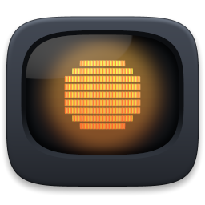

# Phoxium



Phoxium is a CRT shader for Windows. It captures the window of a game or a program, runs the picture through a virtual CRT tube on the GPU and shows the result in its own window, which can go fullscreen over the game. It runs beside the captured program: nothing is injected into it and nothing in it is changed. The output is SDR.

The model is physical, not a filter: each source pixel drives the three electron beams of a virtual tube, and each phosphor element of the mask emits light in proportion to the beam energy it receives.

Phoxium is a personal project, below 1.0.0 (a minor version may still change behaviour). Bug reports and feedback are welcome in the [GitHub issues](https://github.com/arnaud-sintes/Phoxium/issues).

## Requirements

- Windows 11 x64 (the tested system). Windows 10 version 2004 or later is expected to work (the capture API needs it) but has not been tested.
- A GPU and driver with Vulkan 1.3.
- Nothing to install: the zip holds one plain executable, `phoxium.exe`.

## Download and run

1. Download `phoxium-vX.Y.Z-windows-x64.zip` and its `.sha256` file from the [Releases page](https://github.com/arnaud-sintes/Phoxium/releases).
2. Check the download against the hash (see "Unsigned binaries" below), then unzip it into a folder you own.
3. Start the game or program you want to capture.
4. Double-click `phoxium.exe`. It opens one window with the list of windows you can capture: type to search, Up and Down to choose, Enter or a double-click to capture.

That is all: no command line is needed. The integer upscale of the game and the black bars around its picture are detected automatically, and the picture is scaled and centred for you. Every automatic choice can be overridden in the menu. (Developer and diagnostic options: `phoxium.exe --help` from a terminal; the program does not need any of them.)

## First use

| Action | Default key |
|---|---|
| Settings menu | `F10` |
| Fullscreen / framed window | `F11` |
| Quit | `Ctrl+Alt+End` (or the close button of the framed window) |
| Stats overlay | `Ctrl+Alt+F9` |
| A/B: bypass the whole CRT chain | `Ctrl+Alt+F7` |
| A/B while held: bypass only as long as the key is down | `Ctrl+Alt+Insert` |
| Next / previous preset | `Ctrl+Alt+PageDown` / `Ctrl+Alt+PageUp` |
| Click-through on / off | `Ctrl+Alt+F6` |
| Save a snapshot of the picture | `Ctrl+Alt+F2` |

- Once a window is captured, the output never takes the keyboard focus from it, except while the settings menu is open (it gives the focus back when it closes).
- These keys are **global**: while Phoxium runs, F10 and F11 reach no other program, the game included. Every key, Quit included, can be changed in the menu (GPU and system, Hotkeys).
- Click-through sends the mouse to the window under the output (the game under a fullscreen output).

## The menu, presets and main controls

F10 opens the settings menu inside the output window. Every parameter of the tube is there, in panels by topic; changes apply at once and are saved. Hover a label for what it does.

- **Presets:** ten tube presets ship with the app (Sony PVM and BVM monitors, a Trinitron TV, the GDM-F520 PC monitor, a slot-mask TV, a consumer TV, an NEC CromaClear, an arcade monitor, VGA and delta-dot monitors). They are starting points built from published data, not measurements of one unit. Pick one, change anything, save your own.
- **Mask:** aperture grille, slot mask or delta dot, and its pitch in millimetres.
- **Beam and scanlines:** the spot width and how it grows with brightness, which shapes the scanlines.
- **Geometry:** curvature, overscan, pincushion, convergence and colour fringes.
- **Phosphor:** saturation and the afterglow (persistence) behind moving objects; Persistence blend (0 to 1, default 0.5) sets how much of the trail you see. Type switches from the colour tube (P22) to a monochrome phosphor: white P4, green P31, P1 or P39, or a Philips yellow blend.
- **Optics:** glow (bloom) around bright areas and the vignette; turn on its **Enable** switch first.
- **Source:** what was detected, **Change source**, the picture area (Auto or manual limits), the scaling multiplier, the saved profile of each game and the **colour target** (off by default; the Game Boy Color, the Game Boy Advance, the Super Game Boy's 32 palettes, the Mega Drive's measured colour levels the Commodore 64's and the NES's signal colours the IBM CGA monitor's measured colours and two further Game Boy screens (the Color by Pokefan531's colour space, the backlit SP AGS-101 from measurements) transform the colours of an emulator picture into what that handheld's screen showed, as emulator conventions, not measurements; a SNES "black boost" look is also there).
- **Performance:** the quality tier (how much work the model costs, never the look) and the automatic drop (on by default) that lowers it by itself while the GPU cannot keep up, and says so in the window title.
- **Gun and white:** the gun law, the white balance and colour sets (SMPTE-C, EBU, NTSC-J, Trinitron primaries and white points).
- Optional and off by default: ageing and burn-in (burn-in deliberately damages the picture and is kept between sessions), composite video and interlace, the faults of a poor analogue signal (hum, jitter, ghosts, snow), a VHS tape and a vertical roll, TV controls (tint, colour, black and white level, sharpness) and a refresh flicker, and a cabinet bezel with the glass reflecting it.

## Capture

By default the captured picture stays on the GPU (**zero-copy**). If the PC cannot do that, Phoxium falls back to a **CPU copy** by itself, which works everywhere. You can choose the CPU copy in the menu (Source, Capture) if the picture looks wrong, stutters or freezes.

A window, a whole monitor ("Whole screen N"), a still image (a PNG file: **Open image**) or a video device (a capture card or a camera, in the list under **Capture card**) can be the source. A game in exclusive fullscreen cannot be captured; run it in a window or borderless fullscreen. Protected content is captured black, and a minimised window sends no frames until it is restored.

## Settings and privacy

Everything Phoxium keeps is in `%APPDATA%\Phoxium\` (settings, your presets, game profiles, burn-in state). Delete that folder to go back to the defaults.

The program has no network code and sends nothing anywhere. It opens a video device (a capture card, the PC's camera) only when you choose one in the list, and only to show its picture in the output window. The settings file keeps the title of the last captured window (to find it again after a restart); look at the file before you attach it to a bug report.

## Known limits

- Checked live mostly with a test source of the repository (`pixel-demo`, not part of the download) and a few windows on one PC, not yet with a wide range of real games.
- Measured on one NVIDIA laptop (RTX A2000, with an Intel GPU beside it) and tried on a second one (an RTX 3060 Laptop GPU with a GeForce driver, Windows 11, a 1080p panel at 60 and 300 Hz: zero-copy capture and the quality tiers worked there; an Intel UHD 630 whose 2020 driver offers Vulkan 1.2 only is not usable, Phoxium needs Vulkan 1.3 and leaves it out). AMD GPUs and other PCs are untested: please report what you see. On a 240 or 300 Hz panel the render rate follows the GPU time (115 to 155 frames per second at the lowest tier on the RTX 3060), not the refresh rate. On an Intel UHD 770 the picture matched the NVIDIA one (largest difference 1 of 255 on a test pattern), and the Vulkan validation layer is silent on it (the UHD 770 only reaches about 24 frames per second on the slot-mask TV preset at 1920 x 1200 even at the lowest quality tier). There is no lower tier (the tiers never change the look); a smaller output window or a lighter preset (the PVM preset costs about 1.5 times less) is the lever.
- Zero-copy capture is not yet validated with a wide range of games and drivers (the CPU copy is the safe choice).
- Several newer parts are covered by automated tests but not yet checked by hand; [QUESTIONS.md](QUESTIONS.md) and the [CHANGELOG](CHANGELOG.md) say which.
- SDR output only; no HDR.
- A whole monitor can be captured ("Whole screen N" in the list); the output window is then hidden from screen captures, and the Manual picture-area limits give a fixed region. Not checked with an HDR monitor.
- Opening the menu deactivates the game for the moment (some games pause).

## Unsigned binaries

The executables are **not code-signed** (a personal project without a certificate). Windows SmartScreen may say "Windows protected your PC" on the first run: choose "More info", then "Run anyway", only after checking the hash. Antivirus tools may also warn about an unsigned program that captures windows and registers hotkeys.

Each release gives the SHA-256 of the zip in its notes and in the attached `.sha256` file. Compare it with yours:

```
PowerShell:  (Get-FileHash .\phoxium-vX.Y.Z-windows-x64.zip -Algorithm SHA256).Hash
cmd:         certutil -hashfile phoxium-vX.Y.Z-windows-x64.zip SHA256
```

The hash proves that your copy is the published file; it does not replace trust in the project. The source is public and the executables can be rebuilt from it.

## Building from source

Rust (pinned in `rust-toolchain.toml`), the Vulkan SDK (for `glslc`) and the MSVC C++ build tools, then:

```
cargo build --release
```

The executables are `target\release\phoxium.exe` and `target\release\pixel-demo.exe`. Setup, tests, packaging and releases: [ENV.md](ENV.md).

## More documentation

- [ENV.md](ENV.md): build, test, package and publish. [ARCHITECTURE.md](ARCHITECTURE.md) and [DESIGN.md](DESIGN.md): how it is built, coding rules.
- [CRT.md](CRT.md): what real CRT monitors do and the data the model uses. [QUESTIONS.md](QUESTIONS.md): decisions, open questions, live-test findings. [CHANGELOG.md](CHANGELOG.md): changes per version.

## Licence

MIT: see [LICENSE](../LICENSE). The release zip also carries `THIRD-PARTY.md`, the licences of the third-party code and of the Inter font built into the executables. Only permissive licences are used (no GPL, LGPL or AGPL).
