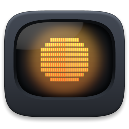

# Phoxium reference

The detailed reference of Phoxium. The short user guide is the [README](README.md); setup, build, tests, packaging and releases are in [ENV.md](ENV.md), the architecture in [ARCHITECTURE.md](ARCHITECTURE.md), the physics in [CRT.md](CRT.md), decisions and open questions in [QUESTIONS.md](QUESTIONS.md), changes per version in [CHANGELOG.md](CHANGELOG.md).

The first part is the user guide in detail (status, requirements, download, the source picker, hotkeys, the menu, the settings files, known limits, unsigned binaries, licence, building); the second part is the reference: command-line options, the picker, the GPU choice, the capture path, hotkeys, presets and parameters, the menu, quality tiers, the optional modules, source scaling and adjustment, the target lifecycle and the icon.

# User guide in detail

## What it is, and where it stands

**Status:** v0.5.0 is the fourth public release (v0.2.0 and v0.3.0 came before). Phoxium is a personal project, still below 1.0.0 (a minor version may change behaviour); feedback and bug reports are welcome as GitHub issues on the repository. What exists: window capture with source scaling and a list to pick the window from, a test pattern and an image source, the physical chain on the GPU in linear light (FP16: source decode, video amplifier, gun law and white balance, automatic beam limiting, scanline beam with spot growth, geometry and convergence, aperture grille, slot mask or delta dot mask, phosphor saturation and persistence, faceplate optics with glow (bloom) and vignette, output transform), colour fringes (chromatic aberration), zero-copy capture on the GPU with an automatic fallback to a CPU copy, ten tube presets, the optional composite, interlace, ageing and burn-in modules (all off by default), a settings menu with every parameter, a click-through option, and a stats overlay. What is not proven yet: the chain has been checked live mostly with the bundled `pixel-demo` source and a few windows, not with a wide range of real games and PCs, and zero-copy capture has not been validated with a wide range of games and drivers (see "Known limits").

## Requirements

- Windows 11 x64 (the tested system). Windows 10 version 2004 or later is expected to work (Windows.Graphics.Capture needs it) but has not been tested.
- A GPU and a driver with Vulkan 1.3 (measured on an NVIDIA RTX A2000 Laptop GPU; on a PC with several GPUs the adapter is chosen automatically, see "GPU choice").
- No installation and no extra runtime: the release zip holds one plain executable, `phoxium.exe`.

## Download and run (no command line)

1. Download `phoxium-vX.Y.Z-windows-x64.zip` from the Releases page of the GitHub repository `arnaud-sintes/Phoxium`, and `phoxium-vX.Y.Z-windows-x64.zip.sha256` next to it.
2. The executables are **not code-signed** (see "Unsigned binaries"): check the download against the hash file before the first run.
3. Unzip it anywhere (a folder you own; do not run it from inside the zip).
4. Start the program you want to capture (any window).
5. Double-click `phoxium.exe`. It opens one window with a "Choose a window to capture" card: type to search, Up and Down to choose, Enter or a double-click to capture. The chosen window is captured and shown through the CRT tube.
6. **F11** puts the output fullscreen over the source (same monitor, the source keeps the keyboard focus); **F10** opens the settings menu. **Ctrl+Alt+End** (or the close button of the framed window) quits.

`phoxium.exe --help` (from a terminal) lists the developer and diagnostic options; the program does not need any of them.

### The source picker

At start (and from **Change source** in the menu) the output window lists the windows that can be captured, each with its program icon, title, program, size and monitor, most recently used first. Type to filter (every word must appear in the title, the program or the class). The last choice is remembered. By default the list is shown at every start; with `[global.source] ask_at_start = false` (also a checkbox of the card and of the menu) the app attaches straight to a running window of the last program and class. If the captured window closes, the app waits for a new window of the same program and class. The detail is in "Choosing the window to capture".

### Hotkeys

| Action | Default |
|---|---|
| Quit | `Ctrl+Alt+End` |
| Fullscreen / framed window | `F11` |
| Settings menu | `F10` |
| Stats overlay | `Ctrl+Alt+F9` |
| A/B: bypass the whole CRT chain | `Ctrl+Alt+F7` |
| A/B while held: bypass only as long as the key is down | `Ctrl+Alt+Insert` |
| Next / previous preset | `Ctrl+Alt+PageDown` / `Ctrl+Alt+PageUp` |
| Click-through on / off (mouse to the game under the output) | `Ctrl+Alt+F6` |
| Save a snapshot of the output (PNG) | `Ctrl+Alt+F2` |

**These are global hotkeys.** They are registered system-wide (`RegisterHotKey`, no keyboard hook) while Phoxium runs: the plain keys F10 and F11 do not reach any other program during that time, the captured game included. That is why the two bare chords are function keys and the others use Ctrl+Alt with a function or navigation key: Ctrl+Alt with a letter would also fire on AltGr, which Windows sends as Ctrl+Alt on European keyboard layouts (AltGr+Q types `@` on a German keyboard), and that character could not be typed in any program while the app runs. All of them, Quit included, can be changed in the menu (GPU and system, Hotkeys: Change, then press the new keys) or in `settings.toml` (`[global.hotkeys]`; the detail and the fallback chords are in "Hotkeys and output modes"). If another program already owns a chord, the app tells you and keeps the old one (or, at start, uses a fallback). If you pick Ctrl+Alt with a letter or a digit that types a character with AltGr on one of your keyboard layouts, the menu warns you which one. Quit can never be left without a chord. While the menu key is changed, F10 keeps opening the menu too, and the menu says so. The hotkeys are released when the app quits.

### The settings menu

F10 opens the menu inside the output window (it takes the focus while open and gives it back to the source when closed). Every CRT parameter is in it, in panels by topic: Output and headroom, Source and placement, Signal and amplifier, Gun and white, Beam and scanlines, Mask, Geometry, Phosphor, Ageing and burn-in, Optics, Performance and diagnostics, GPU and system. Pick a tube preset (ten ship with the app: PVM and BVM monitors, Trinitron TV, GDM-F520, slot-mask TV, consumer TV, CromaClear, arcade, VGA and delta-dot monitors), then change anything; changes apply at once and are kept. **Performance** has the quality tier (exact, standard, fast, low: how much work the model costs, never the look) and an optional automatic drop when the GPU cannot keep up. **Phosphor** has the persistence (afterglow) controls, with a short explanation at its top (see "Phosphor persistence: getting a visible trail"), and **Geometry** has the chromatic aberration group for colour fringes (see "Colour fringes (chromatic aberration)"). **Optics** holds the glow (bloom) around bright areas and the vignette (darker corners), with the glass halo, glare and room light; turn on its **Enable** switch (first row, off by default) to use any of them; the glass halo and the glare start at 0, so that switching it on lifts no black (see Glow and vignette below). The **Source** section at the top shows what was detected (native size, integer scale, picture area) and has **Change source**, **Detach**, the **Capture** path (zero-copy by default, or the CPU copy), the Auto or Manual picture area and the **Saved profiles** of your games. **Manage files** (in the Preset section) renames, deletes, duplicates, exports and imports presets; **Interface** sets the menu size (Interface size), switches **Click-through** (the output ignores the mouse so clicks reach the game under it; the menu takes the mouse back while open) and has the resets; **About** gives the version, the licences and the settings folder; the hotkeys are rebound under **GPU and system** (Change, then press the new keys). On the very first start the window list also shows the main keys.

### Settings, files and privacy

Everything the app keeps is under `%APPDATA%\Phoxium\`: `settings.toml` (your overrides, hotkeys, output window rectangle, GPU choice, capture path, the last source), `presets\` (your own presets, `.toml` files), `export\` and `import\` (preset files you export, or drop there to import; made when first used), `tubes\` (the burn-in wear map per preset, only when burn-in is on). "Reset everything to defaults" keeps a copy of the old file as `settings.toml.bak`. Delete the folder to start from the defaults. The program has no network code and sends nothing anywhere.

- **Window titles are stored locally.** `settings.toml` keeps the program, window class and **title** of the last captured window (`[global.source] last`), because the title helps to find the same window again after a restart. A title can contain private content (a document name, a chat contact). The file never leaves your PC unless you share it, so look at it before you attach it to a bug report.
- **Diagnostics.** `--log file.csv` (developer option, off by default) writes one row per second with the process id and executable name of the foreground window and whether it is the captured one, and no window titles. `scripts\poll-foreground.ps1` (a developer script, not part of the zip) does write titles into its CSV; delete that file after use.

### Known limits

- Zero-copy capture (the default since v0.3.0, see Capture path) has been checked live only on the reference PC with the demo source (the last fixes of v0.3.0 were verified by automated tests and 45 consecutive starts without a crash, but not yet re-checked by hand on an unlocked desktop with this exact build): it is not yet validated with a wide range of games and drivers. If the picture looks wrong, stutters or freezes, choose **CPU copy (most compatible)** in the **Capture** combo of the menu's Source section (or start once with `--capture-path cpu`).
- SDR output only; HDR output and HDR colour are out of scope for now.
- Window capture only (Windows.Graphics.Capture): a program that uses exclusive fullscreen cannot be captured; run it in a window or in borderless fullscreen. Protected content is captured black.
- Measured and tested on one NVIDIA GPU (RTX A2000 Laptop, with an Intel GPU beside it) and Windows 11; the target is NVIDIA. AMD and Intel GPUs, and other PCs, have not been tested beyond that laptop: please report what you see.
- One GPU runs the whole chain, chosen at start. On a hybrid laptop or with monitors on different GPUs, Windows copies frames between adapters; that cost is not measured (HW-3 in `QUESTIONS.md`). Moving the output onto a monitor of another GPU during a session does not switch GPUs (too risky live): the title and the menu (GPU and system) say "moved to a monitor driven by another GPU: frames cross adapters (slower); restart to use that GPU".
- Only simple integer nearest-neighbour upscales are recognised as native pixels; a smoothed or non-integer upscale is treated as x1 (an advisory warning is printed).
- Clicks land on the output unless **Click-through** is on (`Ctrl+Alt+F6`, or Interface in the menu; off by default). With it on, the mouse goes to the window under the output, and a framed output cannot be moved or resized by the mouse until the menu is open or click-through is off. The source keeps the keyboard focus except while the settings menu is open.
- A minimised source, or one on another virtual desktop, sends no frames (a Windows rule): the title and the menu say so ("source minimised: no frames") and the picture resumes when the window is restored.
- The framed output's drag replaces Windows' snap with a simple one: release the title bar at the left or right edge of a screen for a half, at the top for the whole work area. No snap preview, no keyboard snap (Win+arrows), no snap layouts.
- If the settings file cannot be written (disk full, read-only folder, file locked by another program), the title and the menu say "settings not saved"; the session keeps working and the next successful write clears it.
- Weak GPUs: the cost of the chain follows the number of output pixels and the preset. An Intel UHD 770 driving a 1920 x 1200 monitor reaches about 24 frames per second on the slot-mask TV preset with a 640 x 480 source even at the `low` tier (38.5 ms, measured live on 2026-11-24); the automatic drop stops at `low` and no tier goes below it, because the tiers only change the approximation, never the look. The levers are a smaller output window (the cost falls with its pixel count) and a lighter preset (on the RTX A2000, preset 01 costs 8.9 ms against 13.7 ms for the slot-mask TV preset 05 at 640 x 480 on a 2560 x 1440 output).
- Opening the menu deactivates the captured game for the moment (some games pause).
- The bare F10 and F11 hotkeys are global while the app runs (see above).
- The physical model is documented and tested against a reference implementation, but the presets are starting points built from published data, not measurements of a particular unit.

### Unsigned binaries and checking the download

The executables are **not code-signed** (a code-signing certificate costs money and this is a personal project). Windows SmartScreen may show "Windows protected your PC" the first time you run them: choose "More info", then "Run anyway", only after you have checked the hash. Antivirus tools may also warn about an unsigned program that captures windows and registers hotkeys.

Every release publishes the SHA-256 of the zip twice, in the release notes and in the `.sha256` file attached to it. Check yours:

```
PowerShell:  (Get-FileHash .\phoxium-vX.Y.Z-windows-x64.zip -Algorithm SHA256).Hash
cmd:         certutil -hashfile phoxium-vX.Y.Z-windows-x64.zip SHA256
```

The value must be identical to the one on the release page (upper or lower case does not matter). The hash proves that your copy is the file that was published; it does not replace trust in the project. The source is public and the executables can be rebuilt from it ("Building from source").

### Licence

Phoxium is released under the MIT licence: see `LICENSE` (Copyright (c) 2026 Arnaud Sintès). The release zip also carries `THIRD-PARTY.md`: the licence texts of every third-party crate built into the executables and the notices of the bundled C++ sources (Dear ImGui, cimgui, ProggyClean, the stb libraries) and of the Inter font (SIL Open Font License 1.1). The policy is permissive licences only (no GPL, LGPL or AGPL), checked by `cargo deny` and by `scripts\package.ps1`.

## Building from source

Requirements:

- Rust 1.98.1 (pinned in `rust-toolchain.toml`, MSVC toolchain)
- The Vulkan SDK with `glslc` (`VULKAN_SDK` set, or `glslc` on `PATH`); the version used for a release is recorded in `BUILD-INFO.txt` of the zip
- The MSVC C++ compiler (Visual Studio Build Tools): `dear-imgui-sys` compiles Dear ImGui from source (about 16 s once)

```
cargo build --release
```

The executables are `target\release\phoxium.exe` and `target\release\pixel-demo.exe` (or in `CARGO_TARGET_DIR` when it is set). Setup, tests, packaging and releases are in `ENV.md`, architecture in `ARCHITECTURE.md`, coding rules in `DESIGN.md`.

# Reference

## How to run (command line, developer use)

1. Start the demo source: `target\release\pixel-demo.exe`
   - Keys (window focused; the title shows the state and lists the keys, so a live agent can drive it with `SendInput`): 1 to 9 and 0 set the integer scale 1 to 10, M cycles the presentation (1to1, integer, autofit, fit, stretch), F the filter, B the bar colour, P the bar pattern, C (or Space) the content, N the native preset (an exact-size window follows), K toggles the frame counter, X the corner markers, A the alignment, Alt+Enter toggles fullscreen (F11 belongs to phoxium), Esc quits. The window is resizable and re-lays out the picture on every size change; it handles `WM_DPICHANGED` (an exact-size window stays exact on a monitor with another scaling).
   - Game emulation (to exercise every source-adjustment setting of phoxium: `source_scale_mode`, centring, surround colour, crop and divisor detection):
     - `--native-preset nes|snes|gb|dos|vga|hd720|hd1080` (256x240, 256x224, 160x144, 320x200, 640x480, 1280x720, 1920x1080; exclusive with `--native`); `--par` also takes a decimal 0.25 to 4 (`--par 1.2`).
     - `--present 1to1|integer|autofit|fit|stretch` names the presentation the way games do: true 1:1 pixels, integer `--scale N`, the largest integer scale that fits, the largest non-integer fit (aspect kept), or a stretch that fills the client (aspect not kept). It is the same as `--mode native|integer|fit|fit-free|stretch` (the two flags are exclusive). `--filter nearest|bilinear|bicubic` applies to `fit` and `stretch`.
     - `--bars black|grey|white|red|green|blue|magenta|#rrggbb` (alias `--bg`) colours the letterbox and pillarbox bars; `--bars-pattern checker|stripes|noise` fills them with that colour and a second one 64 codes away, to test the surround detection on a non-uniform border.
     - `--window WxH` (alias `--window-size`) is the initial client size in physical pixels (the process is per-monitor DPI aware, so 125 % scaling does not change it); `--fixed-size` stops the user from resizing it.
     - `--content grid` (white edge outline, lines every 8 and 32 native pixels), aliases `testcard` (= `card`) and `gradient` (= `ramp`); `--markers` / `--no-markers` draws red, green, blue and yellow squares in the four corners of the native surface (default on for `grid` and `motion`), under the frame counter.
   - Universal test source (T-95), all options also on the command line (`pixel-demo --help`):
     - `--native WxH` (alias `--res`, default 256x240; 320x240, 640x480, 1280x720, 1920x1080, any 16 to 8192) is the native image, `--image file.png` shows a pixel-art image (its size is the native size unless `--native` is given), `--par N:M` is the pixel aspect ratio (for example `8:7`).
     - `--mode native` shows the image 1:1 (PAR ignored), `--mode integer --scale N` an integer upscale x1 to x10 (nearest, `--scale N` alone keeps meaning that, default 3), `--mode fit` the largest integer scale that fits the client area (1 to 10), `--mode fit-free` a non-integer fit that keeps the aspect, with `--filter nearest|bilinear|bicubic` to emulate a smoothed upscaler (for the smoothed-source warning of the application). With a PAR the integer modes scale the height by N and the width by N times the PAR, floored.
     - The picture is centred in the client area (`--align center`, or `top-left`) with black bars around it, `--bg #rrggbb` colours the bars. Without `--window-size WxH` the initial client area is exactly the picture (x3 for the fit modes).
     - Windows: `--borderless`, `--maximised`, `--fullscreen` (Alt+Enter toggles at run time), `--no-round-corners` (Windows 11: the bottom corner pixels of a normal window are darkened by the rounded corners, this asks DWM not to round them).
     - `--content card|bars|ramp|checker|motion|text|noise|scene|image` (alias `--scene`, default `scene`). `motion` is a moving bar and box on a grid. `--counter` (default on for `motion`, `--no-counter` to disable) draws a 32 bit binary frame number in the top-left corner (a sync cell, 32 cells of at most 8 native pixels, a closing cell; it needs a native width of at least 34). `pixel-demo --decode capture.png <same layout flags>` prints the frame number found in a client-area capture (exit code 1 if none), which gives a capture-based latency and cadence test. `--fixed-seed` makes the `noise` content deterministic (frame N is always the same pixels).
     - `--fps N` (1 to 240, default 60) is the update rate. The loop waits on a high-resolution waitable timer armed for each frame deadline instead of `WM_TIMER` (which was limited to about 57 distinct frames per second), and `--stats` prints the achieved painted rate and skipped frames every second (also in the title). Frames are painted with GDI, so a capture sees at most the DWM composition rate (the monitor refresh rate); during a window drag or resize Windows runs a modal loop and the animation pauses. `--exit-after SECS` quits by itself. The achieved rate is not measured yet on the reference PC, `scripts\check-pixel-demo.ps1` measures it.
      - An integer scale whose exact window is taller or wider than the work area of the monitor (for example x5 and above for a 240-line source on a 1080-line monitor) is clamped at start and on the digit, M and N keys to the largest scale that fits, and the window is moved back inside the work area; the title says so (`integer x5 (clamped to x4)`) instead of claiming a scale that is not displayed. An explicit `--window` size, maximised and fullscreen are not clamped.
     - Presentation keys at run time (pure logic in `crates/pixel-demo/src/keys.rs`, unit tested): `1` to `9` and `0` set the integer scale x1 to x10; `+` / `=` / numpad plus / `Up` raise it by 1 and `-` / numpad minus / `Down` lower it by 1 (a French AZERTY `-` is the digit key 6: use the numpad or the arrows there); `PgUp` / `PgDn` move by 2; all clamp to x1..x10 and, from 1to1, autofit or the free modes, switch to integer starting from the scale shown. `Home` is x1, `End` is autofit (largest integer scale that fits the client area, live while the window is resized). `T` or `Tab` flips between autofit and the last explicit mode (it remembers your multiplier, even one that had been clamped), `Z` cycles autofit, fit (non-integer), stretch, `M` still cycles all five presentations. A multiplier that does not fit the work area keeps the clamp text `integer xN (clamped to xM)`. The title shows the state first (mode, effective multiplier, client size) and the key legend last. After each of these keys, and `F` in the free modes, a toast (one line of white text on a dark box, bottom centre, 1.5 s) shows the new state (`integer x4`, `autofit -> x3`, `stretch nearest`); it sits clear of the frame counter and the corner markers and only appears after a key, so the counter decoding is not affected; `--no-toast` disables it.
   - `scripts\check-pixel-demo.ps1` exercises the modes with `phoxium --save-capture` and the counter decoder (layouts, resize, rounded corners, optional DPI move, rates).
2. Start the CRT app: `target\release\phoxium.exe` (double-click it, no command line needed; see "Choosing the window to capture" below). The options that follow are developer and diagnostic conveniences.
   - `--window "pixel-demo"` captures at once the first window whose title starts with that text (else contains it), without the picker; an error when there is none. Every output is non-activating: starting it, clicking it, or moving and resizing the framed window by its title bar or frame leaves the foreground and the keyboard on the captured window (only the settings menu takes them while it is open). Quit with Ctrl+Alt+End.
   - **Launcher automation:** `--process Game.exe` (the executable name, with or without `.exe`, any case) captures a window of that program, the largest one that is listed and not minimised (a game often has a launcher or a splash window of the same program); with `--window` too, only a window of that program with that text in its title. `--wait-window 30` makes the start wait up to 30 s for the window to appear (0 = no limit, the console prints `source: waiting for ...`), so a launcher can start Phoxium and the game together; without it a missing window is an error at once. The saved source profile of the program (`[[source]]`, picture area, multiplier, source settings) applies by itself, as it does when the window is chosen in the picker, and `--preset <id|file>` picks the look. `--exit-on-lost` ends Phoxium when the game closes. Example: `phoxium --process Game.exe --wait-window 60 --preset kv-trinitron-tv --fullscreen --exit-on-lost`. Checked live with `pixel-demo` as the program (window present, absent, and started after Phoxium); not with a real launcher.
   - `--fullscreen` covers the source's monitor with a borderless, topmost, non-activating window. `--monitor N` picks another monitor. `--no-activate` is accepted for older scripts and has no effect.
   - `--window "text"` captures another window, `--list-windows` and `--list-gpus` list candidates, `--list-adapters` prints the GPU and monitor topology (adapters, LUIDs, the chosen adapter marked `<- CHOSEN`, the capture adapter, verdict and warnings; opens no window), `--gpu N` picks the Vulkan device by index (see GPU choice below). `--capture-path cpu|zero-copy` chooses how captured frames reach the renderer for this run (see Capture path below).
   - `--divisor N` (or `NxM`) tells it the source is an integer upscale by N, `1` meaning native. `--crop x,y,w,h` selects the part of the client area that is the source. Without `--divisor` the factor is detected automatically.
   - `--no-crop` captures the whole window instead of its client area.
   - `--allow-multiple` starts even when another Phoxium runs. By default a second start is refused with a message, because two instances would share `settings.toml` and the burn-in wear maps (a named mutex of the Windows session; it goes away with the process, however it ends). A run with `--exit-after`, `--snapshot` or `--save-capture` is never refused.
   - `--stats` prints capture and render rates once per second, followed by a GPU line: the mean whole-frame GPU time and one value per timed segment (`upload`, `decode`, every chain slot, `encode`, `ui` for the settings menu and overlay) in ms, from Vulkan timestamp queries (`gpu 3.4 ms | upload 0.097 | decode 0.023 | signal - | amp 0.061 (bypass) | ...`). `-` is a segment that did not run in the second (an off or placeholder slot that keeps its domain, an upload without a new frame); `(bypass)` is an off slot that changes the domain (`amp`, `screen`) and runs the cheap resample copy, so its value is that copy's cost. The numbers are read when a frame slot is reused, so they lag the CPU by at most two frames and never stall it. A device without timestamp support prints `gpu timings unavailable: <reason>` once. A third line gives the capture path in force and the capture thread's copy cost per frame (`capture path: zero-copy, copy 0.210 ms per frame (max 0.402 ms, 60 frames)`, or `cpu (zero-copy off: <reason>)`). `--save-capture out.png` saves the first captured frame and exits, `--exit-after SECS` quits by itself, `--integer` restricts to integer scales, `--validation` enables the Vulkan validation layer.
   - `--log file.csv` writes a diagnostics CSV with one row per second: capture fps, min/max/p99 capture interval, render fps and interval stats, gaps over 50 ms (strictly greater, capture and render counted separately), the number of foreground-window changes in that second, the pid of the last foreground window when it changed (no window title is recorded), and `fg_is_source` (1 when the foreground window is the captured one). The GPU timings are appended after those 15 columns (the earlier columns keep their position): `gpu_frame_ms`, then `gpu_<segment>_ms` for `upload`, `decode`, every chain slot, `encode` and `ui` (the new chain slots add columns at their place in the chain, so read columns by name), each the mean over the second in ms, empty when the segment did not run or the device has no timestamps. The last two columns are `capture_path` (`cpu` or `zero-copy`, the path in force) and `capture_copy_ms` (the capture thread's mean copy cost per frame in that second, empty without frames). The foreground is polled with `GetForegroundWindow` once per loop (no hooks); the first poll is the baseline, not a change. A summary line is printed at exit. Capture intervals are observed from the main loop (a counter jump of k frames over d ms counts as k intervals of d/k), so their resolution is the render cadence; exact capture timestamps come with T-59. The log holds no window titles.
   - `--pattern name[:args]` shows a generated test pattern instead of capturing a window (no capture target needed, divisor 1): `flat[:level]`, `ramp`, `vline[:N]`, `hline[:N]`, `grating[:N]`, `checker[:N]`, `crosshatch[:N]`, `point`, `window[:APL]` (10, 25, 50, 100 % area on black), `bar[:width[:px-per-frame]]` (moving), `pluge`, `moire[:N]`. `--pattern-size WxH` sets its size (default 320x240). Values are 8-bit sRGB codes.
   - `--image file.png` shows a still PNG (any colour type, alpha flattened over black, divisor 1) instead of capturing. It is exclusive with `--pattern`.
   - `--detect-bars capture.png` (developer diagnostic, offline, opens no window) runs the picture-area detector on a saved capture (a `--save-capture` PNG) with the thresholds of the settings file and prints the picture found (`detected: picture 256 x 224 at 422, 288 (x 422..677, y 288..511); bars left 422, top 288, right 422, bottom 288`), or why nothing was cropped, and per edge the dark rows or columns, the largest lit-pixel count among them and the threshold, plus what the first single-pixel rule would have found. To debug a detection: `phoxium --window "game" --save-capture frame.png`, then `phoxium --detect-bars frame.png`.
   - `--help` prints all options, `--version` the version.
3. Offline render, no window: `phoxium render (--pattern name[:args] [--pattern-size WxH] | --image f.png) [--set id=value]... [--size WxH] --out out.png|out.pfm`. It runs one frame through the same GPU pipeline headless (default transfer settings and parameters of the live path, `--set` overrides a parameter by id: numbers, `a,b` for vectors, `true`/`false`, enum value names). `--size` is the output size (default: the source size). A `.png` is 8-bit RGB (the codes the output window would show); a `.pfm` is 32-bit float RGB (little-endian, no dependency) holding the same encoded values unquantised, in [0, 1], not linear light. `--validation` enables the validation layer. `--preset <id|file.toml>` applies a tube preset before the `--set` overrides. `render` has no `--gpu` option.

## Choosing the window to capture (no command line)

Phoxium is one window and needs no command line. Started without options:

1. The output window opens (framed, at its remembered place; on a first start it fills the work area of the source's monitor, as large as a maximised window) with a "Choose a window to capture" card: the app name, a short hint and the list of windows that can be captured, each with its program icon, title, program, size and monitor. The windows recently in the foreground come first, then the others alphabetically. Minimised windows are listed greyed with the note that they deliver no frames until restored. Our own windows, hidden, cloaked (other virtual desktops), tool and owned windows, untitled ones and the shell (taskbar, desktop, start menu) are not listed. The list refreshes by itself every second; Refresh does it at once.
2. Type to search (every word must appear in the title, the program or the class), Up and Down (Page Up, Page Down) choose, Enter or a double-click (or Capture) captures. The preview on the right is a one-shot capture of the hovered or selected window (taken after a short pause on the row, again every few seconds; never of our own windows, one at a time); Refresh preview takes it again.
3. The chosen window is captured, its source profile (`[[source]]` for its program and class) applies, the foreground goes back to it and the output is non-activating again. Everything else is automatic as before: the integer upscale and the native raster are detected, the client area is captured, the picture is scaled, centred and surrounded by the tube's settings.
4. The settings menu (F10) has a Source section at the top (click its header, it names the program): what was detected (native size, integer scale, capture area, captured size, whether a source profile applies), **Change source** (the list again; Esc or Cancel keeps the current window), **Detach** (stop capturing: the list comes back), **Capture** (zero-copy or CPU copy, with the path in force and its cost, see Capture path), the **Picture area** (Auto by default, Manual limits, Whole client area; **Detect now**, **Back to Auto**, **Reset (whole client area)**, **Undo**) and the **Scaling multiplier** (see Source scaling), **Ask at every start** and **Wait for a closed window**. The manual overrides are the "Source and placement" panel: scale mode and scale, crop and divisor modes, centring, surround colour, aspect and PAR; the crop and divisor modes now apply live.

The last choice (program, class and title) is kept in `settings.toml`, `[global.source] last`. `[global.source] ask_at_start` (default true, also "Show this list at every start" in the card) shows the list at every start; off, the app attaches at start to a running window of the last program and class, and shows the list only when there is none. `[global.source] wait_s` (default 30) is how long a closed window is waited for (see Target lifecycle); `--wait-source` wins over it.

**Open image** (a button next to Refresh in the list, and next to Change source in the Source section) uses a still image as the source instead of a window: a PNG file chosen in a native dialog (the same decoding as `--image`: any PNG colour type, transparency over black). It takes the place of the capture (the capture ends, as with Detach); the picture is native (divisor 1) with the preset's source settings and no game profile. Choosing a window, or Change source, goes back to windows. A file that cannot be read, or whose picture is larger than this GPU's image limit (or than 32768 pixels a side, 128 Mpixel), is reported in the card and the source stays as it was; the native dialog does not close the menu or the picker. The picture area, the divisor and the other settings of a window are not applied (no game profile). This is the in-window way of the command line's `--image`; it is built and covered by the decoding tests, and not checked live (the native dialog and the switch inside the running loop).

**Capture card** (a row under the search field of the list, shown when Windows lists a video capture device): uses a video device (a capture card with a console or a computer plugged into it, or a camera) as the source instead of a window. It is read through Media Foundation's source reader, which converts what the device sends (YUY2, NV12, MJPEG, ...) to RGB; the device's own default picture mode is the native raster (divisor 1, no game profile, the preset's source settings, as for an image). The list is made when the picker opens and again with **Refresh**. Choosing a window, an image or Change source ends the video. If the device is unplugged or stops delivering, the last picture stays and the console says so. Limits: no choice of the device's mode (resolution and frame rate), no audio, no deinterlacing, and the signal is shown as Windows converts it (the range of a limited-range capture card is not expanded). Checked: the conversion of samples (stride, bottom-up, padding), and on the reference PC its own camera (it lists, opens and delivers a frame of its 1920 x 1080 mode, `PHOXIUM_VIDEO_TEST=1 cargo test -p phoxium --lib video`); not checked with a real capture card, nor the picker row and the switch inside the running loop.

**Default profile** (Source section, Saved profiles): the profile a program without one of its own gets. **Use this game's profile as the default** copies the source settings of the saved profile of the program captured now (scale mode and pixel size, flip, filter, aspect, rotation, colour interpretation, surround; not its picture area, crop or divisor, which belong to its window) as `[default_source]` in `settings.toml`; a program without a `[[source]]` entry then gets it when it is attached, keyed to that program (a change of its picture area or multiplier then saves a profile of its own, which starts from the default's values). Deleting or resetting a program's own profile gives it the default one. A program with a profile keeps its own whole, not merged with the default. **Clear default** forgets it, and a program that had only the default goes back to the preset's source settings. **Reset everything** keeps the default, like the other profiles. Profiles can now also hold `flip`, `prefilter` and `pixel_size`.

Without a source, Esc in the list only clears the search (there is nothing to go back to) and the menu key shows the settings; closing them comes back to the list. Switching to another window leaves the list where it is. Quit with Ctrl+Alt+End or the close button. Errors during the session (a window that cannot be captured, a source given up) are shown as a message in the card; a fatal error at start is shown in a message box when the app was not started from a terminal.

### A whole monitor as the source

Every connected monitor is also in the list, after the windows, as **Whole screen N** (program "Display", the monitor's size and number): choose it to capture everything that monitor shows, for games and programs that are not a window of their own (exclusive or borderless fullscreen, several windows together, an emulator frontend and its game), and to see the desktop as it is.

- **The output is hidden from the capture.** A monitor that holds the output would otherwise capture the output itself, a picture of the picture without end. While a whole monitor is the source, the output window is hidden from screen captures (`SetWindowDisplayAffinity` with `WDA_EXCLUDEFROMCAPTURE`, Windows 10 version 2004 and later): the capture sees what is under it. Only what other programs capture of the screen is affected (the output, its menu and the snapshot are as always); with another source the output is shown to captures again. On an older Windows the console says so and a second monitor for the output is the way out.
- **A fixed region:** the captured frame is the whole monitor, and the picture-area limits of the Source section (Manual: Left, Top, Right, Bottom, the pixels cropped from each side, kept in the profile) cut the region you want out of it, so a game window that stays put on a monitor is a fixed region of it. The profile belongs to the program "Display" and the class of the monitor ("phoxium_monitor_2"), so each monitor has its own picture area and settings, and a monitor that is unplugged and plugged again is reattached like a window. Auto detection of the picture area works on it as on any frame (black bars around a picture), which on a desktop usually finds nothing to cut.
- **Command line:** `--window "Whole screen 2"` (the numbers are those of the picker: `--list-windows` prints each monitor with its `--monitor` index, from 0, and its source name, from 1).
- **Cost and limits:** a 2560 x 1440 source is four times the pixels of a 1280 x 720 game: the capture is cheap with zero-copy, the chain costs what its size costs (profile it with `--stats`), and the amplifier samples are limited on a source that wide (the console says so). The mouse pointer is not captured, as for windows. A monitor that goes away is a lost source (the wait, then the list). Checked live: a whole 2560 x 1440 monitor through the real window under zero-copy, no picture of the output in the picture; not checked: the old Windows without the capture exclusion, several monitors of different GPUs, an HDR monitor.

Release builds are GUI programs (no console window). Started from a terminal with options, the app writes its text to that terminal (`--help`, `--list-windows`, `--stats`...); without options it prints nothing.

## GPU choice (HW-3)

One GPU runs the whole chain: the capture's Direct3D 11 device and the Vulkan renderer are created on the same adapter. It is chosen at start from the settings file:

```toml
[global.gpu]
adapter = "auto"   # or an adapter as the menu writes it, or part of the adapter name such as "RTX" or "Intel"
```

- `auto` (the default, also when the key or the table is missing): the adapter that drives the monitor the output window covers (the one holding most of the window). When that cannot be told, or that adapter has no usable Vulkan 1.3 device, the earlier default is used: an NVIDIA discrete GPU, else any discrete GPU, else the first.
- An adapter value forces an adapter. The menu writes it as the adapter name with its PCI ids, for example `"NVIDIA RTX A2000 Laptop GPU (PCI 10DE:25B8:0A3D1028, LUID 00000000:00017801)"` (`--list-adapters` prints the value of each adapter). It is matched at start by vendor and device id (and subsystem id), preferring the same name; the LUID is only a hint, because Windows keeps an adapter LUID only until the next restart. Two identical GPUs are told apart by `#2` after the PCI ids (their rank in the DXGI order) and, within one boot, by the LUID. A name part is matched case-insensitively against the DXGI and the Vulkan names; when it matches several, the first is used and a warning names them all. A bare LUID (`"00000000:00017801"`, written by earlier builds) is still read; when it still names an adapter it is replaced by that adapter's value.
- `--gpu N` (Vulkan index from `--list-gpus`) wins over the setting.
- Changing the adapter needs a restart. The settings menu (GPU and system) lists the adapters and writes the setting.
- At start the console prints `gpu: <adapter> (Vulkan [i], LUID ...; <reason>)`. A `warning: gpu: ...` line appears when a configured adapter or `--gpu` index is not found (the automatic choice is used instead; this one is also shown in the window title, in the window list and in the menu's GPU and system panel), when the chosen adapter does not drive the monitor the output covers (every presented frame then crosses adapters, done by Windows), when the renderer had to fall back to another device, or when the capture device could not be created on the renderer's adapter.
- The choice is made once per session: the GPU is never switched while the app runs (recreating the devices live is too risky). About once a second the app checks which monitor the output is on; when a drag, F11 or a display change puts it on a monitor driven by another GPU, the choice is evaluated again for the new place and the title, the console and the menu (GPU and system) show `moved to a monitor driven by another GPU (<name>): frames cross adapters (slower); restart to use that GPU` (or, with a configured adapter that a restart would keep, `... the GPU setting keeps the current one`). Back on a monitor of the GPU in use, the notice goes. The situation at start is warned about once at start, not repeated.
- A move onto another monitor also restarts the automatic quality drop's counting against the new refresh rate (each second is compared with the refresh period of the monitor the output is on); the persistence's automatic rate measures the real frame period and follows by itself. The UI scale follows the new monitor's scaling (`WM_DPICHANGED`, and a once-a-second check of the window's DPI).
- Capture restart: the first capture session starts before the output window exists, on a guess of the adapter. When the renderer ends up on another adapter, the session is restarted there; if that fails it runs again on its first adapter (frames cross adapters, the CPU copy is used), and if that fails too the window list comes back with the reason (with `--window` the app stops, as before).
- `--list-adapters` shows what the setting selects without opening a window. Without a window it only knows the output rectangle with `--fullscreen --monitor N` or a remembered windowed rectangle; otherwise it lists, per monitor, what `auto` would pick.

## Capture path (CAP-2)

How the captured window's pixels reach the renderer. The default is **zero-copy**, with an automatic fallback to the CPU copy. Change it in the settings menu (F10): **Source** section, **Capture** combo, next to the attached program and Change source. The change applies at once, in both directions, and is saved.

- **Zero-copy (GPU sharing, default)**, `zero_copy`: the client area is copied on the GPU into one of three textures shared between Direct3D 11 and Vulkan, which the first stage of the chain reads in place; no pixel of the picture goes through the CPU. It needs capture and rendering on one adapter (see GPU choice) and a driver that imports Direct3D 11 textures into Vulkan. For the automatic analyses (integer-scale detection, picture area, black frames) the client area is still read back, but only about ten times a second (every frame while a detection runs). Measured on the reference PC (RTX A2000, headless, relative numbers): the capture thread's copy costs about 0.2 ms per frame instead of about 3 ms for the CPU copy at 2560 x 1440 (0.4 ms instead of 6.4 ms at 3840 x 2160); see CAP-2 in `QUESTIONS.md` for the table.
- **CPU copy (most compatible)**, `cpu`: the client area is copied into a staging texture, read on the CPU and uploaded to Vulkan. It works on every PC and every adapter pair.

In `settings.toml` the choice is stored only when it is not the default:

```toml
[global.capture]
path = "cpu"   # absent (or "zero_copy", "auto"): the default, zero-copy
```

- A file without the key (for example one written by v0.2.0) gets the default. Any other value reads as the default, with a note.
- `--capture-path auto|zero-copy|cpu` wins over the setting for one run (`auto` is the default).
- When the PC cannot run zero-copy (capture and rendering on different adapters, no import support), the CPU copy is used without a title notice: the console prints one `notice: capture: ...` line and the menu shows the zero-copy entry disabled with the reason. A failure during the session (a texture, handle, import or copy failure) falls back to the CPU copy by itself, without stopping: one console line, the window title shows it, and the menu gives the reason. Choosing CPU copy then zero-copy again tries zero-copy again.
- Below the combo, the menu shows the path in force with its copy cost per frame; the Performance and diagnostics section repeats it (read-only), the About section names it, and `--stats` prints it. "Reset everything to defaults" puts it back to zero-copy.
- The Vulkan device enables the sharing extension (`VK_KHR_external_memory_win32`) whenever the GPU can import the textures, whatever is chosen, so the switch needs no restart; the CPU copy does not use it and gives the same picture bit for bit.
- Checked live only on the reference PC with the demo source: a five-minute run, source resizes, minimise and restore, the live switch of the Capture combo. Not validated: real games, other GPUs and drivers, a driver reset during a capture, a covered source (see CAP-2 in `QUESTIONS.md`). If the picture looks wrong, stutters or freezes, go back to the CPU copy: choose **CPU copy (most compatible)** in the Source section, or start once with `--capture-path cpu`.

## Frame pacing, tearing and capture rate (menu: Display and pacing)

Four settings in the menu's **Display and pacing** section, all applied at once and saved:

- **Frame rate cap** (`[global.output] frame_cap`, frames per second, 0 or absent = none, otherwise 10 to 1000; the menu offers Off, 30, 60, 90, 120 and 144). Each frame starts after a display refresh (the composition wait of the loop, OUT-6); the cap adds whole refreshes until the cap interval has passed (90 % of it, to absorb timing jitter). So the rate in force is the display rate divided by a whole number and never above the cap: 30 on a 60 Hz display gives 30; 60 on a 144 Hz display gives 48 (3 refreshes), not 72. Use it to save power when the game runs slower than the display. The phosphor time base follows real time, so the afterglow does not change with the cap.
- **Allow tearing** (`[global.output] tearing`, off by default): the swapchain presents with `IMMEDIATE` instead of `FIFO` (no wait for the vertical blank, lower latency, the picture may tear; variable refresh displays can follow the frame rate). The swapchain is recreated at the next frame. When the surface does not offer `IMMEDIATE`, vsync stays and the **Presenting** row says so. The frame cap and the composition wait still pace the loop, so the GPU is not run flat out.
- **Max capture rate** (`[global.capture] max_rate`, on by default; stored only when off): sets `GraphicsCaptureSession.MinUpdateInterval` to 1 ms so a window above 60 fps is captured at its own rate (Windows 11 24H2 or later; older Windows has no such property and the setting is ignored). Applies to the running capture and to every later one.
- **Keep the PC awake** (`[global.output] keep_awake`, off by default): asks Windows (`SetThreadExecutionState` with the system and display flags) not to sleep the PC or the display and not to start the screen saver while Phoxium runs, for a long session with a gamepad where no key or mouse activity tells Windows that someone is there. The request is released when the box is cleared and when Phoxium exits. **Reset everything** clears it.

Not checked live: tearing on a variable refresh display, and the capture rate above 60 fps (the development monitors are 60 Hz). Covered by unit tests: the cap pacing against a fake clock, the present mode choice, the settings round trip (keep-awake included, with the Windows flags) and the menu rows. Keep-awake is not checked against the real power settings.

## Snapshot of the output

The picture the CRT drew, as it is on the screen (display codes, dithering included), without the menu on it:

- **Save:** the hotkey `Ctrl+Alt+F2` (`snapshot`, rebindable like the others) or the **Save snapshot** button of the menu's Display and pacing section writes an 8-bit RGB PNG of the output size to `the Phoxium folder of your Pictures (`Phoxium-YYYYMMDD-HHMMSS.png`)` (UTC; a `-2`, `-3` suffix when the name exists). The console prints the path and the menu shows it under the buttons.
- **Copy:** the **Copy snapshot** button puts the same picture on the clipboard (`CF_DIB`, 32 bits per pixel). Only from the button: it replaces what the clipboard holds, so no hotkey does it.
- How: the swapchain images are made copyable when the surface offers `TRANSFER_SRC`; the frame after the request is drawn without the menu (one frame of it is missing on screen), copied to a host buffer and read after the present. Where the surface does not offer it, the menu says the snapshot is not available.
- `phoxium --pattern ramp --snapshot out.png` saves a snapshot after about a second and exits (a developer check of the path; any source works).
- Checked: the PNG of a CRT-rendered ramp through the real window under the validation layer (no message), unit tests of the PNG, the file names, the clipboard bitmap and the pixel order, and the menu rows. Not checked by hand: the clipboard paste in another program, a snapshot with the menu open on screen.

## Hotkeys and output modes (T-54, T-57)

Global hotkeys are registered with `RegisterHotKey` on the output window (no keyboard hook, no antivirus red flag). A registered chord is swallowed system-wide while phoxium runs, so the captured game does not receive it: that is why the chords below that use no modifier are function keys, and why the others use Ctrl+Alt with a function or navigation key (Ctrl+Alt with a letter also fires on AltGr on European keyboard layouts and would swallow the character, such as `@`, in every program). They work while the source has the focus and never change the foreground window.

| Action | Default | Settings key (`[global.hotkeys]`) |
|---|---|---|
| Quit (can be rebound, never removed) | `Ctrl+Alt+End` | `quit` |
| Fullscreen / framed window (also the panic key back to a window) | `F11` | `toggle_fullscreen` |
| Settings menu (T-52a) | `F10` | `toggle_menu` |
| Overlay (T-52b) | `Ctrl+Alt+F9` | `toggle_overlay` |
| A/B: bypass the whole CRT chain | `Ctrl+Alt+F7` | `toggle_bypass` |
| A/B while held: bypass only as long as the key is down | `Ctrl+Alt+Insert` | `hold_bypass` |
| Next preset / previous preset | `Ctrl+Alt+PageDown` / `Ctrl+Alt+PageUp` | `next_preset`, `previous_preset` |
| Click-through on / off | `Ctrl+Alt+F6` | `toggle_click_through` |
| Save a snapshot of the output (PNG) | `Ctrl+Alt+F2` | `snapshot` |

- **Chord text:** `Mod+Mod+Key`, case-insensitive. Modifiers `Ctrl`, `Alt`, `Shift`, `Win`; keys `F1` to `F24`, `A` to `Z`, `0` to `9`, `PageUp`, `PageDown` (`PgUp`, `PgDn`), `Home`, `End`, `Insert`, `Delete`, the arrows, `Space`, `Pause`, `ScrollLock`, `PrintScreen`. Only function keys may go without Ctrl, Alt or Win. Example: `toggle_menu = "Ctrl+Alt+F12"`.
- **In the menu:** the GPU and system panel changes every chord, Quit included (see "Settings menu and overlay"); the chord is registered at once and written here. While `toggle_menu` is not `F10`, the first free chord of the menu's fallback list stays registered as well (a safety chord, never in the file), so the menu always opens. An unparsable chord, an unknown action, or a chord used by two actions prints a `warning:` line naming the entry and the default is used instead (a collision keeps the first action in the table order above and gives the other its default).
- **Registration failure:** when another program owns a chord, the console prints `warning: hotkey toggle_menu: cannot register F12 (hot key is already registered by another program, Win32 error 1409); using F10 instead`. Each action has a short fallback list tried in order (menu: `F10`, `Ctrl+Alt+F10`, `Ctrl+Alt+F12`; fullscreen: `Ctrl+Alt+F11`; quit: `Ctrl+Alt+End` (when it was rebound), `Ctrl+Alt+Shift+End`; the others add Shift: `Ctrl+Alt+Shift+F9`, `...+F7`, `...+PageDown`, `...+PageUp`, `...+F6`). `Ctrl+Alt+F6` is free of AltGr (a function key types nothing) and is not one of the Intel graphics hotkeys (F1, F3, F4, F8, F11, F12, arrows). If none registers the action is unavailable and the line says so. F12, the usual debugger key, was already registered by another program on the reference PC (error 1409), which is why the default menu key is F10. The line `hotkeys: ...` at start lists the chord in force per action. A fullscreen output refuses to start without a quit chord, a windowed one warns (Esc still works).
- **Earlier defaults:** builds before 2026-11-20 used `Ctrl+Alt+Q` (quit), `Ctrl+Alt+O` (overlay) and `Ctrl+Alt+B` (bypass), which also fired on AltGr. A `settings.toml` written by such a build lists every chord; at the first start of a newer build the chords still equal to those old defaults become the new defaults (a chord you changed stays), the file is written back without the defaults (only changed chords are stored, with `hotkey_defaults = 2` in `[global]`), and a note says what changed (window list, Hotkeys rows, console).
- **F11 and the output modes:** F11 toggles between the borderless fullscreen output (topmost, non-activating, covering the monitor the window is on) and a framed, resizable window (not topmost). Both show a taskbar button with the Phoxium icon; clicking it (or Alt+Tab to it) gives the foreground straight back to the window you were in, like a click on the picture. The window rectangle (position, size, so the monitor) is remembered in `settings.toml` (`[global.output] windowed = [left, top, right, bottom]`, written on F11 and at exit) and used again at the next start when it is still on a monitor, else the window is centred on the monitor it came from. The swapchain follows every size change; the picture keeps its tube-based placement (letterboxed, see Source adjustment). Both modes are non-activating, except while the settings menu is open (the menu takes the focus; F11 works in both states): in the framed window Esc cannot reach it, quit with `Ctrl+Alt+End` or the close button. When the monitors change (`WM_DISPLAYCHANGE`: resolution, a monitor plugged or unplugged) a fullscreen output re-covers the monitor that holds most of it, and a framed window that is mostly off screen is moved back onto a monitor. The framed window follows its own DPI when moved to a monitor with another scaling (also in the middle of a title-bar drag). The framed window is moved and resized by the app itself (Windows' own move loop would activate it), which turns off Windows' snap; a simple snap replaces it: released at the left or right outer edge of a screen the window takes that half of the work area, at the top edge the whole work area (an edge shared by two monitors does not snap).
- **Cursor:** the host cursor is hidden over the picture while the settings menu is closed (the source's own cursor is not captured, so no cursor shows; over the frame and title bar it stays). With click-through on, the output gets no mouse message at all and the cursor is the one of the window under it.
- **Click-through:** `[global.output] click_through = false` (the default, PLAN D-8), the `Ctrl+Alt+F6` hotkey (`toggle_click_through`) or the **Click-through** checkbox of the menu's Interface section. When on, the output window ignores the mouse (`WS_EX_TRANSPARENT | WS_EX_LAYERED` at full opacity, the picture unchanged): clicks, drags and the wheel reach the window under it, typically the captured game under a fullscreen output. While the settings menu or the window list is open the output takes the mouse again, and closing it returns to click-through; F10 and every other hotkey keep working, so the menu is always reachable. The hotkey and the checkbox print `output: click-through on` / `off` and write the setting at once; "Reset everything to defaults" turns it off. With click-through on, a framed output cannot be moved or resized by the mouse (open the menu, or switch it off). Known risk, not measured yet: a layered window may lose independent flip (one more compositor pass, a little more latency, QUESTIONS OUT-4); the style is set only while click-through is on.
- **Presets:** next and previous step through the presets in menu order (the ten shipped ones, then the user ones in `%APPDATA%\Phoxium\presets\`), wrap around, print `preset next: <name> (<id>)`, and replace the tube parameters at once. The `source` group (scale mode, PAR, crop, surround) is kept; the parameter overrides of `settings.toml` belong to the preset they were made on and are not carried over. The choice is not written to the settings.
- **A/B bypass:** `Ctrl+Alt+F7` disables every slot of the CRT chain (the picture then goes through source decoding, placement and output encoding only) and prints `bypass: on`; pressing it again restores the slot flags as they were and prints `bypass: off`.
- **Hold to bypass:** `Ctrl+Alt+Insert` (`hold_bypass`) bypasses the chain only while its key (Insert) is down, and the picture is back when you let go: a quick before and after without a second press. It leaves the toggle alone: held while the toggle has the bypass on, nothing changes at the release; the toggle switched off while the key is down keeps the bypass until the release. A registered hotkey reports only the press, so the release is read from the keyboard state once per frame, which also means a tap shows the bypass for at least one frame. Rebindable like the others (Hotkeys section of the menu).
- `scripts\check-hotkeys.ps1` is the live check (sends the keys with SendInput, needs a hands-off desktop, prints PASS, MITIGATED or FAIL). It has not been run yet.

## Tube presets and parameters

- `--preset <id>` (live and `render`) starts from a shipped preset, a user preset (a `.toml` file in `%APPDATA%\Phoxium\presets\`, whose `id` replaces a shipped one of the same id) or a preset file path. Shipped ids (`presets\tubes\`): `pvm-20m4u` (Sony PVM-20M4U), `bvm-20f1u` (Sony BVM-20F1U), `kv-trinitron-tv` (Sony KV-class Trinitron TV), `gdm-f520` (Sony GDM-F520 PC monitor), `slot-tv-26in` (26 in slot-mask TV class), `tv-13in` (13 in consumer TV class), `cromaclear-17in` (NEC CromaClear 17 in), `arcade-19in` (19 in arcade monitor class), `vga-15in` (15 in delta-dot VGA class), `delta-17in` (17 in delta-dot monitor class). They are starting points built from published data, each tagged with its source, not measurements of a given unit.
- Every parameter (id, unit, default, range, confidence tag, source, description) is declared in `params\*.toml`, one file per stage. `--set id=value` of `render` takes those ids.
- Without `--preset`, the live app starts from the preset named in `%APPDATA%\Phoxium\settings.toml` (else the parameter defaults), with the parameter overrides stored in that file on top.

### Colour sets (Gun and white panel)

The **Colour sets** rows at the top of the **Gun and white** panel are starting points for the four chromaticities of the tube (`tube_red_xy`, `tube_green_xy`, `tube_blue_xy`, `tube_white_xy`, the Colour group below them). Picking one writes those four values, which stay editable and travel with presets, profiles and `render` as before; what the combos show is derived (the set the values equal, else "Custom"), nothing is stored. **Standard** sets primaries and white together: SMPTE-C with D65, EBU with D65, Rec.709 / sRGB with D65, NTSC 1953 with Illuminant C, NTSC-J (ARIB TR-B9) with D93 (the 9300 K of Japanese TV), Trinitron GDM-17SE1 with its 9300 K. **Primaries** and **White point** change one of the two (the white list also has 9300 K + 27 MPCD, the Japanese TV practice, and the RCA ColorTrak white of about 7500 K). Every number is from `CRT.md` ("Chromaticity" and "White point"). The picture shows them with **Match sRGB colours** (Output and headroom) off, which applies the tube primaries and white to the sRGB panel, or with the gun white retune on; with Match sRGB colours on (the default) the tube's colours are shown as the sRGB colours the game was authored in. Checked: the values against `CRT.md`, that every white lies inside every gamut, and the round trip of every set (`colour_sets.rs`); not checked by eye on a calibrated display.

### Host LCD subpixel layout (Mask panel, `mask_host_subpixel`)

An LCD pixel is three vertical stripes, one per colour, each a third of a pixel wide: red, green, blue from left to right on most monitors (`rgb`), the other way round on some (`bgr`). By default the mask is averaged over the whole host pixel, the same for the three channels (`off`). With the layout set to `rgb` or `bgr` (Mask panel, Advanced), the value of each channel is averaged over the footprint of that channel's own subpixel, a third of a pixel wide and moved by a third of a pixel to its side, so a resolved mask keeps its colour structure at the grain of the panel and the light of each stripe is computed where it is really emitted. In the blend band the footprint narrows from one whole period (prefiltered end, unchanged: the mask averages out there) to the third of a pixel, so nothing steps.

- Set it to the stripe order of your monitor (a close look at white text on a white-on-black page shows it). It describes the machine, not the tube: a preset change and **Reset look overrides** keep it, as they keep the quality settings. It is saved with the other parameter overrides.
- The tier thresholds are unchanged (3 px per triad horizontally): the layout changes what a resolved mask looks like, it does not make a mask resolvable that the rule prefilters. The headroom readout follows it: a narrower footprint lifts the brightest stripe of a resolved mask to 1 / fill, where a whole pixel falls short of it.
- Not for WOLED or QD-OLED panels (other subpixel layouts), nor for a vertical or rotated panel. The picture is made for the screen: a snapshot or a screenshot shows the colour fringes of the layout and looks wrong on another monitor.
- Checked: the CPU oracle (`crt-model` `host_value_subpixel`) and the GPU for the three mask types, both layouts, through the prefiltered tier, the blend band and the area integral. Not checked by eye on a real RGB or BGR panel.

### A turned tube: TATE (Source section, `source_rotation`)

Vertical arcade games ran on a tube turned a quarter turn: the picture is upright, a portrait, but the beam still sweeps along the tube's own width, so the **scanlines are the columns of the picture**, the phosphor mask and the curvature are turned with the tube, and the picture is `224 x 288` where the game's own raster is `288 x 224`. Capture the (upright, portrait) window of an emulator, set **Rotation** (Source section) to `counter_clockwise` or `clockwise`, and the output is the turned tube: a portrait picture whose scanlines run down the screen.

- **Which way:** `counter_clockwise` is a tube turned a quarter turn counter-clockwise (its top is on the left of the screen): the first scanline is the rightmost column of the picture. `clockwise` is the other way (its top on the right): the first scanline is the leftmost column. The picture is upright either way; the two differ in the direction of the sweep, which shows in the amplifier smear, the interlace field order and the phosphor trail. Pick the one of the cabinet you remember, or the one whose smear trails the right way.
- **What turns and what does not:** the tube is the landscape tube of the preset (`tube_visible_height_mm`, `tube_aspect`) before it is turned; the beam, the mask, the geometry, the optics, the ageing and the burn-in map are all in the tube's frame and turn with it, with no resampling (a quarter turn moves whole pixels). The output is fitted to the screen as the turned tube: a 4:3 tube turned fills the screen's height with `tube_height_fraction` = 1 (the fraction is of the screen's height), pillarboxed on a landscape monitor. The host LCD subpixel layout is **not applied** while the tube is turned (it runs along the screen's horizontal axis, which is no longer the tube's).
- **Capture and window:** nothing changes there: the picture area, the scaling multiplier and the window or monitor capture work on the upright picture as captured. The source profile of a program keeps it (`rotation = "clockwise"`, `"counter_clockwise"` or `"off"` in its `[[source]]` table), so a vertical game has its own profile. Changing it in the menu applies at once. The Source section and the title bar show the size of the captured picture, the placement readout (`--stats`, menu) names the turn and shows the native raster as the tube sees it (`288x224` for a `224 x 288` picture).
- **Offline:** `phoxium render --pattern ... --set source_rotation=counter_clockwise`.
- Checked: a turned render equals, bit for bit, the plain render of the turned picture turned by hand (both directions, `tests/tate.rs`), the scanlines run down the screen, the hand-derived placement. Not checked on a real vertical game, nor with a portrait monitor.

### Colour fringes (chromatic aberration)

A real tube shows coloured fringes because its three beams never land exactly on the same spot (imperfect convergence): red and blue end up slightly apart, usually on opposite sides of green, more toward the edges. The settings menu has a **Chromatic aberration** group in the Geometry panel for that, off by default (both amounts 0 give exactly the picture without it):

| Control | Default | Range (slider; files up to) | What it does |
|---|---|---|---|
| Chroma lateral (`geometry_chroma_lateral_mm`) | 0 mm | -10 to 10 (-20 to 20) | How far apart red and blue land at the picture corner, along the line from the centre: red outward by half, blue inward by half, green fixed. Negative: red inward. |
| Chroma axis (`geometry_chroma_axis_mm`) | 0 mm | 0 to 5 (0 to 20) | The same separation everywhere, in the direction of the angle. |
| Chroma angle (`geometry_chroma_angle_deg`) | 0 deg | -180 to 180 | Direction in which red moves for the axis amount: 0 right, 90 down, 180 left, -90 up. |
| Chroma edge exponent (`geometry_chroma_edge_exponent`) | 2 | 1 to 3 (1 to 4) | How the lateral fringes grow from the centre: 1 evenly, 2 like a real tube, 3 almost only in the corners. |

Recommended values: a good monitor, lateral 0.5 to 1 mm; a consumer TV, lateral 1.5 to 2 mm; axis 0.2 to 0.5 mm at 0 deg in either case. Above about 2 mm the fringes become strong and a colour moire can appear on fine patterns at the sides (lateral 3 mm, live review 2026-11-20), so keep a cheap or badly adjusted set to about 2 mm. On the command line: `render --set geometry_chroma_lateral_mm=1.5 ...`. The per-colour Convergence controls below it (static offset and radial term per beam) still work and add to these. A different spot size per colour (per-gun focus) is not modelled yet.

Only the client area of the target window is captured, so a 256×240 source at 3× arrives as exactly 768×720 pixels.

## Settings menu and overlay (T-52a, T-52b)

- The menu key (default F10, `toggle_menu` in `[global.hotkeys]`, with the fallbacks of the hotkey table) opens the settings menu inside the output window, windowed or fullscreen. While it is open the output window takes the keyboard focus, the mouse cursor shows over it, and mouse, wheel and keyboard go to the menu; the captured game sees a deactivation and may pause (accepted, D-7). The same key, or Esc, closes the menu and gives the foreground back to the window that had it (else to the captured window); Esc never closes the output while the menu is open. Switching to another window yourself (Alt+Tab, a click elsewhere) also closes the menu, and that window keeps the foreground. F11 still toggles fullscreen and the framed window while the menu is open, and the menu stays usable; after the menu closes the output is non-activating again in either mode. Ctrl+Alt+End quits at any time (an open menu gives the foreground back first).
- When a hotkey could not be registered (a chord owned by another program, a fallback in force, an action left without a key), the menu shows the same message as the console under its key hint, and the hint names the chord actually in force.
- The menu window can be moved, resized and collapsed, and has an opacity slider, so it can be moved off the picture while tuning; its place, size, opacity and collapsed state are kept in `settings.toml` (`[global.ui]`) when it closes.
- **Every parameter is in the menu** (T-53), in panels by topic: Output and headroom (open; the SDR headroom readout, the mode in effect, exposure, knee, mask depth...), Source and placement (with the placement readout of `--stats`), Signal and amplifier, Gun and white, Beam and scanlines, Mask, Geometry, Phosphor, Ageing and burn-in, Optics, Performance and diagnostics (the capture path, fps, GPU ms per stage), GPU and system. Click a header to open or close a panel; the body scrolls with the wheel.
  - Drag a slider, or Ctrl+click it (or focus it and press Enter) to type a value; values outside the slider range are accepted. Wide ranges (exposure, bandwidth, curvature radius...) use a logarithmic slider. Check boxes, lists and a colour swatch (the surround colour) work as usual. Hover a label for what the parameter does, its range, and its preset and default values.
  - A parameter that differs from the preset in force (with the source profile and command-line options) shows an amber dot and a brighter label, and its panel header counts the changes. Double-click a label to reset it to the preset value; right-click it to choose the preset value or the table default. "Reset N changed" at the bottom of a panel resets the whole panel.
  - "Search parameters" at the top finds parameters in every panel by name, id or group (every word must match). "Advanced" shows the fine-tuning parameters (model internals such as the mask tier or the BT.1886 constants); a search always shows them.
  - Preset: type in the filter to narrow the list and pick a preset to apply it at once (the source profile and the command-line options stay on top). An amber dot next to the preset means the parameters were changed since; Revert restores the preset, Reload reads the preset files again. Type a name and press "Save as new" to keep the current parameters as a user preset (`%APPDATA%\Phoxium\presets\<id>.toml`, the id made from the name); the shipped presets cannot be overwritten. When the preset in force is a user preset, "Update" rewrites it.
  - Changes apply to the picture at once and are saved in `settings.toml` as overrides of the preset in force (only the parameters you changed), one second after the last change and when the menu closes; the next start comes back to the same picture. Picking a preset clears the overrides.
  - GPU and system: the adapter in use and why, the adapter for the next start (writes `[global.gpu] adapter`; a note says a restart is needed), the GPU warnings, the hotkeys and the settings folder.
  - **Hotkeys** (in GPU and system): each action shows its chord, **Change** and **Default**, Quit included (it can be changed, never removed). Click Change, then press the new keys (for example Ctrl+Alt+F5 or F9; only F1 to F24 work without Ctrl, Alt or Win): Esc cancels, Backspace (or Delete) sets the default. A chord used by another of our actions is refused with its reason; Ctrl+Alt with a letter or a digit that types a character with AltGr on one of your keyboard layouts is accepted with a warning naming the character and the layout; the new chord is registered at once, and when another program owns it the old chord is kept and the menu says why (the Win32 reason). **Reset all hotkeys** brings the defaults back. Changes are saved in `[global.hotkeys]` at once. While the menu key is not F10, F10 (else Ctrl+Alt+F10, Ctrl+Alt+F12) stays registered as a fallback, and the menu names it: you cannot lock yourself out of the menu.
  - **Preset files** (**Manage files** in the Preset section, next to Revert and Reload): pick a preset; **Duplicate** and **Export** work on any preset, **Rename** and **Delete** on your own presets only (Delete asks first, and the preset in use cannot be deleted; shipped presets are never changed). Export writes `<id>.toml` into `%APPDATA%\Phoxium\export\` (the path is shown). Import: put `.toml` preset files in `%APPDATA%\Phoxium\import\`, press **Rescan**, then **Import** on a file; files above 256 KB (checked on the bytes read, not only the size the file reports) or not valid presets are refused (a user preset file above 256 KB in `presets\` is skipped at start with a warning), values outside the valid range are clamped (the message says how many), the name is cleaned; a file with the id of one of your presets asks **Replace** or **Import a copy**, one with a shipped id is imported under a new id. **Export to file...** and **Import file...** open the Windows Save and Open dialogs instead.
  - **Saved profiles** (in Source): every program with a profile (picture area, multiplier, source settings), the current and last used ones marked; **Use for current source** copies a profile to the program captured now, **Delete** forgets one (asks first), **Reset this game's profile** forgets the profile of the program captured now (asks first).
  - **Interface** (closed by default): **Interface size** Automatic (the monitor's scaling) or 75 % to 300 % (`[global.ui] scale`), applied at once. **Reset look overrides** sets every look parameter back to the preset in force (quality settings kept). **Reset everything to defaults** resets the parameter changes, the hotkeys, the interface size, the GPU choice and the capture path, after keeping a copy of `settings.toml` as `settings.toml.bak`; your presets, the game profiles, burn-in and the preset in force stay. Both ask first.
  - **About** (closed by default): version and commit, licence, the project address (text you can select; the app opens nothing), the adapter and Vulkan device, the capture path in force, the settings folder with **Copy**, the third-party licences (names, versions, licence ids; the full texts are in `THIRD-PARTY.md` of the zip) and the note on unsigned binaries.
- **First start:** when no settings file exists yet, the window list shows a card with the main keys (menu, fullscreen, quit, as registered) and **Do not show again**; it is never shown when a settings file already exists.
- The read-only stats overlay (top right: fps, GPU ms, px per triad) is toggled by `Ctrl+Alt+F9` (`toggle_overlay`); it never takes input or focus.
- The menu and the overlay are drawn over the finished picture, after the CRT chain (never dithered or tone-mapped), and cost nothing while hidden (no pass at all). `--stats` and `--log` show their GPU time as the `ui` segment (`gpu_ui_ms`).
- `scripts\check-menu.ps1` is the live check of the focus hand-off (needs a hands-off desktop; see its header). It judges each open and close cycle against the independent foreground poll (not a count of all the changes, which depends on the startup state), and `scripts\check-menu.ps1 -SelfTest` tests that criterion on recorded sequences without opening anything. Not re-run live since that change.

## Quality tiers and the automatic quality drop (T-48)

The menu panel **Performance** chooses how exactly the CRT model is computed. A tier never changes the look parameters (the tube, the mask, the beam), only how much work is spent evaluating them; a preset change keeps the tier.

- `quality_tier` = **standard** (default): the beam of a flat tube is computed once per scanline and column, the method the curved tubes already used, instead of once per screen tile. The picture is within one FP16 step of `exact` (measured mean 0.012 %, max 0.2 % of white) and the `screen` pass costs about 2.5 times less on a flat tube.
- **exact**: the evaluation as written, with nothing approximated beyond the model itself; the same picture, bit for bit, as before the tiers existed. The slowest.
- **fast**: standard, plus no more amplifier sub-samples per source pixel than the output has pixels per source pixel (at least 4). Within 1 % of white on average (worst case a 1-pixel checker, 0.8 %), at most 2.7 % on one pixel. Mostly helps the presets with 16 sub-samples (PVM, BVM, the TVs).
- **low**: fast, plus a beam reach of 3 instead of 4 spot widths and a coarser sampling grid on curved tubes. About 5 to 15 % cheaper than fast; within 1 % of white on average (worst 0.86 %), 2.7 % at most.
- `quality_auto` (on by default since 2026-11-24: the picture is that of the selected tier while the frames are on time, and changes only when they are late; switch it off to keep the selected tier whatever the frame time): when the GPU frame time stays above the refresh period of the output's monitor for 3 seconds, the next lower tier is used; it goes back one tier after 10 seconds with at least 35 % headroom, when the tier above is predicted to fit (from the cost ratio measured at the drop; otherwise after 160 seconds of headroom), waiting twice as long after each relapse, up to 160 s. The console, the window title and the overlay (`Ctrl+Alt+F9`, row "Quality") show the tier in force while it is lowered.

The measured cost and error of each tier are in ARCHITECTURE.md, section 3.7 "Quality tiers".

## Glow and vignette (Optics panel)

Everything in the **Optics** panel is behind its master switch **Enable** (the first row, off by default; `optics_enable`). With it off the panel's effects are not applied whatever their settings, and the stage costs nothing. Turn it on first.

- **Glow (bloom)**: the soft, wide light around bright text and sprites of a bright CRT. It only moves light (each pixel gives a fraction of its light to the glow and keeps the rest), so a white screen keeps its brightness. Controls: **Bloom weight** (`optics_bloom_weight`, 0 = off, slider 0 to 0.3, up to 0.6 in a file), **Bloom radius** (`optics_bloom_radius_mm`, 0.5 to 60 mm on the tube face, default 6), **Bloom falloff** (`optics_bloom_falloff`, 0 = a short Gaussian edge, 1 = a long faint tail; default 0.5), **Bloom threshold** (`optics_bloom_threshold`, 0 = all light glows, default; 0.5 to 0.8 = only highlights glow) and, under Advanced, **Bloom tint** (`optics_bloom_tint_rgb`, how much each channel glows).
  - A gentle glow without veil: weight 0.12, radius 6 mm, falloff 0, threshold 0.6. Highlights glow (a white window on black gets a halo of 16 codes beside it) and the blacks stay black: no lift, far from the window or inside a black area of a bright picture.
  - A gentle glow with a soft tail: weight 0.12 to 0.15, radius 6 mm, falloff 0.5 (the default), threshold 0.6. The wide lobes of the tail add a faint veil: about 2 codes of lift in black far from a bright area, about 9 inside a black area of a bright picture (falloff 0.2: about 1 and 6).
  - A glow of all the light: weight 0.08, radius 4 mm, falloff 0.5, threshold 0 (no lift far from the window, about 5 codes inside a black area of a bright picture).
  - Glowing highlights: weight 0.2, radius 6 mm, falloff 0.7, threshold 0.6 (veil: about 3 and 14 codes).
  - A strong haze: weight 0.3, radius 15 mm, falloff 1 (a haze by design: about 21 and 60 codes).
  - These lifts are 8-bit codes of the display output through the whole chain with the Optics defaults otherwise (`look_recipes_whole_chain` in `tests/stage_optics.rs`): a 320 x 240 source shown at 960 x 720, "far" 240 pixels from a white window on black, "inside" the middle of a black window in a white picture. Any glow lifts the blacks a little through its wide lobes; falloff 0 or a lower weight keeps that to nothing.
  - The weights of the halo, the glare and the glow share the light: their sum stays at 1 or less (the value just set is lowered).
- **Vignette**: darker corners. **Vignette corner** (`optics_vignette_corner`) is the corner brightness relative to the centre: 0.7 to 0.9 is what real tubes do (thicker glass toward the edges; the default 0.85 and the default shape give exactly the 0.2.0 vignette), lower values are an artistic grade, down to 0 for black corners. The shape controls: **Vignette start** (where the darkening begins, 0 = from the centre), **Vignette exponent** (2 = the physical law; higher keeps the centre bright and drops the edges fast), **Vignette softness** (smooths the onset at the start), **Vignette roundness** (1 = round, 0 = follows the picture's shape), **Vignette floor** (the least light it leaves anywhere; 0.5 halves the effect), **Vignette enable**, and under Advanced **Vignette centre** (moves the bright centre).
  - A subtle tube: corner 0.8, the rest at the defaults (on a 16:9 picture the middle of the left edge keeps 85 % of the centre, the corner 80 %).
  - A strong vignette: corner 0.3, start 0.3, exponent 3, softness 0.3 (the middle of the left edge keeps 71 % of the centre on a 4:3 picture and 57 % on a 16:9 one, the middle of the top edge 96 % and 100 %, the corner 31 %).
  - Black corners, clean sides: corner 0, start 0.6, exponent 4, softness 0.2, roundness 0. The middle of every edge keeps 99 % of the centre (4:3 and 16:9 alike) and only the last tenth of the diagonal goes to black (70 % at 80 % of the way to the corner, 8 % at 90 %). A start of 0.7 with exponent 5 darkens an even smaller corner. Do not use a corner of 0 alone: with the default start of 0 the darkening begins at the centre and the whole picture becomes a spotlight (the earlier recipe, corner 0, start 0.5, exponent 2, softness 0.4, roundness 0.5, left a white area at the middle of the left edge of a 16:9 picture at 13 % of the centre, 165 to 24 in the live review). Roundness 0 matters on a wide picture: round (1) measures the distance in a circle, so the middle of the left edge of a 16:9 picture sits at 87 % of the way to the corner and goes dark with it, while at 0 it sits at 71 %, like the middle of the top edge (`vignette_recipes_keep_the_sides` in `tests/stage_optics.rs` checks these numbers on the GPU against the model).
- **Glass halo and glare** (the thin halation ring at about 1.75 times the glass thickness and the veiling glare) are off by default (`optics_halation_weight` and `optics_glare_weight` are 0), so that switching Optics on gives exactly the effects you choose and nothing else. Their physical values are halation 1.5 % and glare 1 %, and a glass veil lifts the blacks: on the same test (white window on black, black window in a white picture) glare 0.01 alone lifts 13 codes far from the window and 29 inside the black window, halation 0.015 alone 2 and 11, both together 13 and 30 (before this change they were the defaults, which is why switching Optics on alone gave grey blacks), plus about 25 codes in the halo ring beside a bright window. The shipped presets set their own halation (1 to 3 %, never a glare weight; presets 06 and 10 set none) but do not switch Optics on: with Optics on, a preset gives its halation veil, for 1 % about 2 codes of lift far from a window, 9 inside a black area of a bright picture and 21 beside a window; for 3 % about 3, 15 and 34. Set halation to 0 to remove it.
- The other groups: **Phosphor diffusion** (a short glow of a fraction of a mm) and **Tint and room** (glass tint, room light on the screen).
- Cost (headless measurements at 1920 x 1080 on the shared laptop GPU, in units of one full-resolution read and write pass, `glow_cost_study` in `tests/stage_optics.rs`): the vignette alone about 1.8, the glow with three lobes about 3.4 more, with a threshold about 7 more; the `low` quality tier runs each glow lobe on a coarser level (about half the glow's cost, a softer approximation).

## Phosphor persistence: getting a visible trail

Persistence (`phosphor_persistence`, on in every shipped preset, off in the bare defaults) is the afterglow a phosphor keeps after the beam has passed: a moving bright object leaves a fading trail. The menu panel **Phosphor** explains it in one paragraph.

**Why the default trail is subtle.** The default is the measured colour-TV phosphor (P22, one measured monitor, Kuhn 2002): green and blue keep about 5, 3 and 2 % of a frame's light in the next three frames at 60 Hz (6.3, 3.5, 2.4 % at 144 Hz), then a long faint tail; red has no visible trail at all. In the display output a white bar moving on black over 60 Hz frames leaves a green-blue smear of about 57, 44, 37 and 33 (8-bit codes, the bar 212) one to four frames behind it, measured headlessly through the whole chain (`tests/persistence_chain.rs`; the bare defaults with persistence on, a 12 source-pixel bar stepping 40 px, 960 x 720 output). With the conditions of the live test (`--pattern bar:8:24`, preset `delta-17in`, 1264 x 1181 output, 8-bit display output with dither, 60 Hz with jitter) the same model gives the bar 203 and 58, 45, 38, 34 at the places the bar really was. A screenshot measurement that steps back by the bar's blurred width instead of its real step (round(24 x 33 / 8) = 99 px instead of 94.8 px) drifts off the old bar positions and reads 56, 38, 29, 23, which is what the live test of 2026-11-20 reported (57, 39, 29, 24): the live trail agrees with the model. The trail also shows a little red (16 one frame behind with `delta-17in`): the preset's tube primaries are SMPTE-C, whose green and blue light has a small red component in the panel's sRGB; with sRGB tube primaries it is 0. That is physically right, but at 60 frames per second, with the eye following the object and the host LCD's own hold blur on top, it is easy to miss; a bright object over a bright background shows almost nothing. A real colour CRT looks the same: its trails are short.

**How much of the trail you see: Persistence blend** (`phosphor_persistence_blend`, 0 to 1, default 0.5, also 0.5 in every shipped preset; owner decision 2026-11-21, the full trail looked too strong). It mixes the picture without any trail (0) and the picture with the full trail (1: the measured phosphor plus the controls below), in linear light. The trail numbers above are for 1; at the default 0.5 the same moving bar reads 222 and 42, 32, 27, 24 one to four frames behind, at 0 it reads 230 and leaves no trail. A still picture keeps its brightness at any value and a change takes effect at once. Set it to 1 for the full trail, then use the controls below for more.

**Controls beyond the real tube** (all non-physical, their defaults leave the picture exactly as before; a still picture keeps its brightness with any of them):

| Parameter | Default | What it does |
|---|---|---|
| `phosphor_extra_afterglow_rgb` | 0, 0, 0 | An added exponential glow per channel holding this many times the phosphor's own light. The control that gives a long, clearly visible trail, also for red. 1 at 100 ms: a moving green object shows 0.46 of a still picture's level instead of 0.76 and its next 60 Hz frame still 18 % of that. |
| `phosphor_extra_afterglow_time_ms` | 100 ms | How long that glow lasts (37 % left after this time, 5 % after three times it), in real time: the same at 60 and 144 Hz. 5 to 1000 ms. |
| `phosphor_decay_scale` | 1 | Multiplies every time constant of the measured decay (1 to 30 on the slider). The P22 tail is a power law, nearly scale free, so this mainly doubles the first trail frames (green 5.4 to 11 % at 30) and gives red a short trail (24 % of a frame at 30). |
| `phosphor_tail_strength_rgb` | 1, 1, 1 | Strength of the measured tail. 0.07 to 1 is physical (Ni-killed phosphors have a shorter trail); above 1 it changes little at 60 Hz (10 gives 5.44 % instead of 5.36 %), because the tail already carries 98 % of a frame's own light. |

Recommended starting points (the moving-bar codes four frames behind, 60 Hz, with Persistence blend at 1; physical 33):

- **Visible but still CRT-like:** extra afterglow 0.3 to 0.5 on all three channels at 100 to 200 ms.
- **A clearly visible trail** (live review 2026-11-20): extra afterglow 1.0 on all three channels at 200 ms.
- **Long-persistence look** (radar, oscilloscope or old monochrome tubes, which used other phosphors): extra afterglow 1 to 2 at 200 to 500 ms (1 at 200 ms: 51; 2 at 300 ms: 52, with the moving object at 141 instead of 212). For a green-only trail raise only the G component.
- `phosphor_decay_scale` 10 to 30 for a slightly longer and redder P22 trail (20: 40 four frames behind; 42 under the live test's conditions, where a screenshot stepping by the blurred bar width reads 29).

**Phosphor type** (`phosphor_type`, the first row of the Phosphor panel; the presets stay P22). P22 (default) is the colour tube described above. The other values are monochrome tubes built only from sourced data (`CRT.md` "Phosphor types", QUESTIONS PHY-19): one gun driven by the BT.601 luma of the source, no mask (a continuous coating), light of the phosphor's colour, its own decay:

| Value | Colour (CIE xy) | Decay model | Trail at 60 Hz (next frame, blend 1) |
|---|---|---|---|
| `p4` | white 0.270, 0.300 | power law through 60 µs / 470 µs to 10 / 1 % | 3.9 % |
| `p31` | green 0.245, 0.523 | power law through 38 µs / 250 µs | 1.7 % |
| `p1` | green 0.218, 0.712 | exponential, 10.4 ms (24 / 48 ms to 10 / 1 %) | 20 % |
| `p39` | green 0.223, 0.698 | exponential through 150 ms to 10 % (one point: an approximation) | 77 % |
| `philips_yellow_data_display_blend` | yellow 0.480, 0.490 | exponential through at least 34 ms to 10 % (a lower bound) | 32 % |

The registered times are step-off responses, used as the impulse response (exact for an exponential only). P1 and P39 smear strongly at 60 Hz, as the real phosphors did (they were made for 50 Hz and slower). The greens of P1, P39 and P31 and the yellow lie outside sRGB: the output clips the negative display channel, so they look a little less saturated than the real phosphor. With a monochrome type the green value of every red, green, blue control (tail strength, extra afterglow, saturation, gun cutoff and drive) is used, the colour-temperature retune does not apply, and Decay scale, Extra afterglow and Persistence blend work as for P22. Not offered: P7 and P38 (decay longer than the 1 s the trail is fitted over), P3 and P134 (no usable data), P43 and P45 (only vendor decay figures).

Keep `phosphor_frame_rate_hz` (Advanced) at 0, the default: it follows the real time between frames, so the trail lasts as long at 144 Hz as at 60 Hz. The automatic rate is the mean of the last 64 measured frame periods; each frame decays the trail by that mean (a pause or a stall longer than three periods decays by its own length), so the uneven intervals of the window loop (with frames in flight, a frame is often recorded a millisecond after the previous one, then waits for the next vertical blank) neither shorten the trail nor make it flicker. The trail restarts (a still picture is unchanged, the afterglow of the frames before is dropped) when the display rate really changes, about a second after the change, and at most once in the first second after start (the first estimate comes from one frame). A positive value is a manual override for tests, which decays the trail by 1 / value per output frame whatever time passed (397 Hz on a 60 Hz output: each frame decays the trail by only 2.5 ms of phosphor time).

## Ageing and burn-in (T-42, T-43, optional)

Both are off by default; the picture is then exactly the same as without them. They are in the menu panel "Ageing and burn-in".

- **Tube ageing** (`ageing_enable`): the tube has been used for `ageing_hours` at an average picture level `ageing_mean_level` on a white of `ageing_white_cd_m2`. The phosphors lose efficiency (blue fastest, so white turns warm; 20,000 hours of full white at 350 cd/m² cost 15 % of the white, the one sourced figure), and the worn guns can lose emission (`ageing_cathode_loss_rgb`, a dimmer channel and a colour cast), drift their cutoff (`ageing_cutoff_drift_rgb`, crushed or lifted blacks) and draw a larger spot (`ageing_spot_growth`, softer scanlines).
- **Burn-in** (`burnin_enable`). **Warning: this deliberately degrades the picture, and the damage is kept between sessions.** Static bright parts of the picture (a HUD, a score, a letterbox edge, a logo) wear the phosphors under them and leave a ghost, tinted by the colour that wore (blue fastest). Real burn-in takes thousands of hours: `burnin_acceleration` sets how many tube hours pass per real hour (1 is real time, 3600 makes every second an hour, typing 0 freezes the wear). The button "Burn in N h now" wears the current picture for `burnin_now_hours` at once.
- **Where the wear is kept:** one file per tube preset, `%APPDATA%\Phoxium\tubes\<preset>.state` (`default.state` without a preset), next to `settings.toml`. It is loaded when burn-in is on, saved every 5 minutes (without stopping the picture), when you switch to another preset, and at exit. A damaged or unknown file is not used: the tube starts new, a warning is printed and the file is kept as `<preset>.state.bak`.
- **Reset (a new tube):** the button "New tube (reset wear)" in the menu, or start with `--reset-burnin` (the stored wear of the preset in force is replaced at the next save). Deleting the `.state` file while the app is closed does the same.

## Composite video (T-31, optional)

Off by default (`composite_enable`); the picture is then exactly the same as without it. The settings are in the menu panel "Signal and amplifier", group "Composite video". It re-encodes the captured RGB as a composite (or S-Video) signal and decodes it again, before the video amplifier, as a TV fed by an 8-bit era console would:

- **Set the source's pixel clock first:** `amp_pixel_clock_mhz` (same panel) is the clock of the source's video mode, which the capture cannot know. Its ratio to the colour subcarrier makes the artifact colours: 5.37 MHz (NES, SNES, default), 6.71 MHz (Genesis H40), 7.16 MHz (Apple II high res, CGA 320), 14.32 MHz (CGA 640). These clocks are from general knowledge, not from `CRT.md`; check your machine's.
- `composite_connection`: `composite` (cross-colour, dot crawl, chroma bleed) or `svideo` (chroma bleed only). `composite_standard`: `ntsc` or `pal`. `composite_separation`: `notch` (soft luma, strong false colour on fine luma detail) or `comb` (NTSC: a 1-line comb that removes it where adjacent lines match; PAL: the colour delay line).
- `composite_frame_advance_deg`: 180 makes the dot pattern and artifact colours alternate every frame (broadcast NTSC), 0 keeps them still. `composite_hue_deg` (tint) and `composite_saturation` (colour) are the TV's knobs; `composite_i_bandwidth_mhz` and `composite_q_bandwidth_mhz` set how far colour bleeds past edges.
- Advanced: the subcarrier and line rate (0 = the standard's), the channel bandwidth, and `composite_phase_deg`, which picks the hues of the artifact colours (machine specific, try values to match a known screenshot).

### The decoder's imperfections (Composite video group, Advanced)

The phase of the colour subcarrier is already followed per pixel, per line (`composite_line_rate_khz`) and per frame (`composite_frame_advance_deg`), which is what makes the dot crawl and the artifact colours. Six more controls make the decoder a real, imperfect one; each is neutral at its default, so nothing changes until you move it. They are controls with no measured values behind them (`CRT.md` has none), to be set by eye against a known screenshot:

- `composite_hue_slope_deg`: the decoder's reference drifts along the line, so the hue error grows from 0 at the left edge to this many degrees at the right edge (a hue that shifts across the picture).
- `composite_hue_jitter_deg`: the burst lock differs from line to line: each line gets its own phase error, up to this many degrees either way, drawn again every frame (a hue that shimmers from line to line). With the PAL delay line (`composite_separation` `comb`) it only costs saturation, as on a real PAL set.
- `composite_decoder_axis_error_deg` and `composite_decoder_v_gain`: the decoder's second demodulation axis is off by this angle (some blue leaks into red) and the red colour difference has this gain against the blue one (above 1 pushes reds).
- `composite_decoder_green_ry` and `composite_decoder_green_by`: the coefficients of the green matrix, G' = Y - a (R' - Y) - b (B' - Y). 0 keeps the standard 0.5094 and 0.1942, which make green exact; other values shift greens and skin tones.

Checked: the GPU against the f64 oracle for all of them, NTSC and PAL, to the FP16 step (`tests/stage_composite.rs`).

## Analogue impairments (optional)

Off by default (`impair_enable`, menu panel "Signal and amplifier", group "Analogue impairments"): the faults of a poor signal, applied after the video amplifier, in drive voltage, before the gun. Each has an amount (0 turns that one off) and the module does nothing, and costs nothing, while it is off or every amount is 0. With **Enable** on, the defaults are mild amounts of hum, jitter, crawl, ghost and noise, so the switch alone shows something; snow and line tracking stay at 0 until you raise them.

- **Hum bar** (`impair_hum_amount`, `impair_hum_hz`): mains interference added to the signal. One picture holds mains over frame rate bars: 50 Hz on 60 Hz frames is a bar that rolls slowly up the picture, equal rates a bar that stands still.
- **Line jitter and crawl** (`impair_jitter_px`; `impair_crawl_px`, `impair_crawl_period_lines`, `impair_crawl_speed_hz`): each line starts a little to the left or right (jitter, random per line and frame) and the picture bends in a slow wave down its height that drifts with time (crawl). Amounts are in source pixels.
- **Ghost** (`impair_ghost_gain`, `impair_ghost_delay_px`): a copy of the signal, a fraction as strong, arrives late (a cable reflection, an echo). Negative gain makes a dark, inverted ghost.
- **Noise and snow** (`impair_noise`; `impair_snow`, `impair_snow_length`): random brightness on every source pixel, new every frame (noise), and speckles of white noise in short streaks (snow, the share of the picture hit).
- **Line tracking** (`impair_tracking_px`, `impair_tracking_lines`, `impair_tracking_position`, `impair_tracking_roll_hz`, `impair_tracking_noise`): a band of lines, at the bottom by default, that lean and tear sideways with more noise inside, as a tape that is not tracked; it can roll slowly.
- **Time base:** `impair_field_rate_hz` (Advanced, 60; 50 for PAL) is the rate at which the source delivers frames. The impairments, the tape's roll and its random draws follow **real time**: the source frame is the whole number of frames that have passed at that rate (`FrameConstants::source_frame`, from the sum of the frame times, in f64), whatever the display rate, so the hum bar, the crawl, the tracking roll and the tape roll run in real seconds on a 144 Hz display too, and the random jitter, noise and snow are redrawn once per source frame (a 144 Hz display shows the same source frame for a while, as a tube shows the same field). Every effect is a pure function of the line, the source frame and the pixel (a fixed integer hash, not a random generator): the same moment is impaired the same way twice, and a snapshot is reproducible. (The composite module and the interlace still advance per output frame, DESIGN section 12.)
- **Limits:** the impairments act on the decoded R'G'B' (the composite module comes before them), so a ghost is a ghost of the colour picture, not of the chroma; sync and burst loss, and head-switching noise, are not modelled. Every amount is an estimate, with no measured values behind it. Checked: the GPU against the f64 oracle for each effect and all together, to the FP16 step (`tests/stage_impair.rs`); not checked by eye on a real source in motion.

## TV controls and refresh flicker (optional)

Slot `tv`, in the **Signal and amplifier** panel, group **TV controls** and **Refresh flicker**; every control is neutral at its default and the module is an exact identity, and skipped, until one moves. They act on the drive voltage just before the gun (after the analogue impairments and the tape module), in this order: **Sharpness**, **Tint** and **Colour**, **Black level** and **White level**, the refresh flicker's gain, then a clamp at 0.

- **Sharpness** (`tv_sharpness`, -1 to 1; `tv_sharpness_px`, Advanced, 1): the aperture correction of the luma, Y' = Y + s (Y - LP(Y)), LP a triangular low-pass over `tv_sharpness_px` source pixels. Positive peaks edges (they overshoot and ring a little), negative softens (-1 is the low-pass itself). The change is the same on the three channels, so the colours do not move. Below half a sample of width the control does nothing.
- **Tint** (`tv_tint_deg`) and **Colour** (`tv_colour`): the BT.601 colour differences U = 0.492 (B' - Y) and V = 0.877 (R' - Y) are turned by the tint angle and scaled by the colour gain; the luma is untouched. Colour 0 is black and white. They work without the composite module (whose own **Hue** and **Saturation** act in the decoder).
- **Black level** (`tv_black_level`) and **White level** (`tv_white_level`): V' = black + (white - black) V, the voltages of black and of white (the brightness and contrast or picture knobs of a set). A positive black lifts everything and the blacks with it; a negative one crushes the darks; a white above 1 drives the tube harder (the highlights then clip at the gun and the output).
- **Refresh flicker** (`tv_flicker_amount`, 0 to 0.5; `tv_flicker_hz`, 10; `tv_frame_rate_hz`, Advanced, 60): the whole picture dims by up to the amount and returns, at the rate you see, which is the difference between the tube's refresh rate and the display's (a 50 Hz tube on a 60 Hz display beats at 10 Hz). The flicker follows real time, sampled at `tv_frame_rate_hz` frames a second (set it to the display's refresh rate for the smoothest beat): its phase is the whole frames that have passed at that rate over the rate, in f64, so a given moment is reproducible. It models the beat, not the phosphor's own decay (see Phosphor persistence).

Every amount is an estimate: `CRT.md` holds no measured knob law of any set. Checked: the GPU against the f64 oracle `crt_model::tv` for each knob and all together, to the FP16 step (`tests/stage_tv.rs`), and the oracle's hand numbers; not checked by eye on a real source.

## VHS tape and vertical roll (optional)

Slot `tape`, in the **Signal and amplifier** panel, groups **VHS and tape** and **Vertical roll**; off by default (`tape_enable`), each effect has its own amount and 0 turns it off; the slot is skipped as an identity while it is off or every amount is 0. It acts on the drive voltage after the analogue impairments. With **Enable** on, the defaults are a soft picture, smeared and lagging colour, a head-switching band and rare dropouts, so the switch alone shows something; the roll is 0 until you raise it.

- **Roll** (`tape_roll_hz`, pictures per second; `tape_roll_bar_lines`, 12): the picture slides down past the screen, the way a set with a lost vertical hold does, and the top rows of the picture (the black bar of the blanking interval) cross it. The offset is whole lines (the scanlines stay where they are), from real time at `impair_field_rate_hz`. Vertical roll takes only the lines of the same frame; there is no tearing between two frames.
- **Luma blur** (`tape_luma_blur_px`, 0.5): the half width of a triangular low-pass of the brightness, in source pixels: the 240 or so lines of horizontal resolution of a VHS tape.
- **Colour smear** (`tape_chroma_blur_px`, 2) and **colour lag** (`tape_chroma_shift_px`, 0.75): the colour differences are low-passed much wider than the luma and taken a little later, so colour bleeds past the edge it belongs to and trails it to the right (the colour-under signal of a tape). The line's ends repeat.
- **Head switching** (`tape_head_lines`, 6; `tape_head_shift_px`, 6; `tape_head_noise`, 0.12): the last lines of the picture tear sideways, more towards the bottom, with grey noise, each frame a little differently.
- **Dropouts** (`tape_dropout`, 0.003 per line and frame; `tape_dropout_length_px`, 24): short white streaks where the oxide is missing.

Every random number is a fixed integer hash of the line and the frame (`crt_model::noise`, the same arithmetic in the shader), so a frame is impaired the same way twice. Every amount is an estimate with no measured tape data. The tape works on the decoded R'G'B', so it is not a model of the tape's luma and chroma carriers (the composite module is the nearest thing to that). Checked: the GPU against the f64 oracle `crt_model::tape` for each effect and all together, to the FP16 step (`tests/stage_tape.rs`), and the oracle's hand numbers (the triangle, the lagging colour, the roll offset and its bar, the head ramp, the dropout rate); not checked by eye on a real source in motion.

## Cabinet and bezel (optional)

Panel **Cabinet and bezel**, off by default (`cabinet_enable`): a moulded bezel drawn around the picture, and the glass reflecting it. The picture is placed in the output minus a band of `cabinet_bezel_width` (a share of the output's shorter side, 0.07 by default) on every side, and the band is drawn on the surround: a flat face of `cabinet_bezel_color` with a sloped inner edge (`cabinet_bevel`, the share of the band it takes) lit from the top left (the top edge darker, the bottom edge brighter), the outer fifth of the band rolling off, and rounded outer corners (`cabinet_corner_radius`). Outside the bezel the surround colour shows (Source: surround colour). The bezel is lit and encoded like the rest of the output (host transfer and dither), not by the tube: exposure does not change it.

`cabinet_reflection` (0.04 by default, the reflectance of bare glass, ((n - 1) / (n + 1))^2 for n = 1.5) adds a faint mirror image of the bezel inside the picture's edges, fading linearly to nothing over the width of the band. A dark bezel reflects almost nothing, as in real life (0.04 of a bezel at 1 % luminance is invisible); a light cabinet (beige, around (0.75, 0.70, 0.60)) shows it, and a larger value shows it on a dark one. With a quarter turn (TATE) the bezel follows the turned picture. All the shape numbers (width, bevel, light direction, roll-off) are estimates: `CRT.md` holds no measured cabinet data. An image overlay (a picture of a real cabinet) is not supported; the bezel is drawn by the shader.

Checked: the GPU output pixel by pixel against the f64 oracle `crt_model::cabinet`, the bezel over the surround and the reflection inside the picture, to 2e-7 (`tests/cabinet.rs`), the placement numbers by hand (`placement.rs`), the oracle's hand numbers for the shading; not checked by eye on a real source.

## Interlace (T-32, optional)

Off by default; the picture is then exactly the same as without it. In the menu panel "Beam and scanlines" (the field lock is an Advanced setting), or with `--set` on the command line and in presets.

- **`interlace_mode`**: `off` (every refresh draws every row: 240p and 480p sources), `alternate_frames_are_fields` (each captured frame is one field of an interlaced picture; every other field lands half a line lower, between the lines of the previous one) or `split_woven_frame` (the captured frame holds both fields woven together, a "combed" 480i frame; each refresh draws only the even or only the odd rows, at twice the line spacing). The window capture cannot tell which, so you choose.
- **`interlace_field_order`**: `top_first` (default) or `bottom_first`. If moving edges jitter up and down or look doubled, try the other order.
- **`interlace_field_select`**: `alternate` (default: the field changes at every output refresh) or `top` / `bottom` to lock one field (a still picture for inspection; with a split woven frame, the 240p "double strike" look with its scanline gaps).
- Interlaced pictures flicker and one-line horizontal details twitter, as on a real TV; phosphor persistence (`phosphor_persistence`) gives the afterglow between fields. The output refresh should equal the field rate (a 60 Hz monitor for 59.94 Hz fields): the window title and the console show a notice when it does not.

## Source scaling

The CRT model needs the native raster: scanlines are native rows. A game shown at 3× is captured as 768×720, so the app recovers 256×240 with a divisor:
- **Automatic (default):** over the first 30 informative frames (flat frames such as a black screen are skipped) it looks at the run lengths of identical pixels along rows and of identical rows, and keeps the largest factor that explains nearly all of them. If nothing does, the source is native (x1) and nothing is divided. One odd frame does not decide: x1 is taken early only after the first 6 informative frames all say so, otherwise the frames vote (a factor that at most 10 % of them rule out is kept; frames that look native, such as the previous picture still shown right after the window changed size, give x1 only when they are the majority). A margin of 16 pixels is ignored because Windows 11 rounds window corners.
- **Manual:** `--divisor` and `--crop`.
- The shader reads the centre of each block, so no extra pass is needed. Detection restarts when the captured size changes.
- Only simple integer nearest-neighbour upscales are handled. Smoothed or non-integer scaling detects as x1.

### In the menu: the picture area and the scaling multiplier

Open the settings menu (F10) and click the **Source** header.

- **Picture area** (Auto, Manual, Whole client area). Many games and emulators draw their picture inside a larger window with black bars around it (letterbox, pillarbox, or a small game centred in a big window). The picture area is the part of the captured window that is the game's picture; everything outside it is cropped away before the CRT.
  - **Auto** (the default) finds it by itself: when a window is attached, again whenever the captured window changes size, and with **Detect now**. For about one second the app counts, for every row and column, how many of its pixels are lit (more than 8 code values above black, so dithering and compression noise do not matter) and keeps the largest count of any frame. A row or column is part of the picture only when at least 2 of its pixels, and 0.5 % of its length, are lit (5 px of an 1100 px row): a lone bright pixel (a hot pixel, a 1 px cursor) does not count. The rows and columns at the edges that are not picture are the bars, each side measured on its own. A 48 px square at each corner of the window is left out, because Windows 11 rounds the window corners and the capture includes the grey anti-aliased rounding (it is what made the detection fail on a real capture). One bright frame is enough to keep a dark scene from being taken for a bar. When the scale is known, the picture is shrunk to whole source pixels.
  - While the game runs, Auto keeps checking cheaply: a few frames per second (never more than 2 % of the time; `--stats` prints the cost), evaluated every 2 s. A picture that grows or moves is followed after three evaluations in a row agree (about 6 s: a toast or an overlay shown for a second over a bar is ignored). A picture that shrinks is followed only after its bars stayed dark for 30 s: a dark scene, a fade or a black screen never shrinks the crop. A black or flat screen changes nothing.
  - The Source section shows the area in force ("detected · 256 × 224 at 329, 265 in 914 × 754") and the outcome of the last detection.
  - **Guard rails.** The bars of one axis may remove up to 97 % of it (**Largest crop**), and the picture left is always at least 16 source pixels and 2 % of the window, so an almost black capture never collapses to a sliver. When a guard blocks an axis the message says why ("the bars would remove 99 % of the width, more than Largest crop allows"); that axis is left uncropped. (The first version refused more than 60 %, which blocked a 256 × 224 game at x1 in a 914 × 754 window.)
- **Manual limits.** Four rows, **Left**, **Top**, **Right**, **Bottom**: the pixels cropped from each side of the captured client area. They always show the limits in force (in Auto, the detected ones). Drag a slider, Ctrl+click it to type a value, or use **-** and **+**. Touching any of them switches to **Manual**, starting from the values shown, so the automatic result can simply be tweaked. Changes apply live (placement, native size, scale detection, readouts) and are stored for that program and window class. The limits never cross (the picture stays at least 8 × 8 px) and stay inside the window.
  - **Snap to source pixels** (on by default, active when a scaling multiplier is known): the limits move in whole source pixels (x3: 3 px at a time), so the picture keeps whole game pixels.
  - Manual limits are stored with the window size they were made for. When the captured window has another size (resized, or a profile from an earlier session), the stored limits are not applied: the picture area is detected as in Auto, the mode still reads **Manual (stored)**, a note gives both sizes, and **Back to Auto** makes Auto permanent (changing a limit stores new limits for the current size).
  - **Back to Auto** lets the app find the picture again; **Reset (whole client area)** crops nothing; **Undo** puts back the picture area as it was before your last change (a drag or a series of nudges is one step).
  - With **Advanced** ticked: **Black tolerance** (default 8), **Minimum bar** (default 2 px, thinner borders are ignored), **Largest crop** (default 97 %, 10 to 99 %). These are `[global.source]` settings (`bars_tolerance`, `bars_min`, `bars_largest_crop`). The keys of the first version, `bars_max_crop` and `detect_bars_at_attach`, are dropped when the settings are read, so an old file gets the new default.
- **Scaling multiplier.** The factor the game is enlarged by in its window (a 256 x 224 game shown at x3). **Auto** (default) uses the detected value, shown next to the control ("detected: x3"); **None** takes the capture as the game's own pixels; **x1 to x10** forces a factor, even when the detection disagrees (a hint then says "detected x3, forced x2"). The native size, the placement and the readouts follow at once, and the choice is stored for that program. With **Advanced**, **Separate X and Y** gives a factor across and one down for non-square source pixels.
- A choice made in the menu replaces `--crop` or `--divisor` for the rest of the session.

## Source adjustment (T-96)

How the source is mapped to the output, adaptive to any host monitor (no resolution is assumed: everything follows from the actual window or monitor size). Each option is a parameter of `params/source.toml`, can be stored in the source profile of `settings.toml` (keyed by executable and window class, applied when the target window is attached) and is overridden by its command-line flag:
- `--scale-mode tube|native|integer|fit|fit-free` (`source_scale_mode`, default `tube`): `tube` sizes the picture by the tube (visible height, aspect, `tube_height_fraction`), the physical default. `native` shows one source pixel on one host pixel, centred. `integer` uses `--scale N` host pixels per source row (`source_scale`, 1 to 10; 0 = the largest whole factor that fits, the default). `fit` takes the largest whole factor that fits (a free fit below 1). `fit-free` takes the largest non-integer scale that fits, aspect kept: it breaks the alignment of the scanlines and the mask with the host pixels. A factor that does not fit is reduced, a source larger than the output is downscaled; both are reported. In the host modes the tube's px per mm follows from the picture height (px per mm = picture height / raster height in mm), so the mask pitch in px per triad scales with the picture.
- `--align center|top-left` (`source_center`) and `--surround r,g,b` (`source_surround_color`, output code values 0 to 1, black by default): the colour of the letterbox or pillarbox around the picture.
- `--crop-mode auto|manual|none` (`source_crop_mode`): the client area with the Auto picture area (default; the profile's `picture_area = "client"` keeps the whole client area), the `--crop` rectangle (or the profile's `crop = [left, top, right, bottom]`), or the whole window. `--crop` implies `manual`, `--no-crop` implies `none`.
- `--divisor-mode auto|manual|none` (`source_divisor_mode`): detected (default), `--divisor` (or the profile's `divisor`, `divisor_v`), or none (the captured pixels are native). `--divisor` implies `manual`.
- `--par W:H` (`source_par`: 1:1, 8:7 for NES/SNES, 32:35 for Genesis H40) and `--aspect par|fill|W:H` (`raster_aspect` and `source_display_aspect`: from the PAR, filling the tube, or a forced display aspect such as 4:3).
- `source_flip` (`off`, `horizontal`, `vertical`, `both`): mirrors the picture before the tube draws it. The tube is not mirrored: the scanlines still run in their own direction and the mask keeps its layout. It is applied to the upright picture, so with a quarter turn (TATE) it mirrors the picture the player sees.
- `source_prefilter` (`point`, `box`, `triangle`, `lanczos2`, `lanczos3`, `sinc`): how a native pixel is read when the capture is a whole number of times bigger than the native raster (a divisor above 1, see Source scaling). `point` (the default) reads the one captured pixel at the middle of the block, as before. The others weigh the captured pixels around the block's centre by a kernel of the distance in native pixels: `box` is the block's mean, `triangle` a tent over two native pixels, `lanczos2` and `lanczos3` a windowed sinc (sharper, a little ringing), `sinc` a plain sinc cut at four pixels (the sharpest, the most ringing). With a 1:1 capture every kernel is the identity. The filter works on the captured code values, is clamped to the valid range, repeats the edge of the picture area (the crop) at its borders, so the bars or the window chrome around a cropped picture never leak in, looks at most 16 captured pixels each way from the block's centre (a large divisor with a wide kernel is a truncated one: lanczos3 from a divisor of 6, sinc from 5), and costs more with a larger divisor. Checked: every kernel against the f64 oracle `crt_model::prefilter` on a noisy frame with a 3 x 2 divisor, windows leaving the frame included (`tests/prefilter.rs`).
- `source_colour_target` (`none`, `game_boy_color`, `game_boy_advance`, `super_nintendo_black_boost`, `super_game_boy`, `sega_mega_drive`, `commodore_64`, `nintendo_entertainment_system`, `ibm_cga_rgbi`, `game_boy_color_colorimetric`, `game_boy_advance_sp_ags_101`, `atari_8bit_gtia`, `texas_instruments_tms9928`, `snk_neo_geo`, `sega_master_system`, `ibm_cga_composite`, `atari_7800_maria`, `nec_pc_engine_composite`, `atari_2600_tia`, `amstrad_cpc`, `amstrad_cpc_green_screen`, `msx2_v9958`; the profile's `colour_target`; Source section): the colours of the source as the device it came from would have shown them, before the CRT chain (slot `target`, the head of the chain). `none` (the default) leaves the source alone, bit for bit. `game_boy_color` is the Game Boy Color: the LCD mixed the three channels (a pure red code also lights green and blue a little) and its white came out at 240 of 255. The numbers are a formula of unknown origin that circulates among emulators (near.sh, colour emulation); no instrument measurement of the panel was found, so the target is an estimate, and its data file (`presets/targets/game_boy_color.toml`) lists the source of every value. It works on the drive voltage, so keep the source meaning on `drive_voltage` (the default). A pixel whose three channels are exact 5-bit expansions of an emulator picture is read back to the 5-bit codes and the formula runs on them; any other colour (a source that is not 5-bit, a scaled picture) goes through the same formula on its value, at most half an output code apart. A reflective screen depends on the room: the Optics section has the ambient light and the screen reflectance. `game_boy_advance` is the Game Boy Advance (the LCD's steep response: the input raised to the power 4.0, a 3 x 3 mix, the result raised to 1 / 2.2; one formula for both screens, the backlit one is closer to a plain gamma 2.2 and the frontlit one is bluish, neither modelled; white comes out slightly tinted, about 0.99, 0.93, 0.95). `super_nintendo_black_boost` is **not the console's output**: it is the "deep black boost" of bsnes and ares, an emulator look that darkens the lower half of the 32 levels and leaves the upper half nearly alone (code 8 shows 36 of 255 instead of 66). The console's own colour output is close to linear, so for a real SNES on the tube the right setting is `none`; stacked in front of the tube's gun law (power 2.4) this table crushes the shadows (an effective exponent of about 3.5 at code 8), so use it only to reproduce that emulator look, with a flat gun law. All three are estimates (formulas and a table of known or unknown authorship, tuned by eye, no instrument measurement), and each data file lists its source. An independent audit of each (`QUESTIONS.md`, "Audit of the colour targets") found that the emulators disagree on these colours (white level, gamma, whether the channels keep a neutral white) and that no licence-clean instrument measurement exists for the Game Boy Color; the Game Boy Advance's red weight is 255 in the article and 240 in current ares. The other targets of the study (the original Game Boy and the monochrome palettes, the Commodore, Atari, Amstrad, Sega and NES palettes, a 3D table for the Game Boy Color) need other kinds of transform and are not built (`QUESTIONS.md`).
- `source_colour_variant` (1 to 32; the profile's `colour_variant`; Source section, a combo that shows the variant names of the chosen target): which variant of a colour target that has several. **Super Game Boy** (`super_game_boy`): one of its 32 built-in palettes in the order of its palette screen (1 = 1-A, the power-on palette, 2 = 1-B ... 8 = 1-H, 9 = 2-A ... 32 = 4-H); the Game Boy picture is shown in that palette's four colours. **The source must be grey** (set the emulator to its grayscale palette): the luma of each pixel picks a position between the four colours, lightest first, and the four shades of a grey picture land on the four colours exactly; a green emulator palette would not span the luma range and would come out low in contrast. The palettes are hardware data (four RGB555 words each, from the Super Game Boy firmware according to the rustyboi emulator, cross-checked against Bulbapedia and Gambatte, not against a ROM dump); a colour is its 5-bit code over 31, with no black boost. Not every palette is lightest-first in lightness (1-G, 2-G and 3-F are not): colour 0 always takes the lightest Game Boy shade. The Game Boy's own screen is not modelled, and the colours also depend on the television. **Sega Mega Drive** (`sega_mega_drive`): the emulator whose picture is captured, 1 Genesis Plus GX (the default), 2 Kega Fusion, 3 Regen. The target replaces the 3-bit colour levels of the picture by the levels the Mega Drive's DAC measured: 15 levels (0, 29, 52, 70, 87, 101, 116, 130, 144, 158, 172, 187, 206, 228, 255 of 255), of which the normal mode takes every second one (0, 52, 87, 116, 144, 172, 206, 255), the shadow mode the first eight and the highlight mode the last eight; the emulator decides which 8-bit value each code has (Genesis Plus GX 0, 34, 68 ... 238 in the normal mode, and 17 per level in all: shadow 0, 17 ... 119, highlight 119, 136 ... 238; Kega Fusion steps of 33, Regen steps of 32), so tell the target which one it is. BlastEm already shows the measured levels: leave the target off for it. The measurement is by one forum member on several chip revisions, at the divider output on the board, not at the television; the white scale (255 here, 238 if the top code is 0.9 V at the video encoder) and the black level are open questions, and no gamma is modelled. With Genesis Plus GX the shadow and highlight pixels are at their measured levels too (the first shadow step is 29, the first highlight step 144; 17 per level is that emulator's rule as described for its 32-bit picture, not read line by line, and its builds of fewer bits per channel are not modelled). Kega Fusion and Regen are given the 8 normal levels only (how they show shadow and highlight is not documented here), so for them a level between two codes (a scaled picture, a shadowed pixel) is placed on the straight line between the two points and a shadow pixel is a few levels off (26 for the measured 29 at the first step). Targets without variants (the Game Boy Color, the Game Boy Advance, the SNES look) ignore the number and the combo is greyed. A number past the last variant of a target gives its first.
- **Commodore 64** (`source_colour_target = commodore_64`, `source_colour_variant` 1 to 4: the VIC-II revision 6569R3 (the default), R4, R5 or R1, all PAL): a C64 picture in the colours a PAL television makes of the chip's signal. The chip does not make RGB: it makes a luma level and a chroma wave of one amplitude at one of eight phases, and emulators show a PC palette that someone computed from it (Pepto's, Colodore's). The target recognises each pixel as the nearest of the 16 hardware colours, by comparison with a fixed reference palette that does not depend on the revision (every colour of Pepto's palette, of the Colodore defaults and of VICE's more saturated Colodore file is recognised), and shows the colour a decoder drives the tube with: no conversion for a PC display, the tube's gamma, primaries and white take over. The **luma is measured** (Marko Makela, 1996, one computer, a 40 MHz analog scope, mV per colour per chip: the black level is that chip's colour 0, white its colour 1); the **chroma angles** are Colodore's (11.25 degrees plus multiples of 22.5, which the Lemon64 forum disputes) and the **amplitude** one value for every colour (Colodore's default saturation), a derived number. A pixel with no hardware colour close enough (a scaled or smoothed picture, an edited palette) passes through unchanged, so use the integer upscale and the nearest-pixel prefilter (the defaults). The PAL delay line of the real decoder averages the two lines of the Hanover bars (Pepto's and Colodore's palettes are that average); with the composite module on, the existing PAL decoder does it. Not modelled: the chroma amplitude per colour and per chip, the 8565 chip, the NTSC chips (6567: their phases are not sourced here), the television's contrast and brightness, the 1084 monitor's decoder.
- **NES / Famicom** (`source_colour_target = nintendo_entertainment_system`, `source_colour_variant` 1 to 4: the Ricoh 2C02G with the black at the blank level (NTSC-J, the default), the 2C02G with the 7.5 IRE setup (NTSC-U), and the same two for the 2C02E): an NES picture in the colours a television decodes from the 2C02's composite signal. The chip makes a signal, not RGB: each of the 64 palette entries is a luma row and a hue, a hue of 1 to 12 a square wave between the row's low and high voltage at 12 phases a colour cycle, and nesdev states that no single palette fits every game and every television. The target recognises each pixel as the nearest of the 64 hardware colours (by comparison with a fixed reference palette, so the palettes of Mesen2, Nestopia's canonical one and pally's 2C02G ones are recognised, with at most 3 of 64 colours confused with a neighbour, dark greens and blues; **the FCEUX default palette is not recognised**, use another palette in FCEUX) and shows the colour a decoder drives the tube with: no PC gamma, the tube's gamma, primaries and white take over. The **voltages are measured** (lidnariq, a terminated 75 ohm television, about 2 IRE of noise); the chroma is the fundamental of the square wave, the hue phase 30 x (hue - 2) degrees, the **phase distortion** -5 degrees a luma row (2C02G) or -2.5 (2C02E), the decoder SMPTE 170M with the white at 1100 mV; these choices are nesdev's defaults, not facts of the hardware. The **emphasis bits are not modelled** (an emphasised pixel is recognised as its base colour and the dimmer tinted colour is lost); the square-wave harmonics are not modelled either (the colours are the fundamental). A pixel with no hardware colour close enough passes through, so use the integer upscale and the nearest-pixel prefilter. Against pally's published 2C02G palettes the model is 0.07 away on average in drive voltage (its phase distortion filter also lowers the chroma). Not modelled: the PAL 2C07, the RGB PPUs (2C03, 2C04, 2C05), the television's contrast and brightness.
- **Composite artefacts with the C64 and the NES** (the Composite video section, off by default; the colour target comes first, then the composite model encodes the target's colours and decodes them again): a flat field of every hardware colour returns unchanged (the interior of a block, within 0.0002 of drive in the tests), so the composite module adds only the artefacts: the chroma bleed at a colour edge, the cross-colour of fine detail, the dot crawl, and for the C64 the PAL delay line. The settings that describe each machine: **C64 PAL** (6569): `composite_standard = pal`, `composite_separation = comb` (the delay line), **pixel clock** (Source and the amplifier) 7.8819 MHz, `composite_line_rate_khz` 15.6387 (504 pixels a line, 63 cycles of 8, 283.5 colour cycles a line), `composite_frame_advance_deg` 0 (312 lines, a whole number of cycles a frame). **NES NTSC** (2C02): `composite_standard = ntsc`, `composite_separation = notch` (the 1-line comb needs half a cycle a line, the NES has a third), pixel clock 5.369318 MHz, `composite_line_rate_khz` 15.746 (341 pixels a line, 227 1/3 colour cycles a line: the phase moves 120 degrees a line, so the dot crawl repeats every third line and not every second, as the tests show), `composite_frame_advance_deg` 180 (the mean of the odd and even frames, whose skipped pixel moves the phase by 240 and 120 degrees: the model has one number for the frame). With the standard line rate (0) the NES edge repeats every second line. Both sets are the machines' own numbers (nesdev, the VIC-II timing), not measured on a television.
- **IBM CGA** (`source_colour_target = ibm_cga_rgbi`, one variant: the IBM 5153 monitor with the contrast at the maximum): the 16 CGA colours as an IBM 5153 drove its tube. An emulator shows the canonical palette (each channel 0, 0x55, 0xAA or 0xFF, the brown AA5500); Dr. Hugo Holden measured the voltages at the gun amplifiers of a real 5153 (as tabulated by VileR on int10h.org, 11 June 2022): 1.00 V above black for a channel that is on in the normal half, 0.40 V off and 1.12, 1.24 or 1.30 V on in the intensified half according to how many channels are on, and 0.64 V of green for the brown (36 percent below, not 50). Each colour is its voltage over 1.30 V as the drive voltage (the page normalises linearly, no gamma; IBM never published the monitor's gamma). Each pixel is recognised as the nearest canonical colour (and PCem's dark yellow AAAA00 as the brown), a pixel with no canonical colour near passes through. **Not modelled:** the contrast control (it dims the normal-half colours only), the brightness control, the 5154 and EGA monitors, the 4863 and 5515, Tandy monitors and the composite colours. The DOSBox Staging `ibm5153` preset shows the intensified colours of this table and much darker normal colours: do not combine the two.
- **Game Boy Color, colorimetric** (`source_colour_target = game_boy_color_colorimetric`, `source_colour_variant` 1 to 4: **1** libretro gbc-color with the light above the screen (input exponent 1.2, the libretro and mGBA default), **2** Gambatte accurate with the light at the middle (1.7, Gambatte's default), **3** the light below (2.2), **4** mGBA's sRGB profile): the Game Boy Color's LCD colour space by Pokefan531, matched by eye to photographs of a real console (he calls it 'pretty much eyeballed'; a camera and a flashlight, a calibrated monitor): each channel is raised to the exponent (the gamma is lowered first, as he says), the matrix R = 0.82 r + 0.24 g - 0.06 b, G = 0.125 r + 0.665 g + 0.21 b, B = 0.195 r + 0.075 g + 0.73 b (each row sums to 1, the blue primary of the screen is outside sRGB so one weight is negative and clamps to 0), the lum 0.94, then 1 / 2.2. White comes out at 0.973 (0.94 ^ (1 / 2.2)), a little under full; the first Game Boy Color target (the integer formula, a clip, white at 240 of 255) is the other convention. These are the shader numbers of the public-domain libretro shader and the numbers of Gambatte (GPL) and mGBA (MPL-2.0), one lineage, not three independent sources.
- **Game Boy Advance SP AGS-101, measured** (`source_colour_target = game_boy_advance_sp_ags_101`, `source_colour_variant` 1 to 4: **1** the 2023 session with the screen's own white, **2** the 2023 session adapted to D65, **3** the 2026 session with its own white, **4** the 2026 session adapted to D65): the backlit AGS-101 from readings of one unit by Pokefan531 (an X-Rite ColorMunki Photo and HCFR in 2023, a ColorMunki Display, not calibrated, in 2026, both through a screen protector), published in Brankale's Handheld-Color-Space-Project. The matrix comes from the measured primaries and white (the normalised primary matrix, then linear sRGB; a Bradford adaptation for the D65 variants), the exponent from the grey ramp (a logarithmic fit of the black-subtracted 32 steps over the steps 4 to 28: 2.30 and 2.40; the real exponent runs from 2.1 to 2.8 along the ramp). The white as measured is x 0.306, y 0.310 (about 6800 K) and is tinted; its brightest channel is scaled to full drive. The black level is not modelled. **The repository states no licence and permission has not been asked**: the readings are quoted as numbers with attribution. One unit, one backlight state, one viewing angle; not the frontlit AGS-001.
- **Atari 8-bit and 5200** (`source_colour_target = atari_8bit_gtia`, `source_colour_variant` 1 to 6: **1** the 800XL (the default), **2** the 130XE, **3** the 800, **4** the 400, all at a hue delay of 25.5 degrees, **5** the 800XL at 23.5 degrees, **6** the 800XL at 27.5 degrees): an Atari 400, 800, XL, XE or 5200 picture (NTSC) in the colours a television decodes from the GTIA's signal. The chip makes a luma level and a chroma wave of one amplitude at one of 15 phases (hue 0 has no chroma, hue 1 is the colour burst), and emulators show a PC palette computed from that with their own settings. The target recognises each pixel as the nearest of the 256 colours (index = the colour register, hue x 16 + luma) by comparison with a fixed reference palette (a linear luma, a chroma of 0.27 of the luma range, a hue delay of 25.5 degrees), and shows the colour a decoder drives the tube with: no PC gamma, the tube's gamma, primaries and white take over. The **luma is measured** (Avery Lee, Altirra Hardware Reference Manual, Appendix D, Table 116: 16 levels on an 800XL, a 130XE and an 800 by oscilloscope, +/- 8 mV, and a 400 by a probe before its RF modulator; brightness 7 and 8 are close together because of a mismatched 4.7k resistor in the luma ladder); brightness 0 and 15 become the tube's black and white. The **chroma amplitude** is the manual's saturation per machine (Table 117: 23.9 percent of the luma range for the 800XL, 23.3 for the 130XE, 35.0 for the 800, 30.6 for the 400: the 800's weak luma makes its colours much more saturated). The **hue** of h is 180 - delay x (h - 1) degrees on the U axis (the burst at 180 degrees, minus U); the delay is a trimmer on the board, 'typically 23.5 to 27.5 degrees' in the manual, so no machine's setting is known and the default is the middle, 25.5 (at 25.5 degrees hue 15 lands 3 degrees from hue 1; at 23.5 it falls 31 degrees short, at 27.5 it overshoots by 25). The decoder is the one of the composite model. **Estimated:** the chroma-to-burst ratio, the decode matrix, the television's tint (hue 1 at the burst phase; many games were made on televisions with a redder hue 1), and the recognition reference, **which was not checked against any emulator palette** (Altirra's and Atari800's are made by GPL code that is not read here): it is tested on computed palettes only, and an emulator palette with another saturation or hue delay can be recognised as a neighbouring hue (the colour is then off by one hue step at most for most colours, 24 degrees); a pixel with no colour within 0.12 of drive voltage passes through, so use the integer upscale and the nearest-pixel prefilter. **Not modelled:** PAL machines, the 5200's own board (the same chip, no measurement), the NTSC pedestal (the GTIA's brightness 0 is at the blanking level: 'blacker than black' on a television with the 7.5 IRE setup), the artifact colours of the high-resolution modes (they are in the emulator's picture), the television's controls; the Composite video section adds the crosstalk. The file `presets/targets/atari_8bit_gtia.toml` lists the source of every value.
- **TMS9928A / TMS9929A (Sega SG-1000 and SC-3000, MSX1, ColecoVision, TI-99/4A)** (`source_colour_target = texas_instruments_tms9928`, `source_colour_variant` 1 to 2: **1** the Texas Instruments data manual's levels (the default), **2** the oscilloscope readings of a TMS9929A in an SC-3000): a picture of a TMS9918-family machine in the 15 colours the chip's outputs give. The chip has a fixed palette (the transparent code shows the backdrop and is not a colour); the TMS9928A and 9929A put out a luma Y and two colour differences R-Y and B-Y, and emulators show a PC palette computed from them with their own conventions. The target recognises each pixel as the nearest of 15 colours by comparison with a reference palette (the same colours at two display exponents, 1.1 and 1.5, because emulators differ: the decode as it is and raised to 1.6 are the two ends found) and shows the colour a decoder drives the tube with: no PC gamma, the tube's gamma, primaries and white take over. **The numbers:** Y, R-Y and B-Y in percent of white of Table 2-3 of the TMS9918A, TMS9928A, TMS9929A Video Display Processors Data Manual (Texas Instruments, November 1982; the differences of a grey sit at 47 percent), and TmEE's oscilloscope readings of a TMS9929ANL in an SC-3000 (SMS Power forum, 30 January 2017: white 964 mV, the load not stated), which agree with the manual within 0.02 of white. **The decode:** R' = Y + (R-Y), B' = Y + (B-Y) at unit scale, G' from the luma equation, clamped to the tube's rails (the red of light red is 1.13 and clamps). The other scale (the differences as BT.601 Pb and Pr) puts five channels at 1.14 to 1.35 and is ruled out; a forum scaling for BT.601 turns out to be the same decode as the one used; the 'wrong yellows' an earlier note mentioned were not reproduced (dark yellow decodes to 0.83, 0.76, 0.33) and their cause is open. **Estimated:** that a real television's decoder uses that scale, the neutral offset of the real output, and the reference palette (recognises the Wikipedia 'TMS9918' palette in full and the decode at any exponent from 1.0 to 1.6 with at most one colour of 15 taken for a neighbour, medium and dark green or medium and light red; **not checked against any emulator's own palette**); a pixel with no colour within 0.12 of drive voltage passes through, so use the integer upscale and the nearest-pixel prefilter. **Not modelled:** the TMS9918A's own composite colours (its luminance differs from the 9928A's in cyan and dark green and its chroma phases are not in the sources), the machine encoders and the television, the chroma bleed between pixels (the Composite video section adds some). The file `presets/targets/texas_instruments_tms9928.toml` lists the source of every value.
- **SNK Neo Geo (MVS, AES, CD)** (`source_colour_target = snk_neo_geo`, `source_colour_variant` 1 to 4: **1** normal (the default), **2** the dark bit set on every colour, **3** the shadow on, **4** shadow and dark bit): a Neo Geo picture with its 5-bit colour codes at the levels of the palette DAC. Each colour channel is five logic outputs through 3900, 2200, 1000, 470 and 220 ohm (bits 0 to 4) into one node: a set bit pulls it to the supply, a clear bit to ground, so the level of a code is the conductance of the set resistors over the total (0, 7.8, 13.8, 21.6, 30.4 ... 247.2, 255 of 255; the weights of the bits are 3.06, 5.42, 11.93, 25.38 and 54.22 percent, not binary, and the levels rise strictly). A plain 5-bit picture shows code 16 as 132; the DAC gives 138, code 8 gives 65 and not 66, code 4 gives 30 and not 33. The dark bit adds an 8200 ohm resistor to ground and the shadow switch of the whole video output a 150 ohm one, which lower every level by 0.985663 and 0.557054 (both: 0.552576); black stays black. **The numbers** are derived from the schematic values (the resistors are those of MAME's `neogeo_v.cpp` and Geolith's `geo_lspc.c`, both BSD-3-Clause, and of the neogeodev wiki and the neogeo-diag-bios documents according to the research pass), the table is computed by the unit tests from them and rounded to whole 8-bit codes; **no voltage was measured per code**, the node is taken as unloaded, and the weight of the dark bit is disputed (an unsupported forum claim of 95 percent; FBNeo adds it as a ladder input of the opposite sign). **What the pixel cannot say:** an emulator picture carries neither the dark bit nor the shadow state, so variants 2 to 4 are states of the whole picture that you choose (a game known to run shadowed); they are a model of the hardware, not something recovered. **Which emulators:** the input is read as the plain 5-bit expansion (c x 8 + c / 4), recovered exactly, which is **not verified for any named emulator**. MAME and Geolith compute the ladder themselves (Geolith's 'resnet' palette after smoothing each level with its two neighbours) and both render the shadow and the dark bit in their palettes: leave the target off for them, variants 3 and 4 would darken twice. Geolith's 'Raw' palette is 6 bits (the dark bit as the lowest bit, levels (2 c + 1) x 255 / 63, black 4) and is read directly, up to half a code high in the darkest colours; recovering the dark bit from it is possible and not done. The video amplifier, the monitor and the gamma are not modelled. The file `presets/targets/snk_neo_geo.toml` lists the source of every value.
- **Sega Master System and Mark III (Mode 4)** (`source_colour_target = sega_master_system`, `source_colour_variant` 1 to 3: **1** the first VDP (315-5124: Mark III, SMS1) with TmEE's bench levels and the first step of blue raised (the default), **2** the first VDP as a capture card and scope read it, **3** the second VDP (315-5246: Master System II and later) with TmEE's levels): a Master System picture with its 2-bit colour channels (4 levels, 64 colours), shown at the levels the console's VDP outputs instead of the plain 0, 85, 170, 255 of an emulator (an assumed input: the usual rule, not read in any emulator's code, so an emulator that already applies measured levels is not covered). The levels are TmEE's oscilloscope readings (SpritesMind forum, 22 Oct 2015): the first VDP 0, 324, 620, 916 mV, that is 0, 90, 173, 255 of 255, the second 0, 364, 720, 1052 mV, 0, 89, 174, 255 (the post gives 89, the millivolts 88.2). **What conflicts:** the post gives one value per level and no channel, the thread says the loading of the video dividers compresses the levels (so they belong to a measurement point, not to the chip alone), and bfbiii (SMS Power forum, capture card checked with a scope) reports red and green as 'pretty much linear', that is 85 and 170; variant 2 uses that reading, so the two differ by up to 5 of 255 and the target does not claim to know which one your console and television give. **The blue of the first VDP:** its lowest step is 22 to 23 percent high (bfbiii; furrtek's die imaging gives a tap at about 1.2 tenths against 1, 20 percent, and the SMS Power palette page says the Mark III and SMS1 slightly boost the first blue level); variant 2 has blue 0, 104, 170, 255 (85 x 1.225, derived), variant 1 has 0, 110, 173, 255 (90 x 1.225, an estimate: the percentage is relative to a linear step and TmEE's levels are not linear, 107 is as defensible); only the first step of blue is raised, and the second VDP has a linear blue. A level between two codes (a scaled picture) is on the line between the points. **Not built:** the CRAM substitution table of the TMS9918 modes 0 to 3 (an emulator already shows the CRAM entry's colour, so there is nothing to recognise, and the table is the SMS Power page's own 'approximate, incomplete' list), the SG-1000 (a TMS9918: use `texas_instruments_tms9928`), the Game Gear (another platform), and the Mega Drive in Master System mode (0, 99, 162, 255, TmEE). No gamma is applied. The file `presets/targets/sega_master_system.toml` lists the source of every value.
- **IBM CGA, composite output** (`source_colour_target = ibm_cga_composite`, `source_colour_variant` 1 to 4: **1** the old card with a fixed chroma gain (the default), **2** the new card with a fixed chroma gain, **3** the old card and **4** the new card on a television whose chroma gain follows the burst): a CGA picture in the 16 colours its composite output gives on an NTSC monitor or television (the modes with the colour burst on: the 320 x 200 graphics modes and the 40-column text mode), where the RGBI output and `ibm_cga_rgbi` give the colours of the 5153's tube. The card builds the signal by itself: the colour bits B, G, R select one of six square waves of 3.579545 MHz, or a constant low (black) or high (white), and the intensity and colour bits add to the luma through resistors. **Chroma (S, D):** reenigne's bit patterns over one colour cycle (CRTC emulation for MESS, 2006) are one wave turned by whole steps of 45 degrees (blue 4 steps from the yellow wave, red 2, magenta 3, cyan 6, green 7), so every chromatic colour has the same amplitude, the intensity bit adds no chroma (the colours 8 to 15 have the hue of 0 to 7), yellow is the burst's phase (180 degrees, minus U), and the others are blue 0, magenta 45, red 90, green 225, cyan 270 degrees. The direction of the turn is **not in the source** (the bit order in time is not stated): it is the one that puts the hues near the NTSC hues of the pure colours (13 to 16 degrees away, alternating, the 'lack of purity' of the composite colours; the reverse puts red in the cyan), and The PC Emulation Book's wheel agrees. Colour 6 is a yellow here (the burst phase), not the RGBI monitor's brown. **Luma (S):** the old card's four simulated levels (reenigne, 75 ohm load: 0.416, 0.709, 1.160, 1.460 V, the post does not say which revision) at the mean chroma 0.5 of a wave (788 and 1084.5 mV), 0 (black, dark grey) or 1 (greys 7 and white); the new card's weights 0.29 chroma + 0.10 R + 0.22 G + 0.07 B + 0.32 I (QUESTIONS.md, second pass; not re-read at the source). **Saturation (D, E):** variants 1 and 2 keep the card's own ratio of chroma to luma, the fundamental of a square wave of swing p being 2 p / pi: 0.4558 of the span for the old card (swing 0.7475 V of 1.044 V; most of its chromatic colours clip a channel at the rails) and 0.1846 for the new one; variants 3 and 4 bring the burst to 40 IRE and the span to 100 IRE as an automatic chroma control and the sync would, which makes 0.2 for both cards and needs the sync tip at 0 V (the old card's 0.416 V is then 40 IRE; not in the sources). The decode is the composite model's with black at the blank level; the television's saturation and hue (the burst's phase) are the TV controls. **Recognition:** the nearest of the canonical RGBI colours (and PCem's dark yellow for colour 6), as the RGBI target: use it on the colours an emulator draws in its RGBI modes, not on its own composite emulation. **Not modelled:** the 640 x 200 artifact colours, the 80-column text mode (the burst is cut short), the 160 x 200 composite mode, the PCjr and Tandy 1000 (another phase between the pixel clock and the colour clock), the composite crosstalk and dot crawl (use the Composite video section), the monitor's gamma. The file `presets/targets/ibm_cga_composite.toml` lists the source of every value.
- **Atari 7800 (MARIA, NTSC)** (`source_colour_target = atari_7800_maria`, `source_colour_variant` 1 to 5: **1** a hue delay of 25.7 degrees with a linear luma (the default), **2** 26.7 degrees, **3** 24.7 (cold console), **4** 27.7 (warm console), **5** 25.7 degrees with the luma of the 10k, 20k, 39k, 82k ladder): an NTSC Atari 7800 picture in the 256 colours an NTSC television decodes from the MARIA's composite signal (the colour register holds a hue in its high nibble and a luma in its low one: hue 0 is the 16 greys, hue 1 is the burst phase, every higher hue one more step of a delay line that a pot on the board sets). **Unverified: no hardware measurement was found.** The numbers are computed from an anonymous wiki page (Atari 7800 Programming wiki, 'RGB': luma resistors 8.2k SYNC and 10k, 20k, 39k, 82k ohm, Y = (COLU and 15) x 0.0526, saturation 40 IRE over 185 IRE = 0.2162, hue = 180 - (hue - 1) x 25.714, burst 180), from the 7800 development wiki's observations (two historic pot calibrations of about 25.7 and 26.7 degrees, a drift of about 24.7 cold to 27.7 warm over 20 minutes) and from the notes of MAME's `a7800.cpp` (BSD-3-Clause, numbers with attribution: 25.7 degrees, hue 15 on hue 1, at 27.7 hues 14 and 15 on hues 1 and 2). The luma and the chroma are normalised so that luma 0 and 15 are the tube's black and white (the amplitude is 0.2162 over the luma of COLU 15, 15 x 0.0526: 0.2740, or 0.2734 for the ladder luma; the ladder differs from the linear luma by at most 0.0032 of the range, under one 8-bit level). **Recognition:** the nearest of the 256 colours of MAME's palette 'PALETTE - 25.7 PHASE SHIFT' (a reference table in the data file, BSD-3 notice in `THIRD-PARTY.md`), within 0.05 in drive voltage: MAME's own 25.7 degree palette is recognised exactly; any other palette (Stella's, the ProSystem family's) was not checked and passes through unchanged when it is farther than 0.05 from MAME's colours, or may be taken for a neighbouring colour when it is nearer. The Atari 8-bit target's design (a reference computed by the model) was tried and rejected: the model is 0.12 from MAME's palette on average (up to 0.21) and recognised 57 of its 256 colours. **What the target shows is the model's colour, not MAME's:** a recognised pixel is replaced by the colour the signal gives under the chosen variant, with hue 1 on the burst (MAME's hue 1 is 'gold', about 23 degrees away: whether a CRT showed one or the other is open, the tube's TV controls move the tint). Estimated: the chroma equal to the burst, the 185 IRE base, the decode matrix, the television's tint, the delay of a real machine. **Not modelled:** PAL (the wiki gives a contrast of 0.044, a sync of -43 IRE and a burst of 42.86 over 200 IRE but no PAL hue delay), the Atari 2600's TIA, the artifact colours of the high-resolution modes, the pedestal, the composite crosstalk (use the Composite video section). The file `presets/targets/atari_7800_maria.toml` lists the source of every value.
- **NEC PC Engine / TurboGrafx-16 / SuperGrafx, composite output** (`source_colour_target = nec_pc_engine_composite`, `source_colour_variant` 1 or 2: **1** Kitrinx's fit to a Duo-R with a V gain of 0.96 (the default), **2** the same with a V gain of 14/15): a PC Engine picture in the colours of the console's composite output. The HuC6260 video colour encoder does not encode the RGB it receives: each of its 512 colour codes (a 9-bit word GGGRRRBBB, 3 bits a channel) indexes a silicon table of 5-bit Y, U and V, and the composite signal is made from that. **The table (S):** furrtek read it on a real console through the chip's test pins; Kitrinx published it in `bfbii.h` of the TG16_Palette repository (`pbpry_int_lut`, with `index_lut`, a plain count of the colour code), and it is shipped as the 512 [U, V, Y] triples of `presets/targets/nec_pc_engine_composite.toml` (U and V 1 to 30, Y 0 to 31; black {16, 15, 0}, white {16, 15, 31}); it is close to a plain BT.601 encode of the 3-bit levels (on average 0.25 codes of Y, 1.0 of U and 0.8 of V away, at most 0.55, 2.9 and 2.4) with the differences in the chroma, and its grey diagonal is linear in luma. **The decode (E):** none of the chip's analogue levels is published, so the colours come from Kitrinx's fit to Artemio's vectorscope plots of the 240p Test Suite bars on one Duo-R: Y over 31, U and V as 1's complement codes (0 to 15 are -15 to -0, 16 to 31 are 0 to +15) over 15 times the BT.601 maxima 0.436 and 0.615 (times a V gain of 0.96; the comment of the converter says 14/15, the second variant), the chroma plane turned by -10.4 degrees (it varies from console to console), the exact BT.601 matrix, a desaturation that keeps 192/255 of the colour, no gamma, clamped to 0 to 1. It reproduces the converter's `palette.pal` on all 512 entries. A recognised pixel is replaced by the colour of its code, so the tube's gamma, primaries and white take over. **Recognition:** the emulator's picture is a function of the 9-bit code, so the code is recovered exactly from the three 3-bit levels (255 n / 7 rounded, 0, 36, 73 ... 255, or 36 n, 0, 36, 72 ... 252; both are accepted, within the usual 0.1 of an 8-bit code), with no nearest-colour search; any other pixel passes through unchanged (a picture filtered or scaled before it reaches the target, or shown with another level rule, is not recognised). Use it with an emulator that shows the plain RGB colours; leave it off for one whose palette already is a composite one (the MiSTer core's, Kitrinx's own). **Not modelled and not known:** the RGB output (the chip's raw RGB has a large DC offset and needs an amplifier; no measured level per step and no gamma exist, so there is no RGB target), the analogue levels, burst and setup of the composite signal, any difference of the SuperGrafx or of later chip revisions (the table was read from one console; none is recorded), the composite crosstalk (use the Composite video section). **Licence:** the table is NEC's silicon data; the file in Kitrinx's repository has no licence header and GitHub reports none (the converter in the same repository is MIT), so it ships as hardware facts with attribution (the data file and `docs/THIRD-PARTY.md`); no code was copied, nothing was taken from the MiSTer core (GPL). The file lists the source of every key.
- **Atari 2600 (TIA, NTSC)** (`source_colour_target = atari_2600_tia`, `source_colour_variant` 1 to 5: **1** a hue delay of 25.7 degrees with a chroma of 0.343 (the default), **2** 24 degrees, **3** 26.7 degrees, **4** 25.7 degrees with a chroma of 0.30, **5** 25.7 degrees with a chroma of 0.23): an NTSC Atari 2600 picture in the 128 colours an NTSC television decodes from the TIA's composite signal (the colour register holds a hue in bits 7 to 4 and a luma in bits 3 to 1, so the index is hue x 8 + luma: hue 0 is the 8 greys, hue 1 is the burst phase, every higher hue one more step of a delay line that a pot on the board sets). **Unverified: derived from a mailing-list analysis and emulator notes, no hardware measurement was found.** The numbers are Eric Ball's schematic computation (Stella mailing list, December 2003, 'still off', read second hand: luma 0.045 x (COLU and 15) of 92.5 IRE, that is 0.09 a step and 0.63 at the top, linear; chroma 20 IRE over 92.5 = 0.2162, so 0.2162 / 0.63 = 0.3432 over the luma range; hue = 180 - (hue - 1) x 24), the TIA manual (hue 1 in phase with the burst), the Gopher2600 notes (25.7 to 26.7 degrees a step, default 26.7; saturation 0.3 assumed), jigo2600 (14 stages of 24 degrees) and MAME's notes (about 23 degrees at power-on to about 28 after a long run). The hue step is the real machine's pot (the Field Service Manual has hue 1 and hue 15 matched, which is 25.7 = 360 / 14 degrees, the default); the chroma level has three readings (Ball's 0.3432, Gopher2600's assumed 0.30, MAME's hue 1 magnitude 0.2303). **The burst phase conflict is recorded, not resolved:** hue 1 is on the burst here (180 degrees on the U axis), the Gopher2600 notes turn it by 57 or 32.72 degrees and MAME's hue 1 is 'gold', about 23 degrees from it; the tube's TV controls move the tint. **Recognition:** the nearest of the 128 colours of MAME's TIA NTSC palette (a reference table in the data file, computed once from the numbers of `src/mame/atari/tia.cpp`, BSD-3 notice in `THIRD-PARTY.md`), within 0.05 in drive voltage: MAME's own palette is recognised exactly; any other emulator palette (Stella's is GPL and was not read) was not checked and passes through unchanged when it is farther than 0.05 from MAME's colours, or may be taken for a neighbouring colour when it is nearer. The model's colours are 0.19 from MAME's on average at the default (up to 0.37; 0.11 for the chroma of 0.23), which is why the reference is MAME's table and not the model. **What the target shows is the model's colour, not MAME's.** There is no ladder-luma variant (the LM0 and LM1 resistors were not found) and no 2600 against 2600A variant (the numbers do not tell the two board networks apart). **Not built:** PAL (only a fitted 30-degree model exists, no mechanism) and SECAM (an exact 8-colour table: black, blue, red, magenta, green, cyan, yellow, white). Not modelled: the pedestal, the television's controls, the composite crosstalk (use the Composite video section). The file `presets/targets/atari_2600_tia.toml` lists the source of every value.
- **Amstrad CPC 464 / 6128 (Gate Array)** (`source_colour_target = amstrad_cpc`, `source_colour_variant` 1 to 3: the half level the emulator shows, **1** 128 (the default), **2** 127, **3** MAME's 96): a CPC picture with the three levels of each colour channel (off, half, full: 27 colours) at the Gate Array's levels. Each channel has three hardware levels, which an emulator shows as 0, a middle value and 255; the target moves the middle level to **0.40 of full scale (102 of 255)** and keeps black and full, the same on red, green and blue, by the straight line between the three points for a value in between (a dac of three points). **Where 0.40 comes from (S, second-hand):** the CPCWiki Gate Array page (credited to Grim, confirmed by nocash) and the CPC Plus ASIC's 4-bit mapping to 0, 6 and 15 (6 / 15 = 0.40); the CPCWiki site refuses automated reads and the Grimware scope pages are gone, so the figure was not read at its source and carries no voltage. **It conflicts** with the wiki's own table (the literal 0.5, which is what emulators show) and with nocash's loaded scope readings (about 1.0 V and 0.5 V on a Philips television, a ratio of 0.5; unloaded both about 4.0 V): the level at the monitor depends on the load. The input levels are the emulator's (E: 127 or 128 per a search snippet of the CPCWiki palette page; MAME's 0x60 = 96 is a relayed, unchecked figure, no version known); the literal 0.5 is not a variant because an emulator already shows it, so it would be an identity. **Not built:** per-channel half levels (the sources say green's half is significantly higher than red's and blue's and that Amstrad monitors respond weakly in red, and give no numbers: none was invented), the monitor's own transfer curve and gamma (the CTM644 of the 464 and 6128, the CM14 of the Plus), the composite and RF output through the modulator. Analog RGB: the composite module is not involved. The file `presets/targets/amstrad_cpc.toml` lists the source of every value.
- **Amstrad CPC green monitor (GT64, GT65)** (`source_colour_target = amstrad_cpc_green_screen`, `source_colour_variant` 1 to 4: **1** 27 linear steps with the half level at 0.5 and an emulator half level of 127 or 128 (the default), **2** the sum of the Gate Array's voltages with the half level at 0.40 and an emulator half level of 128, **3** and **4** the same two for MAME's 96): the green-screen monitor sums the three colour outputs with weights 9 : 3 : 1 (10k, 3.3k and 1k, second-hand) into the one signal of a green tube. The target makes that grey, (9 R + 3 G + B) / 13, on all three channels (a `matrix` kind with equal rows and an 8-bit input; a grey of the source is unchanged, a colour is reduced to the grey, with red weighing 0.692, green 0.231 and blue 0.077 where the chain's monochrome tube would use the BT.601 luma). **Choose a green phosphor type (P31 or P1)** in the Phosphor section: the target makes the grey, the phosphor makes the tube green; the chain's decode takes the luma of a grey, which is the grey. **27 linear steps hold only with the half level at 0.5** (9 a + 3 b + c for level indexes 0 to 2 are the integers 0 to 26): with the Gate Array's 0.40 the steps are not evenly spaced, not in the order of the index (red at half, 3.6, is below green and blue at full, 4) and two colours (red and blue at half, green and blue at full) fall on the same grey, so 26 different greys; variants 2 and 4 are that sum. **Estimated:** the exponent that puts the emulator's half level on 0.5 or 0.40 (ln 0.40 / ln (128 / 255) = 1.3294, ln 0.40 / ln (96 / 255) = 0.9379, ln 0.5 / ln (96 / 255) = 0.7095) maps the three levels exactly and a blended value on a power law, which is not measured; that the sum is of voltages and that the half level is the same on the three channels are assumptions too. The monitor's amplifier, gamma, brightness against a colour monitor and phosphor are not modelled. The file `presets/targets/amstrad_cpc_green_screen.toml` lists the source of every value.
- **MSX2+ / turbo R (Yamaha V9958), palette colours** (`source_colour_target = msx2_v9958`, `source_colour_variant` 1 or 2: the emulator's expansion of the 3-bit palette, **1** the plain expansion with bit repetition, 0, 36, 73, 109, 146, 182, 219, 255 (the default; MAME's standard 3-bit helper and the 'steps of 255/7' of Grauw's FAQ), **2** blueMSX's truncated v x 255 / 7, 0, 36, 72, 109, 145, 182, 218, 255, as relayed): a picture of a V9958 machine with the eight levels of each palette channel shown as the chip's 5-bit DAC gives them, 0, 33, 74, 107, 148, 181, 222, 255 (a `dac` of eight points, the straight line between them, the same on red, green and blue). **Where it comes from (S, one claim):** the 3-bit level n reaches the V9958's DAC as the 5-bit code floor(4.5 n) = 0, 4, 9, 13, 18, 22, 27, 31 (Grauw's article 'The YJK screen modes', no licence stated, numbers only; no derivation, said to apply to all screen modes), shown at code x 255 / 31 on the assumption that the DAC is linear (E). The table is the same as round(31 n / 7): a linear 3-to-5-bit quantisation, so it carries no analogue information. openMSX builds its V9958 palette through the same expansion after a comparison with a real turbo R (read through a text summary of its GPL source, numbers only, comment as relayed), which supports the table without being an independent measurement. **The effect is small:** at most 3 of 255 on the integer levels (3.5, 1.4 percent, against the unrounded 255 n / 7). **Not known:** the analogue side (the data books' 'R.G.B. Output Level' pages are scans nobody could read here; no measurement of a V9958's output was found), the machine's output stage, cable and monitor. **Not for openMSX on a V9958 machine**, which already shows exactly these levels (the target would be an identity, so it is not a variant). **The V9938 (MSX2) is not a target:** no non-linear mapping is documented for it and its output is linear, which is what emulators show (an identity). **Not built:** the YJK and YAE decode of screens 10 to 12 (R = Y + J, G = Y + K, B = 5/4 Y - J/2 - K/4 clamped to 0..31): an emulator has already decoded those pixels to RGB, so no pixel-level target can act on them; and because the target moves a pixel by its level only, it also shifts the decoded colours of those screens by a few codes (leave it off for them); the composite and S-Video outputs. fMSX's expansion was not established.
- `--scale-mode manual` (`source_scale_mode = manual`) with `source_pixel_size`: the size of a source pixel (a source row) in host pixels, fractional allowed (2.5, 3.33), set in the Source and placement panel. A size that does not fit the output is reduced to the largest that does, and the readout says so; a non-whole size breaks the alignment of the scanlines and the mask with the host pixels, as `fit-free` does.
- `--stats` prints the resolved placement when the native raster or the output size changes: mode, host px per source px (and whether every source pixel is a whole number of host pixels), picture size and offset, px per mm, scanline pitch in px, px per triad of the current preset, the mask tier per axis, and a note when the requested scale did not fit.

## Target lifecycle (T-56)

- **Reattach:** when the captured window closes, the app waits for a new window with the same executable and window class (title preferred, then the largest) and captures it. Only windows that appear after the loss are candidates, or the old handle if it comes back: sibling windows of a shared host (every Chrome window, every UWP app) that were already open are ignored. A sibling that was hidden or minimised when the target closed and is shown later counts as new.
- **Lost source:** the console prints `source lost; the Quit hotkey (Ctrl+Alt+End by default) quits` at once and every 10 s, and the Source section of the menu shows the time left. After the wait (`[global.source] wait_s`, default 30, the menu's "Wait for a closed window", or `--wait-source SECS`; 0 waits forever) the source is given up: the picture is cleared and the window list comes back with a message naming the window that closed (a fullscreen output first becomes the framed window of F11). Reattaching works only during the wait. `--exit-on-lost` exits at once instead.
- **Black or silent frames:** `protected or not drawing` in the title and the console after 3 s of black frames or 10 s without a frame (a static picture is silent too).
- **Minimised or hidden source:** Windows.Graphics.Capture sends no frames for a minimised window or one on another virtual desktop (cloaked). About once a second the app checks the attached window and shows `source minimised: no frames (restore it to resume)` or `source on another virtual desktop: no frames (bring it to this desktop to resume)` in the title, the console and the menu (GPU and system), instead of the "not drawing" message; the session stays attached and the picture resumes when the window comes back.
- **Smoothed source (advisory only):** when no integer scale is found, a warning is printed if the window looks like a low-resolution source upscaled with filtering: most edges between flat areas are ramps of a few pixels (bilinear, sharp bilinear, bicubic, Lanczos, integer or not) and the edges lie on a regular grid (period 1.5 to 16 px). Text at 1:1 has ramps too but no grid, nearest-neighbour scaling has no ramps, so neither warns. It cannot tell apart monospaced text with heavy strokes at 1:1 (its stems repeat at the character pitch, a possible false warning), and it misses an upscale whose flat areas are all shorter than the filter support (for example bicubic or Lanczos x2 of art without runs of about three native pixels: no flat area is left to measure). Thresholds are tuned on synthetic images only (`lifecycle.rs` tests); they have not been checked on real captures.
- **Size change:** a new source size restarts the scale detection and clears the persistence history.
- TODO(T-80b): a capture session lost without the window closing (Direct3D 11 device loss, monitor hot-plug) is not a lost target: the frames stop and only the `protected or not drawing: no new frame` message appears, with no restart. T-80b must restart the capture session.

## Application icon



A CRT tube face in graphite with a curved screen, a glowing amber pixel-art disc drawn as scanlines with fine
RGB phosphor stripes. pixel-demo has its own variant (flat screen, teal pixel creature). Both are embedded in
the executables (File Explorer, taskbar, Alt+Tab, title bar) with a version resource (product, description,
version, copyright), nothing to ship beside the `.exe`. The build writes the `.res` file itself (`crates/appres`),
so no `rc.exe` is needed. To change the artwork, edit `crates/appres/examples/gen_icon/draw.rs` and run
`cargo run -p appres --example gen_icon --release` (details in `assets/icon/README.md`).

## Known limits (detail)

The short list is in the README and under "Known limits" above. Technical detail:

- Frames stay on the GPU by default (zero-copy, shared Direct3D 11 textures imported into Vulkan, CAP-2, A29), validated live only on the reference PC with the demo source; the CPU copy (GPU to CPU to GPU) is the automatic fallback and a menu choice.
- Capture and render run on one chosen adapter (see GPU choice), but the captured game and the monitor the output covers may sit on other GPUs (hybrid-graphics laptops, monitors split across GPUs); Windows then copies across adapters. That cost is not measured (see HW-3 in `QUESTIONS.md`). A move onto another GPU's monitor during a session is shown as a notice; the devices are not re-created live.
- Click-through relies on `WS_EX_LAYERED`; whether a layered Vulkan window keeps independent flip (no extra compositor pass) is not measured (QUESTIONS OUT-4).
- The edge snap of the framed output is the app's own (no preview, no Win+arrow keys, no snap layouts).
- A capture session lost without the window closing (Direct3D 11 device loss, monitor hot-plug) is not handled as a lost target (T-80b).
